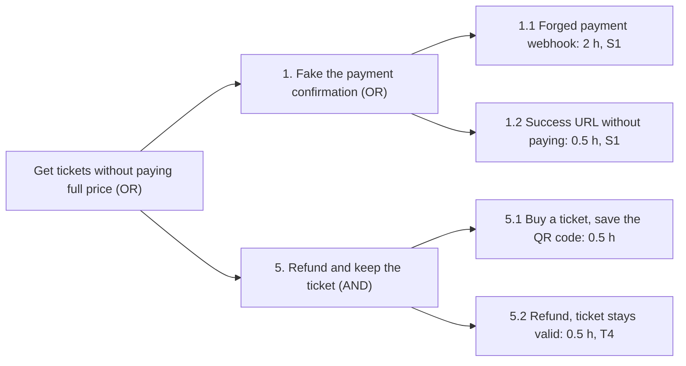

**TLDR**: An attack tree puts an attacker's goal at the root and breaks it down into the ways to reach it. An **OR** node needs any one child; an **AND** node needs all of them. Leaves are concrete actions you can estimate (hours, money, skill). Following Bruce Schneier's rule (an OR node costs as much as its cheapest child, an AND node the sum of its children), you can find the cheapest path to the goal, fix it, and see what the next cheapest path is. Trees also find threats that per-element methods such as STRIDE miss, because they follow the attacker's goal across components.

Attack trees were described by Bruce Schneier in [Dr. Dobb's Journal in December 1999](https://www.schneier.com/academic/archives/1999/12/attack_trees.html). STRIDE ([Part 1](/guides/threat-modeling/01-stride)) asks what can go wrong with each element of a design; an attack tree asks how an attacker who wants one specific thing would get it, and chains individual threats into paths. That makes trees good at three jobs: finding gaps between components, explaining a risk to people who do not read data flow diagrams, and deciding which fix makes the biggest difference.

In this part you build a tree for the ticket shop, annotate it, calculate the cheapest attack path before and after fixes, and find a threat the STRIDE session missed.

## Prerequisites

- The ticket shop and its threat register from [Part 1](/guides/threat-modeling/01-stride#h2-the-threat-register).
- Python 3 if you want to run the path calculation.

## Anatomy of an Attack Tree

- **Root**: the attacker's goal, stated as something they want, not as a vulnerability. "Get tickets without paying full price", not "webhook not verified".
- **Sub-goals**: the main approaches to the goal.
- **Leaves**: actions concrete enough to estimate and to block with a specific control.
- **OR nodes**: alternatives. Any one child achieves the parent. Most nodes are OR nodes.
- **AND nodes**: steps that must all succeed. An AND node is as hard as all of its children together, which is why one control on any child blocks the whole node.

## Building the Tree for the Ticket Shop

### Step 1: Pick a goal an attacker actually wants

Good goals are outcomes with a clear motive: get tickets without paying full price, take over a customer's account and resell their tickets, steal the customer database, stop an on-sale. Build one tree per goal. This part uses **get tickets without paying full price**, free tickets included, because it is the goal with the most direct money behind it.

### Step 2: List the high-level approaches

Ask "how could someone get tickets without paying full price?" and write down every answer at the same level of detail. For the ticket shop the session came up with five: fake the payment confirmation, pay less than the price, get tickets issued without going through payment, abuse staff access, and get a refund while keeping the ticket.

### Step 3: Break each approach down until the leaves are concrete

Keep asking "how?" until a leaf is an action you could estimate and test. Each leaf below has the team's effort estimate and the threat ID from the register that blocks it. Hover or tap a node for details.

```diagram
{
  "type": "graph",
  "columns": [
    [
      { "id": "goal", "label": "Get tickets without paying full price", "sub": "OR: any branch", "icon": "lock", "tone": "accent", "detail": "The attacker's goal. Each branch below is an alternative way to reach it." }
    ],
    [
      { "id": "pay", "label": "1. Fake the payment", "sub": "OR", "tone": "slate", "detail": "Make the shop believe a payment happened." },
      { "id": "less", "label": "2. Pay less", "sub": "OR", "tone": "slate", "detail": "Pay, but less than the real price." },
      { "id": "direct", "label": "3. Issue tickets directly", "sub": "OR", "tone": "slate", "detail": "Skip the payment flow and create tickets another way." },
      { "id": "staff", "label": "4. Abuse staff access", "sub": "OR", "tone": "slate", "detail": "Use the comp ticket feature meant for staff." },
      { "id": "refund", "label": "5. Refund, keep the ticket", "sub": "AND: 1 h, T4", "tone": "amber", "detail": "AND: buy a ticket and save the QR code (0.5 h), then get a refund while the ticket stays valid (0.5 h). The STRIDE session missed this one." }
    ],
    [
      { "id": "hook", "label": "1.1 Forged webhook", "sub": "2 h, S1", "tone": "red", "detail": "POST a fake payment.succeeded event to /webhooks/payments." },
      { "id": "url", "label": "1.2 Success URL", "sub": "0.5 h, S1", "tone": "red", "detail": "Open /checkout/success?order=1042 without paying, if that page marks the order paid." },
      { "id": "price", "label": "2.1 Edit the price", "sub": "1 h, T1", "tone": "red", "detail": "Change the price in the order request with browser developer tools." },
      { "id": "code", "label": "2.2 Discount code race", "sub": "3 h, T3", "tone": "red", "detail": "Send 20 parallel requests with one single-use code." },
      { "id": "job", "label": "3.1 Push a queue job", "sub": "AND: 41 h, T2", "tone": "amber", "detail": "AND: get a foothold inside the private network (40 h), then write an issue-tickets job to Redis (1 h)." },
      { "id": "sqli", "label": "3.2 SQL injection", "sub": "8 h, E2", "tone": "red", "detail": "Find an injectable parameter, set the order to paid and add its issue-tickets row to the outbox." },
      { "id": "phish", "label": "4.1 Phish a staff admin", "sub": "16 h, S3", "tone": "red", "detail": "Phish a password and one-time code, then issue comp tickets." },
      { "id": "route", "label": "4.2 Admin route as customer", "sub": "2 h, E1", "tone": "red", "detail": "Call /admin/comp-tickets with a customer session." }
    ]
  ],
  "edges": [
    ["goal", "pay"], ["goal", "less"], ["goal", "direct"], ["goal", "staff"], ["goal", "refund"],
    ["pay", "hook"], ["pay", "url"],
    ["less", "price"], ["less", "code"],
    ["direct", "job"], ["direct", "sqli"],
    ["staff", "phish"], ["staff", "route"]
  ]
}
```

### Step 4: Mark AND and OR

Most nodes are OR nodes. The two AND nodes are the interesting ones. Pushing a job to the queue (3.1) needs two things at once: a foothold inside the private network, such as a compromised dependency or a server-side request forgery (SSRF) bug whose HTTP client can be made to talk to Redis, and a queue that accepts the job.

```diagram
{
  "type": "graph",
  "columns": [
    [
      { "id": "job", "label": "3.1 Push an issue-tickets job", "sub": "AND: 41 h", "tone": "amber", "detail": "Both children are needed. Blocking either one blocks this node." }
    ],
    [
      { "id": "inside", "label": "Get a foothold in the private network", "sub": "40 h: bad dependency, SSRF", "tone": "red", "detail": "A compromised dependency or container gives code execution; an SSRF bug only helps if its HTTP client can talk to Redis. Hard, and no single control removes it completely." },
      { "id": "write", "label": "Write a job to the queue", "sub": "1 h, blocked by T2", "tone": "red", "detail": "Easy if Redis has no password and the worker trusts every job." }
    ]
  ],
  "edges": [["job", "inside", "and"], ["job", "write", "and"]]
}
```

This shows why T2's mitigation (queue authentication and a worker that re-checks the order) is worth doing even though the first step is hard: you cannot rule out a foothold inside the network one day, but you can make sure it gains nothing from the queue.

## Writing Trees Down

Diagrams are good for discussion; text is better for review in a pull request and for keeping next to the code. An indented outline with the gate on each node is enough:

```text
Goal: Get tickets without paying full price             OR
├── 1. Fake the payment confirmation                    OR
│   ├── 1.1 Send a forged payment webhook               2 h     S1
│   └── 1.2 Open the success URL without paying         0.5 h   S1
├── 2. Pay less than the price                          OR
│   ├── 2.1 Change the price in the order request       1 h     T1
│   └── 2.2 Redeem one discount code in parallel        3 h     T3
├── 3. Get tickets issued directly                      OR
│   ├── 3.1 Push an issue-tickets job                   AND
│   │   ├── 3.1.1 Get a foothold in the private network 40 h
│   │   └── 3.1.2 Write a job to the queue              1 h     T2
│   └── 3.2 Fake a paid order with SQL injection        8 h     E2
├── 4. Abuse staff access                               OR
│   ├── 4.1 Phish a staff admin                         16 h    S3
│   └── 4.2 Call an admin endpoint as a customer        2 h     E1
└── 5. Refund and keep the ticket                       AND
    ├── 5.1 Buy a ticket and save the QR code           0.5 h
    └── 5.2 Get a refund, the ticket stays valid        0.5 h   T4
```

If your repository host renders Mermaid in Markdown (GitHub and GitLab do), you can keep a drawable version in the same file. Mermaid has no AND or OR gate, so put the gate in the label:



## Annotating the Leaves

Annotations turn a picture into something you can reason about. Pick one or two attributes that fit the decision you need to make:

| Attribute     | What it captures                              | Ticket shop example                                |
| ------------- | --------------------------------------------- | -------------------------------------------------- |
| Effort        | Attacker time, in hours or days               | 1.1 forged webhook: 2 hours                        |
| Cost          | Money the attacker spends                     | 4.1 phishing: domains and a phishing kit           |
| Skill         | Low, medium or high                           | 3.2 SQL injection: medium                          |
| Access needed | None, customer account, staff account, inside | 4.2 admin route: a customer account                |
| Detectability | Would you notice the attack while it happens? | 2.2 discount race: yes, if you alert on code reuse |

The estimates are judgment, made in the session, and they only need to be good enough to compare paths. Avoid probabilities with two decimals: they suggest a precision nobody has, and they are hard to agree on.

## Finding the Cheapest Path

Schneier's rule for a cost attribute: **OR nodes have the value of their cheapest child; AND nodes have the value of the sum of their children.** A rational attacker takes the cheapest path, so that is where a fix pays off first.

This script, saved as `attack_tree.py`, holds the same tree, lists every way to reach the goal with its total effort, and leaves out paths whose leaves are blocked by the mitigations you pass on the command line:

```python
"""List every way to reach the root of an attack tree, cheapest first.

OR node: the attacker needs any one child.
AND node: the attacker needs every child, so the costs add up.
A leaf whose mitigation is applied is impossible.
"""
import sys

# (kind, name, children) for OR and AND nodes; (LEAF, name, hours, mitigation) for leaves
TREE = ("OR", "Get tickets without paying full price", [
    ("OR", "Fake the payment confirmation", [
        ("LEAF", "Send a forged payment webhook", 2, "S1"),
        ("LEAF", "Open the success URL without paying", 0.5, "S1"),
    ]),
    ("OR", "Pay less than the price", [
        ("LEAF", "Change the price in the order request", 1, "T1"),
        ("LEAF", "Redeem one discount code in parallel", 3, "T3"),
    ]),
    ("OR", "Get tickets issued directly", [
        ("AND", "Push an issue-tickets job", [
            ("LEAF", "Get a foothold in the private network", 40, None),
            ("LEAF", "Write a job to the queue", 1, "T2"),
        ]),
        ("LEAF", "Fake a paid order with SQL injection", 8, "E2"),
    ]),
    ("OR", "Abuse staff access", [
        ("LEAF", "Phish a staff admin", 16, "S3"),
        ("LEAF", "Call an admin endpoint as a customer", 2, "E1"),
    ]),
    ("AND", "Refund and keep the ticket", [
        ("LEAF", "Buy a ticket and save the QR code", 0.5, None),
        ("LEAF", "Get a refund, the ticket stays valid", 0.5, "T4"),
    ]),
])


def scenarios(node, applied):
    """Return (hours, leaves) for every minimal way to achieve this node."""
    if node[0] == "LEAF":
        _, name, hours, mitigation = node
        return [] if mitigation in applied else [(hours, [name])]
    kind, _, children = node
    options = [scenarios(child, applied) for child in children]
    if kind == "OR":
        return [s for child in options for s in child]
    combined = [(0, [])]
    for child in options:
        combined = [(h1 + h2, l1 + l2) for h1, l1 in combined for h2, l2 in child]
    return combined


applied = set(sys.argv[1:])
print("mitigations applied:", " ".join(sorted(applied)) or "none")
paths = sorted(scenarios(TREE, applied), key=lambda s: s[0])
for hours, leaves in paths:
    print(f"{hours:>5g} h  {' + '.join(leaves)}")
if not paths:
    print("no path to the goal is left in this tree")
```

When paths remain, the first one listed after the header line is the cheapest, the value Schneier's rule gives for the root. Run it for the design as it stands, then with the four fixes that are each a small code change (S1, T1, T4 and E1):

```terminal
{
  "title": "cheapest attack paths",
  "prompt": "$",
  "steps": [
    {
      "comment": "the design before any mitigation",
      "cmd": "python3 attack_tree.py",
      "output": "mitigations applied: none\n  0.5 h  Open the success URL without paying\n    1 h  Change the price in the order request\n    1 h  Buy a ticket and save the QR code + Get a refund, the ticket stays valid\n    2 h  Send a forged payment webhook\n    2 h  Call an admin endpoint as a customer\n    3 h  Redeem one discount code in parallel\n    8 h  Fake a paid order with SQL injection\n   16 h  Phish a staff admin\n   41 h  Get a foothold in the private network + Write a job to the queue"
    },
    {
      "comment": "after the four small fixes",
      "cmd": "python3 attack_tree.py S1 T1 T4 E1",
      "output": "mitigations applied: E1 S1 T1 T4\n    3 h  Redeem one discount code in parallel\n    8 h  Fake a paid order with SQL injection\n   16 h  Phish a staff admin\n   41 h  Get a foothold in the private network + Write a job to the queue"
    },
    {
      "comment": "after every mitigation in the tree",
      "cmd": "python3 attack_tree.py S1 T1 T4 E1 T3 E2 S3 T2",
      "output": "mitigations applied: E1 E2 S1 S3 T1 T2 T3 T4\nno path to the goal is left in this tree"
    }
  ]
}
```

Before any fix, the cheapest path takes half an hour and needs no skill. Four small fixes raise the cheapest path to 3 hours, and the next fixes to make are the discount code race (T3) and SQL injection (E2). With every mitigation in place, no path is left **in this tree**. That is not the same as secure: the tree only contains what the team thought of, which is why you revisit it when the design changes.

## What the Tree Found That STRIDE Missed

Branch 5, refund and keep the ticket, is not in the STRIDE register from Part 1. No single element is broken: the refund works, the ticket works, and the payment provider does what it should. The threat only appears when you follow the attacker's goal across the refund flow (DF2, DF3) and the ticket data in Postgres. It goes into the register as a new threat:

| ID  | Element or flow    | Threat                                       | Mitigation                                                                                                                                                                                         | Status |
| --- | ------------------ | -------------------------------------------- | -------------------------------------------------------------------------------------------------------------------------------------------------------------------------------------------------- | ------ |
| T4  | DF2, DF3, Postgres | A refund leaves the ticket valid at the door | Record the refund and void its tickets in one Postgres transaction, then call the provider with an idempotency key; reconcile with the provider's refund events; check ticket status when scanning | Open   |

The tree also clarified two priorities. It showed that S1 has two forms (the webhook and the success URL), both fixed by the same rule, and that T2 is only reachable after a 40-hour step, so it ranks below S1 even though a forged job has the same impact.

## A Second Tree: Shipping Malicious Code Through CI/CD

For a DevOps team, one of the most useful goals is "run my code in production". It covers the path from a developer's laptop to the running container, which a data flow diagram of the application usually leaves out:

```text
Goal: Run attacker code in the ticket shop's production API          OR
├── 1. Change the code before it is merged                           OR
│   ├── 1.1 Push directly to main                                    AND
│   │   ├── Steal a developer's GitHub session or token
│   │   └── main has no branch protection
│   └── 1.2 Hide a change in a large pull request that gets approved
├── 2. Change the build                                              OR
│   ├── 2.1 Pull request code runs in a privileged workflow          AND
│   │   ├── A workflow uses pull_request_target
│   │   └── It checks out and runs the pull request's code
│   └── 2.2 A third-party action pinned to a tag is compromised
├── 3. Change a dependency                                           OR
│   ├── 3.1 A typosquatted package is added by mistake
│   └── 3.2 A maintainer account is taken over                       AND
│       ├── The attacker publishes a malicious version
│       └── The lockfile update is merged without review
└── 4. Change the image after the build                              AND
    ├── Get write access to the container registry
    └── Production deploys by tag without verifying signatures
```

The leaves map to concrete controls: branch protection with required reviews, `pull_request_target` only for workflows that never run untrusted code, actions pinned to a full commit SHA, lockfiles with dependency review, and images signed in CI, verified at deploy time and deployed by digest. The [CI/CD pipeline hardening guide](/posts/cicd-pipeline-hardening-guide) and [supply chain security post](/posts/software-supply-chain-security) cover each of them.

## Attack-Defense Trees and Tools

**Attack-defense trees** add defense nodes to the attack nodes, and attacker responses to the defenses, so you can model "the attacker phishes the password; we require a passkey; the attacker steals a session cookie instead". They are useful once a simple tree is not enough to explain why a control was chosen.

You do not need special software. Options that teams use:

- **A text outline or Mermaid** in the repository, reviewed like code. This is usually the best start.
- **draw.io (diagrams.net)** or any whiteboard tool for the session itself.
- **[Deciduous](https://www.deciduous.app/)**, a free web app by Kelly Shortridge and Ryan Petrich for security decision trees that show attacks, mitigations and how attackers respond.
- **ADTool**, an academic tool for attack-defense trees with quantitative analysis.

Data flow tools such as OWASP Threat Dragon and the Microsoft Threat Modeling Tool are built around DFDs and STRIDE, not attack trees. [Part 4](/guides/threat-modeling/04-practical-exercises) shows a tool that keeps the whole threat model as code.

## Common Mistakes

- **Starting from a vulnerability instead of a goal.** "SQL injection" is a leaf, not a root. Ask what the attacker wants.
- **Going too deep too early.** Get the first two levels right for every branch before you detail any one of them.
- **Stopping at generic leaves.** "Hack the server" cannot be estimated or blocked. Keep asking "how?".
- **Forgetting AND nodes.** Many attacks need two things at once, and an AND node shows where one control blocks the whole branch.
- **Treating the tree as complete.** It holds what the team thought of in one session. Revisit it when the design changes or after an incident.

## Summary

- An attack tree has the attacker's goal at the root; OR nodes are alternatives, AND nodes are steps that must all succeed.
- Break branches down until the leaves are concrete actions you can estimate and block.
- Annotate leaves with effort, cost, skill or access, and use Schneier's rule (OR takes the cheapest child, AND sums the children) to find the cheapest path.
- Fix the cheapest path first, then recalculate. For the ticket shop, four small fixes raised the cheapest attack from 0.5 to 3 hours.
- Trees follow the attacker across components and find threats such as refund-and-keep that per-element STRIDE misses.

In [Part 4](/guides/threat-modeling/04-practical-exercises), you practice all three methods on new features of the ticket shop, including an AI support assistant, and keep the threat model in the repository with pytm.

## Keep Learning

- [Server-Side Request Forgery (part of A01:2025)](/guides/owasp-top-10/10-ssrf), one way to reach internal services in branch 3
- [Security-Focused Code Reviews](/posts/security-focused-code-reviews), where many of these leaves are caught
- [Defense in depth](/guides/security-principles/02-defense-in-depth), the idea behind blocking AND nodes twice
- [Interview question: security architecture and DevSecOps](/interview-questions/senior/security-architecture)
