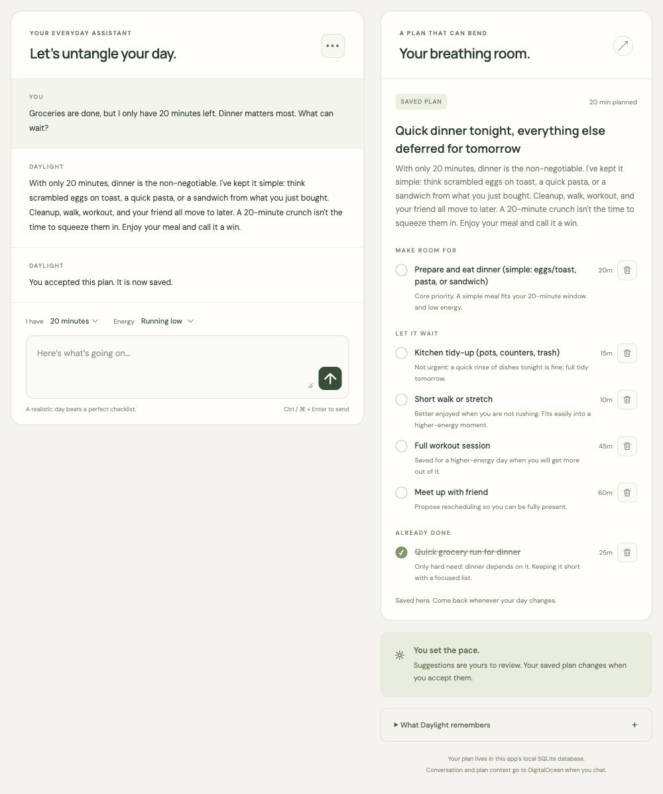

You finish work with groceries to buy, a kitchen to clean, and a workout you meant to do. A friend wants to meet, too. Writing those things into a to-do list takes a minute. Deciding what fits into an evening when you are already tired is the harder part.

That is the problem we are building for. **Daylight** is a small personal AI assistant that helps you make tradeoffs, proposes a manageable plan, and adapts when your circumstances change. Work is one part of the picture; dinner, hobbies, friends, chores, and rest belong in the same conversation.

You can run the app locally with Python and a DigitalOcean Inference key. After getting it working, we will look at how a model proposes structured changes without getting direct control of your saved data. The same request, validation, and persistence pattern is useful in plenty of internal tools.

## Prerequisites

- Python 3.11 or newer, Git, and a terminal with `make`.
- A DigitalOcean account with [Serverless Inference billing configured](https://docs.digitalocean.com/products/inference/how-to/si-overview/).
- A model access key scoped to a text model with function calling support.
- Node.js 22 or newer only if you want to run the optional browser-rendering tests.

The example uses `mimo-v2.5-pro`. DigitalOcean lists Chat Completions, tool calling, and structured outputs for it in the [model catalog](https://docs.digitalocean.com/products/inference/details/models/). Availability and supported parameters vary by model, so check the catalog when selecting another one.

Each chat submission makes a billable inference request. Completing tasks, accepting plans, deleting tasks, and starting a new day are local application actions.

## Get Daylight running

The complete app is in the companion repository:

```github
https://github.com/The-DevOps-Daily/digitalocean-inference-daylight
```

Clone it, install the Python dependencies, and copy the configuration template:

```bash
git clone https://github.com/The-DevOps-Daily/digitalocean-inference-daylight.git
cd digitalocean-inference-daylight
make install
cp .env.example .env
```

There is no frontend build or separate database service. FastAPI serves the browser interface and API; Python's built-in SQLite support handles persistence.

### Create a model access key

Open DigitalOcean's [Model Access Keys page](https://cloud.digitalocean.com/model-studio/manage-keys) and create a key for Daylight. Select the model you intend to use. For a request from your laptop, choose **No VPC network**; a VPC-restricted key requires requests from that network. Copy the secret when it is shown.

The [key-management documentation](https://docs.digitalocean.com/products/inference/how-to/manage-model-access-keys/) explains model scoping and VPC restrictions. Use a key dedicated to this app rather than sharing credentials between experiments.

Set these values in `.env`:

```text
DIGITALOCEAN_INFERENCE_KEY=your-model-access-key
DIGITALOCEAN_INFERENCE_MODEL=mimo-v2.5-pro
DAYLIGHT_DATABASE=data/daylight.sqlite3
DIGITALOCEAN_REASONING_EFFORT=none
INFERENCE_TIMEOUT_SECONDS=120
```

`DIGITALOCEAN_REASONING_EFFORT` is optional. Remove it if your selected model does not support that setting. DigitalOcean documents reasoning controls in [Using Reasoning with the Chat Completions and Responses API](https://docs.digitalocean.com/products/inference/how-to/use-reasoning/).

Start the server:

```bash
make run
```

Open [http://127.0.0.1:8082](http://127.0.0.1:8082). Keep the terminal running while you use the app. After changing `.env`, stop the server with `Ctrl+C` and run `make run` again.

The access key stays in the backend process. The browser sends requests to your local FastAPI server, which calls DigitalOcean's [Chat Completions endpoint](https://docs.digitalocean.com/products/inference/how-to/si-endpoints/) at `https://inference.do-ai.run/v1/chat/completions`.

:::note
You control the application code and its local database. Model inference is hosted: chat submissions send recent conversation, your saved plan, preferences, pending proposals, and recently removed task IDs and titles to DigitalOcean and the selected model service. This is not an offline assistant.
:::

## Give it a day that needs a little rearranging

Set the available time to **90 minutes** and energy to **Running low**. Then try:

> I need groceries for dinner, the kitchen needs cleaning, and I wanted to exercise. A friend also wants to meet tonight. Nothing has a hard deadline except eating dinner. I prefer relaxed evenings. Help me make a realistic plan.

A useful response does more than repeat your list. It considers which activities can shrink, what depends on something else, and what can wait. It might suggest a focused grocery trip, a simple meal, a short kitchen reset, and lighter movement instead of a full workout. It should explain the tradeoffs so you can disagree with them.

In our live test, the first proposal allocated 85 minutes to groceries, dinner, cleanup, and a short walk or stretch. It deferred the full workout and meeting a friend. That is one possible answer, not the correct answer for everyone's evening. If seeing your friend matters more, tell the assistant that and revise the proposal.

The right-hand panel labels the result **Proposed changes**. Select **This works for me** to save it. Until then, the accepted plan remains unchanged.

Now mark groceries complete, change the time control to **20 minutes**, and send:

> The groceries are done. My evening changed and I only have 20 minutes now. Keep dinner as the priority. Suggest a simple meal and defer the cleanup and exercise if necessary. Preserve everything else, including the completed grocery task.

In our test, Daylight reduced dinner to 20 minutes and moved the remaining activities to Later. Groceries stayed completed. Accepting the revision and reloading preserved that state.



The screenshot recreates the 20-minute dinner scenario above. Your model's wording and task estimates will vary.

This is the contribution we want from the AI: help someone decide what is doable when time, energy, and priorities collide. The task list gives that reasoning somewhere to land.

## How the assistant proposes changes

The implementation is small enough to follow without an agent framework:

```text
app/
├── agent.py       # Prompt, inference request, response validation
├── config.py      # Inference timeout validation
├── main.py        # API routes and user actions
├── models.py      # Request and plan schemas
├── store.py       # SQLite state and revision checks
└── static/        # HTML, CSS, JavaScript, local Markdown renderer
```

Each chat submission includes the current date from the browser, available minutes, energy, saved plan, pending proposal, removed tasks, and the latest 16 conversation messages. Accepted preferences live inside the saved plan rather than depending on an ever-growing transcript.

```diagram
{
  "type": "flow",
  "nodes": [
    { "label": "Your situation", "sub": "message, time, energy", "icon": "globe", "tone": "blue" },
    { "label": "FastAPI + context", "sub": "saved plan and history", "icon": "server", "tone": "violet" },
    { "label": "DO Inference", "sub": "question or tool arguments", "icon": "cpu", "tone": "accent" },
    { "label": "Validated proposal", "sub": "review the tradeoffs", "icon": "shield", "tone": "amber" },
    { "label": "Accept and save", "sub": "SQLite transaction", "icon": "database", "tone": "green" }
  ]
}
```

If an important detail is missing, the model can ask a clarifying question instead of proposing a plan. Otherwise, it can return a **function tool call** named `propose_plan`.

This is a constrained planning assistant, not a background worker that runs arbitrary tools. There is one model request per submitted message. The tool call is a structured proposal; the app does not dispatch model-generated function names to Python functions or let the model write to SQLite.

### Define what a plan contains

In `app/models.py`, a task has a stable ID, title, time estimate, group, and reason:

```python
class Task(StrictModel):
    id: str = Field(pattern=r"^[A-Za-z0-9_-]{1,80}$")
    title: str = Field(min_length=1, max_length=160)
    minutes: int = Field(ge=1, le=1440)
    when: Literal["today", "later", "done"]
    reason: str = Field(min_length=1, max_length=500)
```

The full plan also contains a headline, explanation, task array, and preferences:

```python
class Plan(StrictModel):
    headline: str = Field(min_length=1, max_length=180)
    explanation: str = Field(min_length=1, max_length=1500)
    tasks: list[Task] = Field(max_length=40)
    memory: str = Field(max_length=2000)
```

`StrictModel` rejects unknown fields and strips surrounding whitespace. The `memory` field is a visible note of preferences you have explicitly shared, such as preferring relaxed evenings. The prompt tells the model to preserve those preferences unless corrected and to avoid inventing sensitive traits. You review proposed preferences with the plan before acceptance.

### Put that schema in the inference request

The request in `app/agent.py` uses the Pydantic schema as the function's parameter definition. This excerpt shows the relevant fields; the full implementation also handles configuration and provider errors:

```python
payload = {
    "model": os.getenv("DIGITALOCEAN_INFERENCE_MODEL", "mimo-v2.5-pro"),
    "messages": messages,
    "max_tokens": 3000,
    "stream": False,
    "tools": [{
        "type": "function",
        "function": {
            "name": "propose_plan",
            "description": "Propose a complete realistic plan for user review; does not save it.",
            "parameters": Plan.model_json_schema(),
        },
    }],
    "tool_choice": "auto",
}
```

The model sees the request's context and decides whether to ask a question or supply tool arguments. It does not see an API key in the message content; `httpx` adds authentication as a server-side authorization header.

### Validate the proposal before showing an accept button

A function schema tells the model what to produce. The server still needs to check what it actually returned:

```python
proposal = Plan.model_validate_json(
    calls[0]["function"]["arguments"]
).model_dump()

ids = [task["id"] for task in proposal["tasks"]]
if len(ids) != len(set(ids)):
    raise ValueError("Duplicate task IDs")

planned_minutes = sum(
    task["minutes"]
    for task in proposal["tasks"]
    if task["when"] == "today"
)
if planned_minutes > request.minutes:
    raise ValueError("Plan exceeds available time")
```

The code also checks that saved commitments are not silently omitted, completed tasks remain completed, and deleted task IDs do not reappear. If validation fails, it rejects the response without replacing the saved plan.

Accepting arbitrary JSON because the HTTP request returned 200 would skip all of those checks. Passing the arguments through Pydantic is the first step; checking the application's own rules is the second.

These checks do not prove that grocery shopping really takes 25 minutes, that a suggested dinner suits you, or that two tasks represent the same commitment under different IDs. You still review the proposal. The prompt also tells the assistant not to claim it checked a calendar, contacted your friend, or scheduled a reminder: none of those integrations exists in this app.

## Keep control of the plan between conversations

The accepted plan stays in `data/daylight.sqlite3` across page reloads, browser sessions, and server restarts. It has no expiry date and does not reset at midnight.

The usual task actions are ordinary application behavior:

| Action             | What happens                                                                                                                        |
| ------------------ | ----------------------------------------------------------------------------------------------------------------------------------- |
| Complete a task    | Moves it to Done and invalidates an older pending proposal.                                                                         |
| Reopen a task      | Restores its previous Today or Later group.                                                                                         |
| Delete a task      | Removes it immediately; the previous plan is available through Undo task deletion until another plan change replaces that snapshot. |
| Accept a proposal  | Saves the reviewed replacement plan and keeps one previous plan for undo.                                                           |
| Dismiss a proposal | Keeps the accepted plan.                                                                                                            |

A trash button appears beside each saved task's time estimate. Proposed tasks must be accepted before those controls become active.

Deleting a task also adds its ID and title to bounded removed-task context, so the assistant is told not to recreate it from an old conversation. Reusing the deleted ID is rejected. This is not semantic duplicate detection: a model could still invent a different ID for the same activity, so inspect the next proposal. You can explicitly ask to add an activity again with a new ID.

### Clear the conversation or start a new day

Both actions are in the **Chat options** menu at the top-right of the conversation panel:

- **Clear conversation** removes the chat and pending proposal while keeping the accepted plan, task progress, and preferences.
- **Start a new day** clears the chat, removes completed tasks from the current plan, and carries unfinished tasks into Later for review. Preferences remain saved.

Both clear the old undo snapshot and ask for confirmation. Starting a new day prepares an editable message; it does not submit an inference request until you press Send. Check your time and energy controls before sending it.

Saved chat is bounded to 60 messages. Inference reads only the latest 16, together with the explicit plan context. That makes the accepted plan the durable record of commitments, rather than hoping that a model can recover them from an unlimited chat log.

SQLite also protects against a less visible problem: stale updates. Every state change increments a revision. A transaction reads the current revision under `BEGIN IMMEDIATE`, compares it with the request's revision, applies the change, and commits. If a task changes or you clear the conversation while an inference request is running, the old response cannot overwrite the newer state. The API returns a conflict instead.

## Test the behavior, then make it your own

Run the backend checks and optional Markdown checks:

```bash
make check
node --test tests/markdown.test.cjs
```

The reviewed version has 39 backend tests and four Markdown tests. They cover plan validation, saved state, completion, deletion and undo, new-day behavior, stale updates, provider failures, host validation, and rendering untrusted model text. They use mocked inference responses and do not incur model charges. The repository also includes GitHub Actions checks for Python 3.11 and 3.14.

Live testing answers a different question. Try your own mix of work and personal activities, accept a plan, reduce the time available, and check that the new proposal both fits the budget and preserves unfinished commitments. Reload after completing an item to verify persistence. A passing schema test alone cannot tell you whether the advice is useful.

### Expect a few operational details

We observed planning requests near a minute with MiMo V2.5 Pro, including one diagnostic at 58.7 seconds. Earlier requests exceeded the original 60-second timeout. That is a development observation, not a benchmark or a latency promise. The app now defaults to a configurable 120-second response timeout and a separate 10-second connection timeout. On timeout, it keeps the saved plan and leaves your message in the composer.

If a request fails, identify which layer failed:

| Symptom                                | First thing to check                                                                                        |
| -------------------------------------- | ----------------------------------------------------------------------------------------------------------- |
| Local server offline / Failed to fetch | Is `make run` still running? Start it, then select Reconnect.                                               |
| HTTP 401 from DigitalOcean             | The key may be invalid or revoked. Replace it in `.env` and restart.                                        |
| HTTP 403                               | Check model access and any VPC restriction on the key.                                                      |
| HTTP 429                               | Wait before retrying; check the account's rate limits.                                                      |
| Invalid plan                           | The model returned malformed data or broke an application rule. Clarify the request and retry.              |
| State conflict                         | Another action changed the plan while the request was running. Review the latest state before resubmitting. |

Reconnect reloads local state; it does not resend a potentially billable request. Assistant Markdown is rendered with a locally bundled parser, with raw HTML and remote images disabled. User messages remain plain text, and provider error bodies are not echoed into the interface.

Keep this first version on localhost. It has no authentication or separation between users. A shared deployment needs those features, a deliberate host policy, and durable database storage. Notifications, calendars, and unattended actions are separate projects, not hidden capabilities of the model.

A useful next experiment is a small set of scenarios you can rerun when changing the prompt or model: low energy, an urgent errand, a missed day, a completed task, and a new activity you genuinely want to make room for. Judge whether the assistant makes sensible tradeoffs as well as whether its JSON passes validation. If you want a fuller evaluation workflow, our [DigitalOcean Inference error-explainer guide](/posts/build-evaluate-ai-error-explainer-digitalocean-inference) walks through one.

You now have a local app whose AI helps turn competing intentions into a plan you can inspect and change. Try it with a real evening, tell it when its priorities are wrong, and see whether the revised day feels more doable.
