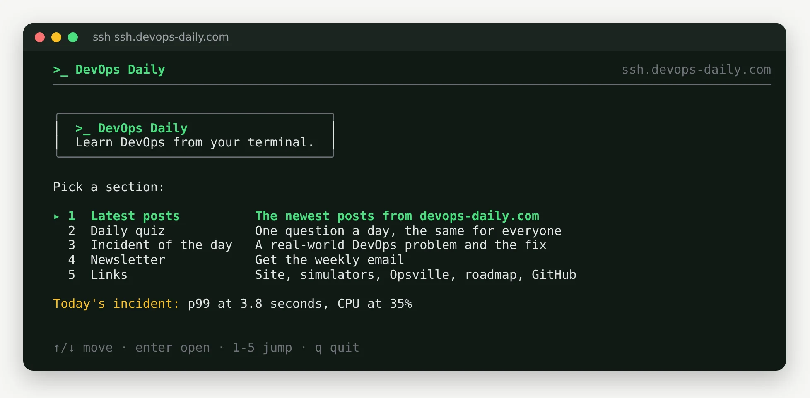

You spend most of your day in a terminal: SSH sessions, `kubectl`, `git`, logs. Switching to a browser to learn something new breaks that flow. So we put DevOps Daily in the terminal too. You can read the posts, play the quizzes, study flashcards, tick off checklists and solve the incident of the day from the same window where you run your commands.

There are two ways in. `ssh ssh.devops-daily.com` works right now with nothing to install. The `devops-daily` CLI is a small open source binary for macOS, Linux and Windows that keeps your quiz scores and flashcard progress and works offline. This post shows both, what you can do with them, and how they are built.

## TL;DR

- Try it now: `ssh ssh.devops-daily.com`. No account, no password, any SSH key or none.
- Install the CLI with Homebrew, npm, Go or a one-line install script. The command is `devops-daily`; Homebrew, npm and the install script also add the short alias `ddy`.
- It has 369 posts, 47 quizzes, 27 flashcard decks, 24 checklists, a daily incident, and links to our 68 games and simulators.
- No telemetry and no account. After the first sync it works offline.
- The code is open source under the MIT license: [The-DevOps-Daily/devops-daily-cli](https://github.com/The-DevOps-Daily/devops-daily-cli).

## Prerequisites

- A terminal with an SSH client for the SSH app. Every macOS and Linux machine has one, and so does Windows 10 and later.
- For the CLI: macOS, Linux or Windows on amd64 or arm64, plus Homebrew, npm or Go if you want to install it that way.

## Try it over SSH first

Run this from any terminal:

```bash
ssh ssh.devops-daily.com
```

You get the home screen of the app:



Use the arrow keys or the numbers to move, Enter to open a section and `q` to quit. Over SSH, the latest posts show a summary and a link (the CLI reads them in full), the daily quiz has one question that is the same for everyone that day, and the incident of the day is a real-world problem with four possible fixes.

The first time you connect, SSH asks you to confirm the server's host key. Check that the fingerprint matches this one before you type `yes`:

```text
ED25519 key fingerprint is SHA256:foWFYF2OcGurRwunAlzGTHrpARFN+VfBRDZdmiZ0zf8.
```

It is an app, never a shell. The server accepts any key or no key, does not store or log keys, and refuses everything except an interactive session: no commands, no SFTP or scp, and no port forwarding. Sessions end after 10 minutes without a key press or 30 minutes in total, and each address can open 10 new connections per minute. If you have not thought about how SSH can be exposed safely before, the [SSH hardening checklist](/checklists/ssh-hardening) is a good companion read.

## Install the CLI

Pick the way you install other tools.

Homebrew on macOS or Linux:

```bash
brew install The-DevOps-Daily/tap/devops-daily
```

npm, or `npx` to try it without installing:

```bash
npm install -g @devopsdaily/devops-daily-cli
npx @devopsdaily/devops-daily-cli
```

Go:

```bash
go install github.com/The-DevOps-Daily/devops-daily-cli/cmd/devops-daily@latest
```

On macOS or Linux, the install script downloads the release for your system and checks it against the published checksum. On Windows, use npm, Go or the ZIP file from the releases page.

```bash
curl -fsSL https://raw.githubusercontent.com/The-DevOps-Daily/devops-daily-cli/main/install.sh | sh
```

As with any `curl | sh`, read the script first if you prefer; it is short. Every release on GitHub has a `checksums.txt` and a build provenance attestation, so you can check where a binary came from:

```bash
gh attestation verify devops-daily_0.1.0_linux_arm64.tar.gz -R The-DevOps-Daily/devops-daily-cli
```

## What you can do

Run `devops-daily` with no command for the same home menu as the SSH app. Every section also has its own command:

| Command             | What it does                                            |
| ------------------- | ------------------------------------------------------- |
| `posts [--tag k8s]` | List posts, newest first                                |
| `read <slug>`       | Read a post in the terminal, with its links at the end  |
| `quiz [topic]`      | Play one of the site's quizzes; your best score is kept |
| `flashcards [deck]` | Study a deck with simple spaced repetition              |
| `checklist [name]`  | Tick off a checklist; your progress is saved            |
| `incident [--fix]`  | Today's real-world incident, then the fix               |
| `play [simulator]`  | Open a simulator, a game or Opsville in your browser    |
| `sync`              | Download the latest content now                         |

Names are forgiving. `devops-daily quiz docker`, `devops-daily play dns` and `devops-daily read terraform-state` find the closest match, or list the candidates when there is more than one.

The first sync downloads everything at once, then posts are a list away:

```terminal
{
  "title": "devops-daily",
  "prompt": "$",
  "steps": [
    { "cmd": "devops-daily sync", "output": "Downloaded 23 files (7.6 MB).\n369 posts, 47 quizzes, 27 flashcard decks, 24 checklists, 16 incidents, 68 games" },
    { "cmd": "devops-daily posts --limit 3", "output": "2026-11-13  CKNE Is Live: What the Kubernetes Network Engineer Exam Tests...\n            ckne-kubernetes-network-engineer-exam-guide\n2026-11-13  Five Production Bugs You Can Reproduce in a Browser Tab\n            five-production-bugs-you-can-reproduce-in-a-browser\n2026-11-12  We Tested AWS Emulator: It Blocks More Than Its Docs Say, and...\n            aws-emulator-hands-on-test\nRead one: devops-daily read <slug>" }
  ]
}
```

The incident of the day describes a real production problem and asks what you would do:

```terminal
{
  "title": "devops-daily incident",
  "prompt": "$",
  "steps": [
    { "cmd": "devops-daily incident", "output": "Four nodes free, pod still Pending\nIntermediate · Kubernetes, AWS EBS, StatefulSets, Cluster Autoscaler\n\nAn EKS cluster spans three availability zones with one node group across all\nthree. The only node in us-east-1a fails. Your StatefulSet pod, with a 200 GiB\nEBS volume, is rescheduled and stays Pending. The cluster autoscaler adds a\nnode, in us-east-1b. The pod is still Pending: 0/4 nodes are available: 4\nnode(s) had volume node affinity conflict. The four nodes have plenty of free\nCPU and memory. What is the right fix?\nA) Delete the PVC so Kubernetes provisions a new volume in a zone that has free nodes\nB) Change the StorageClass to volumeBindingMode: WaitForFirstConsumer\nC) Get a node into us-east-1a, and split the node group so each zone has its own\nD) Give the pod a higher PriorityClass so it can preempt pods on other nodes\nRun with --fix to see the answer." }
  ]
}
```

Make your pick, then run `devops-daily incident --fix` for the answer, why each wrong option is wrong, and a link to a post that goes deeper. For hands-on practice, the [simulators](/simulators) cover many of the same problems.

Quizzes, flashcards and checklists are the same ones as on the site: the [quizzes](/quizzes), the [flashcard decks](/flashcards) and the [checklists](/checklists). In the terminal, your best quiz scores, flashcard schedule and checklist ticks are saved on your machine, so you can stop and pick up where you left off.

When something is easier to learn by doing, `devops-daily play` opens it in your browser: `play dns` opens the [DNS simulator](/games/dns-simulator), and `play opsville` opens [Opsville](/opsville), our DevOps town game.

## Offline and private

After the first sync, the CLI works without a network connection. Content lives in a cache directory (`~/.cache/devops-daily` on Linux) and your progress in a state directory (`~/.local/state/devops-daily`). Set `DEVOPS_DAILY_OFFLINE=1` to turn off the automatic content refresh (an explicit `sync`, `update` or `play` still uses the network), and `NO_COLOR` if you want plain output.

There is no telemetry and no account, and your progress never leaves your machine. The CLI downloads public content files from devops-daily.com, and asks GitHub for the latest version only when you run `devops-daily update`. Like any download, those requests carry your IP address and the CLI version, and nothing else about you.

## How it is built

The CLI and the SSH app are one Go codebase with two front doors. Both use the same screens, built with [Bubble Tea](https://github.com/charmbracelet/bubbletea) and Lip Gloss. Posts render in the terminal with Glamour, and the SSH server runs on Wish, which serves a Bubble Tea app to every SSH session instead of a shell.

The site is static, so there is no API server to run. When devops-daily.com builds, it also writes small JSON files under `/cli/v1/`: the post index, post bodies, quizzes, decks, checklists and incidents. The CLI downloads those files and caches them. The format is documented in the repository, so you can build your own tools on top of it.

Releases are built with GoReleaser for six platforms, with checksums and build provenance attestations. The npm package is published from GitHub Actions with npm trusted publishing, so the release workflow stores no long-lived npm token.

```github
https://github.com/The-DevOps-Daily/devops-daily-cli
```

## What is next

This is version 0.1.0. Next on the list:

- **Sign in with your DevOps Daily account**, so quiz XP, roadmap progress and Opsville stats follow you between the browser and the terminal.
- **Small checks you can use every day**: TLS certificates, DNS records, HTTP security headers and email authentication (SPF, DKIM and DMARC) for a host or domain.
- **A terminal game** in the spirit of Opsville, with incidents to fix from your keyboard.

If you find a bug or want a command, open an issue on the [GitHub repository](https://github.com/The-DevOps-Daily/devops-daily-cli/issues). And if you want a new post, quiz or incident in your terminal every week, [subscribe to the newsletter](/newsletters).

## Summary

- `ssh ssh.devops-daily.com` is the fastest way to try it, with nothing to install.
- `brew install The-DevOps-Daily/tap/devops-daily` (or npm, Go or the install script) gives you the CLI, with saved progress and offline use.
- Run `devops-daily` for the menu, or jump straight in with `posts`, `quiz`, `flashcards`, `checklist`, `incident` and `play`.
- It is open source, has no telemetry, and needs no account.
