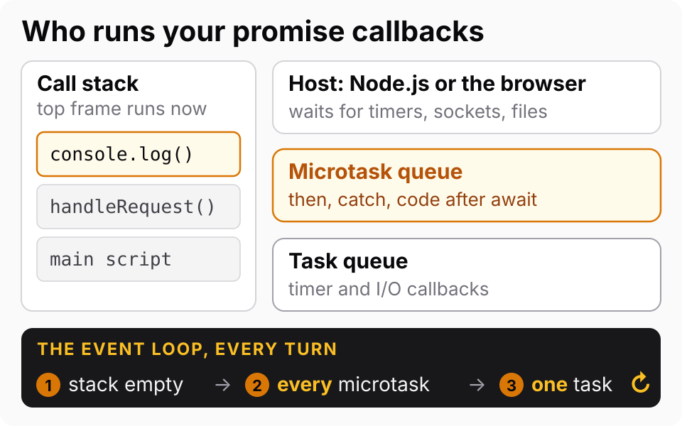
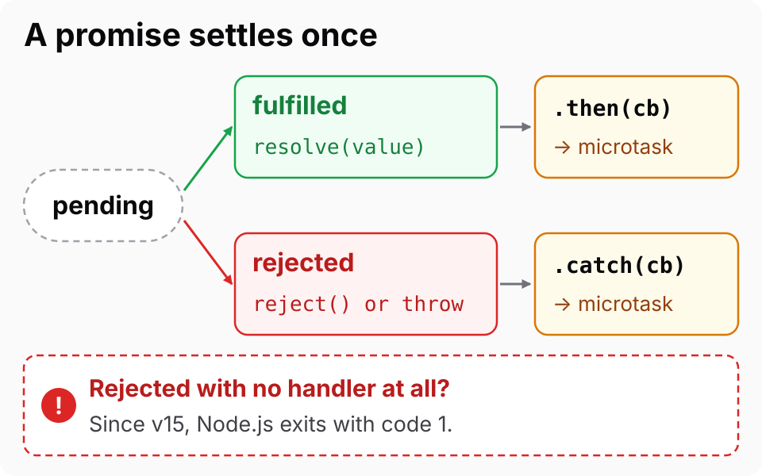
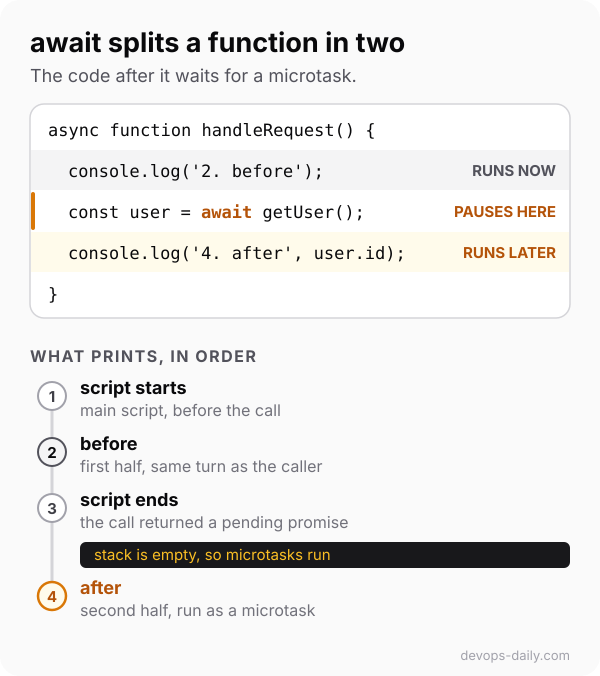
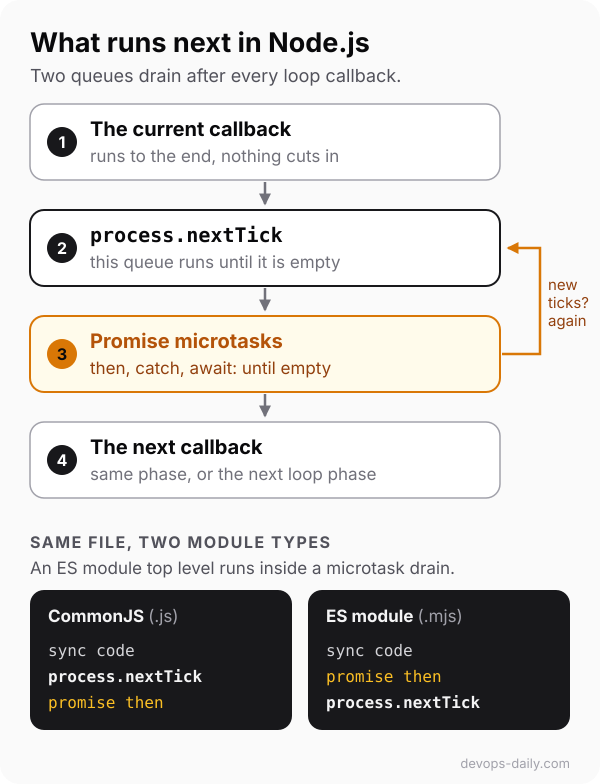
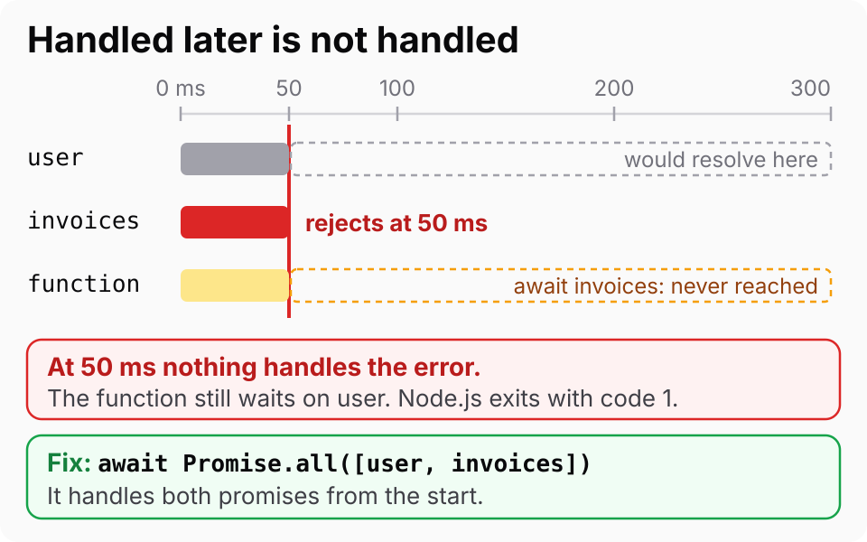

Your Node.js API passes every test. In production, Kubernetes marks a Pod as not ready a few times an hour, and nothing in the logs explains it. No request returned an error, and the CPU is not at its limit. A common cause is one block of synchronous code that holds the only thread your JavaScript runs on. While it runs, the health check request sits unread in a socket, and the probe times out.

To see why, you need a clear picture of how JavaScript runs promises: one call stack, a microtask queue, a task queue, and the event loop that moves callbacks between them. This post builds that picture with small examples, static diagrams and three animations. Then it adds what Node.js does on top, because that is where the production problems come from: `process.nextTick`, `setImmediate`, the event loop phases, unhandled rejections, and event loop delay metrics. Every output below comes from running the code with Node.js 24.22.3.

## TL;DR

- JavaScript runs your code on one **call stack**. Promise callbacks wait in the **microtask queue**. Timer and I/O callbacks wait in the **task queue** (in Node.js, in one queue per event loop phase).
- When the stack is empty, the **event loop** runs every microtask, then one task, then all microtasks again. That is why a promise callback runs before a 0 ms timer.
- `await` splits a function in two. The code before it runs now. The code after it runs later as a microtask, even when the awaited value is ready.
- In Node.js, the `process.nextTick` queue drains before promise callbacks, but a nextTick never interrupts a microtask drain that is already running. The top level of an ES module runs inside one, so there promise callbacks go first. Inside an I/O callback, `setImmediate` always runs before a 0 ms `setTimeout`.
- A 2.4 second synchronous report made a `/healthz` probe with a 1 second timeout fail. The same report in a worker thread left `/healthz` answering in 7 ms.
- A rejected promise with no handler stops the process (the default since Node.js 15). Hand related promises to `Promise.all` so they all have a handler right away.
- Measure event loop delay with `perf_hooks.monitorEventLoopDelay()` and `performance.eventLoopUtilization()`, and alert on the p99 and max.

## Prerequisites

- Node.js 20 or newer. We ran every example with Node.js 24.22.3 and checked the browser-side examples in Chromium 156.
- Basic JavaScript: functions, arrow functions, and the `async` and `await` keywords.
- For the health check section, a basic idea of Kubernetes readiness and liveness probes. Our [Kubernetes Pods guide](/guides/introduction-to-kubernetes/03-pods-and-containers-in-kubernetes) covers them.

## The parts that run your code

Before any promise code, it helps to name the parts. There are five, and only one of them runs JavaScript.



- **Call stack.** The JavaScript engine (V8 in Node.js and Chrome) runs one function at a time. When a function calls another, the new one goes on top of the stack. When it returns, it comes off. Your JavaScript never runs two things at once on this thread.
- **The host.** Node.js or the browser does the waiting. A timer, a socket read or a file read happens outside the call stack. In Node.js, the libuv library handles this with the operating system and a small thread pool. Your code does not stop while it waits.
- **Microtask queue.** Promise callbacks wait here: the functions you pass to `then` and `catch`, and the rest of an `async` function after an `await`. `queueMicrotask()` adds to it directly.
- **Task queue.** Callbacks from timers and I/O wait here. Browsers call each of these a task. This is a simplified picture: browsers keep several task queues and choose between them, and Node.js keeps one queue per event loop phase, which we look at later.
- **Event loop.** The rule that connects them: wait until the stack is empty, run every microtask (including new ones added along the way), then run one task, and repeat.

Keep that rule in mind. Almost every ordering question in this post follows from it.

## A promise is a placeholder with a list of callbacks

A promise is an object that stands for a result you do not have yet. It starts **pending**. Later it settles, once: it becomes **fulfilled** with a value or **rejected** with an error. Code that needs the result registers a callback with `then`, `catch` or `await`. When the promise settles, the callbacks for that outcome go into the microtask queue: `then` callbacks when it is fulfilled, `catch` callbacks when it is rejected.

Two details of this surprise people. First, the function you pass to `new Promise` (the executor) runs right away, inside the constructor call. Second, a `then` callback never runs right away, even when the promise is already fulfilled.

```javascript
console.log('1. script starts');

const ready = new Promise((resolve) => {
  console.log('2. executor runs right away');
  resolve('config loaded');
});

ready.then((value) => console.log('4. then callback:', value));

console.log('3. script ends');
```

```bash
$ node executor.js
1. script starts
2. executor runs right away
3. script ends
4. then callback: config loaded
```

The executor printed line 2 before the script reached line 3. The `then` callback printed last, after the script finished, even though `resolve` had already been called. Settling a promise only queues its callbacks. They run when the stack is empty.



One detail for later: if you resolve a promise with another promise, it follows that promise instead, so it can still end up rejected. And a promise settles only once. Here the second and third calls do nothing:

```javascript
const p = new Promise((resolve, reject) => {
  resolve('first');
  reject(new Error('ignored'));
  resolve('also ignored');
});
p.then((v) => console.log('value:', v));
```

```bash
$ node settle-once.js
value: first
```

## Watch five lines run

Here is the smallest example that shows the whole rule. Each line logs a letter, and the letters follow the order in which they print, not the order of the lines in the file. The puzzle is why those two orders differ.

```javascript
console.log('A');
setTimeout(() => console.log('E'), 0);
Promise.resolve().then(() => console.log('C'));
queueMicrotask(() => console.log('D'));
console.log('B');
```

```bash
$ node five-lines.js
A
B
C
D
E
```

Press play to follow it through the call stack and both queues, one step at a time.

<figure>
<video class="post-video-wide" controls muted loop playsinline preload="none" width="1600" height="1000" poster="/images/posts/javascript-promises-event-loop-visualized/five-lines-poster.webp"><source src="/images/posts/javascript-promises-event-loop-visualized/five-lines.mp4" type="video/mp4"></video>
<video class="post-video-tall" controls muted loop playsinline preload="none" width="1080" height="1500" poster="/images/posts/javascript-promises-event-loop-visualized/five-lines-portrait-poster.webp"><source src="/images/posts/javascript-promises-event-loop-visualized/five-lines-portrait.mp4" type="video/mp4"></video>
<figcaption>Five lines through the call stack, the microtask queue and the task queue. The script prints A and B, the two microtasks print C and D, and only then does the timer callback print E.</figcaption>
</figure>

In words:

1. Lines 1 and 5 run on the call stack and print A and B.
2. `setTimeout(fn, 0)` does not run `fn`. It asks the host for a timer. Zero milliseconds means "as soon as possible", and that can never be before the current script ends. When the timer is due, its callback waits in the task queue.
3. `Promise.resolve()` returns a promise that is already fulfilled, so `then` queues callback C right away. `queueMicrotask` queues D behind it.
4. The script ends and the stack is empty. The event loop runs every microtask first: C, then D.
5. Only then does it take the next task, the timer callback, which prints E.

We ran the same five lines in Chromium 156 and got the same `A B C D E`. Browsers and Node.js agree on this part. If you want to step through more cases like this, including rejections and `Promise.all`, try the [JavaScript Promises and Async/Await Simulator](/games/javascript-promises-async-await-simulator).

## async and await use the same queues

An `async` function always returns a promise. Inside it, `await` takes a promise (or any value) and pauses the function until that promise settles. The pause does not block the thread. At the first `await`, the function returns its pending promise to the caller, and the rest of its body runs later as a microtask.

```javascript
const getUser = async () => ({ id: 42 }); // already cached, so it resolves at once

async function handleRequest() {
  console.log('2. before');
  const user = await getUser();
  console.log('4. after', user.id);
}

console.log('1. script starts');
handleRequest(); // returns a pending promise here
console.log('3. script ends');
```

```bash
$ node await-split.js
1. script starts
2. before
3. script ends
4. after 42
```



Read the output as two halves. Line 2 printed before the call returned, so the first half of `handleRequest` ran as part of the caller. Line 4 printed after the script ended, even though `getUser` had nothing to wait for. An `await` always pauses, even for a value that is ready: the rest of the function runs only after the code that is running now has finished.

The same mechanism lets functions take turns. Here two calls are started up front, and they interleave at each `await`:

```javascript
async function request(name) {
  console.log(`${name}: parse body`);
  await null; // pretend this is a database call that is already cached
  console.log(`${name}: query done`);
  await null;
  console.log(`${name}: send response`);
}

request('req-1');
request('req-2');
console.log('main: both requests started');
```

```bash
$ node interleave.js
req-1: parse body
req-2: parse body
main: both requests started
req-1: query done
req-2: query done
req-1: send response
req-2: send response
```

Two calls, one thread, and the work takes turns at every `await`. None of your JavaScript runs in parallel. With `await null` the turns happen inside one pass over the microtask queue. In a real server, an `await` on real I/O, such as a database query, also hands the thread back to the event loop, and that is when a new request can start. That is fine while each turn is short. The rest of this post is about what happens when a turn is long, or when Node.js schedules work in a way you did not expect.

## What Node.js adds: nextTick, setImmediate and phases

Everything so far works the same in browsers and Node.js. Node.js adds two scheduling functions, `process.nextTick()` and `setImmediate()`, which browsers do not have (in Chromium 156, `typeof setImmediate` and `typeof process` both return `'undefined'`). It also splits its task queue into phases.

```diagram
{
  "type": "loop",
  "title": "The Node.js event loop phases",
  "loopBack": "back to timers",
  "nodes": [
    { "label": "timers", "sub": "setTimeout, setInterval", "variant": "soft" },
    { "label": "pending", "sub": "deferred system callbacks", "variant": "soft" },
    { "label": "poll", "sub": "I/O: sockets, files", "variant": "accent" },
    { "label": "check", "sub": "setImmediate", "variant": "soft" },
    { "label": "close", "sub": "close events", "variant": "soft" }
  ]
}
```

Each phase has its own callback queue. The **timers** phase runs due `setTimeout` and `setInterval` callbacks. **Poll** runs most I/O callbacks, such as socket data and finished file reads, and waits for new I/O when there is nothing else to do. **Check** runs `setImmediate` callbacks. **Close** runs handlers such as `socket.on('close')`. The **pending** phase runs a few deferred system callbacks, and you rarely need to think about it.

Between callbacks, Node.js drains two queues: first the `process.nextTick` queue, then the promise microtask queue, and it repeats until both are empty. This happens after every callback the event loop runs (a timer, an I/O callback, a `setImmediate`), not once per phase:

```javascript
for (const n of [1, 2]) {
  setTimeout(() => {
    console.log(`timer ${n}`);
    process.nextTick(() => console.log(`  nextTick from timer ${n}`));
    Promise.resolve().then(() => console.log(`  promise from timer ${n}`));
  }, 0);
}
```

```bash
$ node between-callbacks.js
timer 1
  nextTick from timer 1
  promise from timer 1
timer 2
  nextTick from timer 2
  promise from timer 2
```

Now put all four scheduling calls in one file:

```javascript
setTimeout(() => console.log('setTimeout 0'), 0);
setImmediate(() => console.log('setImmediate'));
Promise.resolve().then(() => console.log('promise then'));
process.nextTick(() => console.log('process.nextTick'));
console.log('sync code');
```

Run it as a CommonJS file and as an ES module, and the first two callbacks swap places:

```bash
$ node order.js
sync code
process.nextTick
promise then
setTimeout 0
setImmediate

$ cp order.js order.mjs && node order.mjs
sync code
promise then
process.nextTick
setTimeout 0
setImmediate
```



The reason is how Node.js starts an ES module. It loads ES modules with async code, so your top-level code runs while V8 is already working through the microtask queue. A promise callback you queue there runs in that same pass, before Node.js gets back to its nextTick queue. In a CommonJS file there is no such pass, so `nextTick` goes first. The same rule applies inside any promise callback: a nextTick queued there waits until the microtask queue is empty.

```javascript
Promise.resolve().then(() => {
  process.nextTick(() => console.log('nextTick queued inside a promise callback'));
  Promise.resolve().then(() => console.log('promise queued inside a promise callback'));
});
```

```bash
$ node tick-inside-microtask.js
promise queued inside a promise callback
nextTick queued inside a promise callback
```

The safe lesson: do not write code that depends on `nextTick` versus promise order.

The last two lines of the `order.js` output need a warning too. On our machine, `setTimeout 0` came before `setImmediate` in 200 of 200 runs of both files. The [Node.js event loop docs](https://nodejs.org/en/learn/asynchronous-work/event-loop-timers-and-nexttick) say this order is not guaranteed in the main module, because it depends on how fast the process reaches the loop. Inside an I/O callback, the order is fixed. Press play to watch one turn of the loop:

<figure>
<video class="post-video-wide" controls muted loop playsinline preload="none" width="1600" height="1000" poster="/images/posts/javascript-promises-event-loop-visualized/loop-turn-poster.webp"><source src="/images/posts/javascript-promises-event-loop-visualized/loop-turn.mp4" type="video/mp4"></video>
<video class="post-video-tall" controls muted loop playsinline preload="none" width="1080" height="1560" poster="/images/posts/javascript-promises-event-loop-visualized/loop-turn-portrait-poster.webp"><source src="/images/posts/javascript-promises-event-loop-visualized/loop-turn-portrait.mp4" type="video/mp4"></video>
<figcaption>A readFile callback runs in the poll phase and schedules four callbacks. The nextTick queue drains first, then promise microtasks, then the check phase runs setImmediate, and the timer waits until the loop wraps around to timers.</figcaption>
</figure>

```javascript
const fs = require('node:fs');
const log = (msg) => console.log(msg);

fs.readFile(__filename, () => {
  setTimeout(() => log('timeout'), 0);
  setImmediate(() => log('immediate'));
  Promise.resolve().then(() => log('promise'));
  process.nextTick(() => log('nextTick'));
  log('readFile callback');
});
```

```bash
$ node io-order.js
readFile callback
nextTick
promise
immediate
timeout
```

We ran it 200 times and `immediate` came before `timeout` every time. The check phase comes right after poll, so a `setImmediate` queued during an I/O callback always runs before the loop gets back to timers. Use `setImmediate` when you want to run something after the current I/O work, and `setTimeout(fn, 0)` only when you mean a timer.

These rules are for Node.js. Other runtimes, such as Bun, implement their own event loop, so check the [Bun vs Node.js comparison](/comparisons/bun-vs-nodejs) and test on your runtime before you rely on fine-grained ordering. We only tested Node.js here.

## A busy event loop fails health checks

Now the production problem from the start of this post. Here is a small HTTP server with two routes. `/healthz` answers at once. `/report` builds a CSV report in memory: it creates 300,000 rows, sorts them and joins them into a string. All of that is synchronous JavaScript.

```javascript
// report.js
function buildReport(rowCount) {
  const rows = [];
  for (let i = 0; i < rowCount; i++) {
    rows.push({ id: i, customer: `cust-${(i * 7919) % rowCount}`, total: (i * 37) % 1000 });
  }
  rows.sort((a, b) => a.customer.localeCompare(b.customer));
  return rows.map((r) => `${r.id},${r.customer},${r.total}`).join('\n');
}
module.exports = { buildReport };
```

```javascript
// server.js
const http = require('node:http');
const path = require('node:path');
const { Worker } = require('node:worker_threads');
const { buildReport } = require('./report');

const MODE = process.env.MODE || 'sync'; // sync | worker
const ROWS = Number(process.env.ROWS || 300000);

function reportInWorker(rows) {
  return new Promise((resolve, reject) => {
    const worker = new Worker(path.join(__dirname, 'report-worker.js'), { workerData: { rows } });
    worker.once('message', resolve);
    worker.once('error', reject);
  });
}

http
  .createServer(async (req, res) => {
    if (req.url === '/healthz') return res.end('ok\n');
    if (req.url === '/report') {
      const t0 = performance.now();
      const bytes = MODE === 'worker' ? await reportInWorker(ROWS) : buildReport(ROWS).length;
      const ms = Math.round(performance.now() - t0);
      return res.end(`report ${bytes} bytes in ${ms} ms (${MODE})\n`);
    }
    res.statusCode = 404;
    res.end();
  })
  .listen(8080, () => console.log(`listening on :8080, mode=${MODE}`));
```

```javascript
// report-worker.js
const { parentPort, workerData } = require('node:worker_threads');
const { buildReport } = require('./report');

parentPort.postMessage(buildReport(workerData.rows).length);
```

To keep the demo short, the handler has no error path. In a real service, wrap the `await` in `try`/`catch` and answer with a 500, because a crashed worker would otherwise become an unhandled rejection, and the next sections show why that is fatal.

The client below acts like a kubelet probe with a 1 second timeout. It checks `/healthz` once while the server is idle, then starts a report and sends a second `/healthz` 100 ms later:

```javascript
// probe.js
const base = 'http://127.0.0.1:8080';

async function timed(path, timeoutMs) {
  const t0 = performance.now();
  try {
    const res = await fetch(base + path, { signal: AbortSignal.timeout(timeoutMs) });
    const body = (await res.text()).trim();
    return `${path} -> ${res.status} in ${Math.round(performance.now() - t0)} ms (${body})`;
  } catch (err) {
    return `${path} -> FAILED after ${Math.round(performance.now() - t0)} ms (${err.name})`;
  }
}

(async () => {
  await timed('/healthz', 1000); // warm-up: the first fetch loads its HTTP client
  console.log('idle:      ' + (await timed('/healthz', 1000)));
  const report = timed('/report', 30000);
  await new Promise((r) => setTimeout(r, 100)); // probe arrives 100 ms later
  console.log('busy:      ' + (await timed('/healthz', 1000)));
  console.log('the work:  ' + (await report));
})();
```

With the report on the main thread:

```bash
$ MODE=sync node server.js &
listening on :8080, mode=sync
$ node probe.js
idle:      /healthz -> 200 in 13 ms (ok)
busy:      /healthz -> FAILED after 1008 ms (TimeoutError)
the work:  /report -> 200 in 2450 ms (report 6644779 bytes in 2437 ms (sync))
$ kill %1
```

With the same report in a worker thread:

```bash
$ MODE=worker node server.js &
listening on :8080, mode=worker
$ node probe.js
idle:      /healthz -> 200 in 15 ms (ok)
busy:      /healthz -> 200 in 7 ms (ok)
the work:  /report -> 200 in 2257 ms (report 6644779 bytes in 2241 ms (worker))
$ kill %1
```

We ran each mode five times. The synchronous report took 2.3 to 2.5 seconds, and the probe failed in every run. With the worker, the probe that arrived during the report got its answer in 7 to 19 ms. The worker times include starting the worker and sending the result back.

<figure>
<video class="post-video-wide" controls muted loop playsinline preload="none" width="1600" height="1000" poster="/images/posts/javascript-promises-event-loop-visualized/blocked-probe-poster.webp"><source src="/images/posts/javascript-promises-event-loop-visualized/blocked-probe.mp4" type="video/mp4"></video>
<video class="post-video-tall" controls muted loop playsinline preload="none" width="1080" height="1350" poster="/images/posts/javascript-promises-event-loop-visualized/blocked-probe-portrait-poster.webp"><source src="/images/posts/javascript-promises-event-loop-visualized/blocked-probe-portrait.mp4" type="video/mp4"></video>
<figcaption>The two measured runs above as a timeline. On the main thread, the report holds the event loop for 2.4 seconds and the probe gives up after 1 second. In a worker thread, the same report takes 2.2 seconds and /healthz answers in 7 ms.</figcaption>
</figure>

The `/healthz` handler is one line, but it is a callback like any other. It can only run when the call stack is empty, and the report kept the stack busy for 2.4 seconds. The kernel completed the TCP connection, but Node.js could not accept it or read the request until the report was done. By then the probe had given up.

On Kubernetes, a probe has `timeoutSeconds: 1`, `periodSeconds: 10` and `failureThreshold: 3` unless you set them. One slow answer is one failure. Three failures in a row on a **readiness** probe mark the Pod as not ready, so Services stop sending it traffic. Three in a row on a **liveness** probe make the kubelet restart the container, which can cut off requests that are still in flight. One report is not enough for that, but a burst of report requests, or a batch job that keeps the loop busy for half a minute, is. That is how a Pod ends up flapping between ready and not ready with no error in its logs.

Raising `timeoutSeconds` hides the symptom, but every user request on that Pod still waits behind the report. Fix the cause instead:

1. **Move CPU-heavy work off the event loop.** Use `worker_threads`, a job queue with a separate worker process, or a separate service. Sorting, compressing, hashing with the `*Sync` APIs and parsing very large JSON are common examples. The demo above starts one worker per request to keep the code short. In production, use a small, fixed-size worker pool with a bounded queue, or a burst of reports will use up CPU and memory and slow the probes again.
2. **Break long loops into chunks.** Yield to the event loop between chunks, as shown in the next section.
3. **Keep probes cheap and honest.** A liveness probe should only check that the process can answer. Load-test the Pod with the probe running, not only the endpoints.

### Microtask floods block the loop too

You might think `async` code cannot block, because it is full of `await`. It can. An `await` on a value that is already available still queues a microtask, and the event loop keeps running microtasks until the queue is empty. Timers and I/O wait the whole time.

```javascript
const { setImmediate: yieldToLoop } = require('node:timers/promises');

const skus = Array.from({ length: 2_000_000 }, (_, i) => `sku-${i % 1000}`);
const prices = new Map(Array.from({ length: 1000 }, (_, i) => [`sku-${i}`, i]));

// Looks async, but the price is already in memory, so each
// await resolves at once and only queues another microtask.
async function getPrice(sku) {
  return prices.get(sku);
}

async function priceAll(label, yieldEvery) {
  const t0 = performance.now();
  setTimeout(() => {
    console.log(`${label}: 0 ms timer ran after ${Math.round(performance.now() - t0)} ms`);
  }, 0);
  let total = 0;
  for (let i = 0; i < skus.length; i++) {
    total += await getPrice(skus[i]);
    if (yieldEvery && (i + 1) % yieldEvery === 0) await yieldToLoop(); // let timers and I/O run
  }
  console.log(`${label}: priced ${skus.length} items in ${Math.round(performance.now() - t0)} ms`);
}

(async () => {
  await priceAll('no yield', 0);
  await priceAll('yield every 10000', 10_000);
})();
```

```bash
$ node microtask-flood.js
no yield: priced 2000000 items in 1436 ms
no yield: 0 ms timer ran after 1455 ms
yield every 10000: 0 ms timer ran after 8 ms
yield every 10000: priced 2000000 items in 1324 ms
```

```chart
{
  "type": "bar",
  "title": "When did a 0 ms timer get to run?",
  "unit": "ms",
  "caption": "microtask-flood.js on Node.js 24.22.3. The job awaits 2,000,000 values that are already in memory. Yielding with setImmediate every 10,000 items gave the timer a turn after 8 ms.",
  "rows": [
    { "label": "no yield", "value": 1455, "series": "Await only" },
    { "label": "yield every 10,000 items", "value": 8, "series": "Await plus setImmediate" }
  ],
  "series": [
    { "name": "Await only", "color": "#71717a" },
    { "name": "Await plus setImmediate", "color": "#f59e0b" }
  ]
}
```

Without a yield, the timer waited for the whole job. With `await setImmediate()` every 10,000 items, the loop got a turn every few milliseconds, and the job did not get slower. `setImmediate` works here because it is not a microtask. Awaiting it hands control back to the event loop, and the function only continues in the check phase, so timers and I/O callbacks that are due get their turn in between.

Recursive `process.nextTick` calls do the same thing, because the nextTick queue also drains completely before the loop moves on. In our run, 3,000,000 recursive ticks delayed a 0 ms timer by 1,415 ms.

## Unhandled rejections stop the process

Since Node.js 15, the default for `--unhandled-rejections` is `throw`. If a rejected promise has no handler and you do not listen for the `unhandledRejection` event, Node.js raises it like an uncaught exception, and the process exits with code 1. Before that, Node.js printed a warning and kept going, and a lot of older advice still assumes that.

```javascript
async function refreshToken() {
  throw new Error('token endpoint returned 503');
}

setInterval(() => console.log('still serving requests'), 200);

refreshToken(); // nobody awaits it and nobody calls .catch()
console.log('refresh started');
```

```bash
$ node unhandled.js; echo "exit code: $?"
refresh started
unhandled.js:2
  throw new Error('token endpoint returned 503');
        ^

Error: token endpoint returned 503
    at refreshToken (unhandled.js:2:9)
    ...

Node.js v24.22.3
exit code: 1
```

We shortened the stack trace. The interval never printed once: the process exited at the end of the first turn, as soon as Node.js saw a rejected promise with no handler.

The harder version of this bug has a handler, but attaches it too late. Here both requests start together, and the function awaits them one after the other:

```javascript
const wait = (ms, fail) =>
  new Promise((resolve, reject) =>
    setTimeout(() => (fail ? reject(new Error(`${fail} failed`)) : resolve(ms)), ms)
  );

async function loadDashboard() {
  const user = wait(300); // slow, succeeds
  const invoices = wait(50, 'invoices'); // fast, fails
  try {
    console.log('user', await user); // still waiting here at 50 ms...
    console.log('invoices', await invoices); // ...so this handler is attached too late
  } catch (err) {
    console.log('caught:', err.message);
  }
}

loadDashboard();
```

```bash
$ node late-handler.js; echo "exit code: $?"
late-handler.js:3
    setTimeout(() => (fail ? reject(new Error(`${fail} failed`)) : resolve(ms)), ms)
                                    ^

Error: invoices failed
    at Timeout._onTimeout (late-handler.js:3:37)
    ...

Node.js v24.22.3
exit code: 1
```



The `try` and `catch` look correct, but at 50 ms the function is still waiting on `user`. Nothing has called `then` or `await` on `invoices` yet, so its rejection has no handler, and Node.js exits. The fix is to hand both promises to `Promise.all`, which attaches a handler to each of them right away. `wait()` is the same helper as above:

```javascript
async function loadDashboard() {
  try {
    // Promise.all attaches a handler to both promises right away.
    const [user, invoices] = await Promise.all([wait(300), wait(50, 'invoices')]);
    console.log('user', user, 'invoices', invoices);
  } catch (err) {
    console.log('caught:', err.message);
  }
}
```

```bash
$ node late-handler-fixed.js; echo "exit code: $?"
caught: invoices failed
exit code: 0
```

Use `Promise.allSettled` instead when you want every result, including the failed ones.

For the rejections you did not plan for, keep the default mode and add a process-level hook that logs with context and then exits on purpose:

```javascript
const fs = require('node:fs');

process.on('unhandledRejection', (reason) => {
  // Log it with context, then exit so the orchestrator restarts a clean process.
  // writeSync: on a pipe, stderr is asynchronous and process.exit() does not wait for it.
  const line = JSON.stringify({
    level: 'fatal',
    event: 'unhandledRejection',
    error: String(reason),
  });
  fs.writeSync(2, line + '\n');
  process.exit(1);
});
```

We put that hook at the top of a file that calls the failing `refreshToken()` from above:

```bash
$ node unhandled-hook.js; echo "exit code: $?"
{"level":"fatal","event":"unhandledRejection","error":"Error: token endpoint returned 503"}
exit code: 1
```

Do not switch to `--unhandled-rejections=warn` to make crashes go away. We tried it on `unhandled.js`: the process printed a warning and kept serving, with a failed token refresh that nothing will ever retry. A restart from a clean state is usually the safer failure.

## Measure event loop delay

You cannot fix event loop blocking that you cannot see. Node.js has two built-in measurements in `perf_hooks`:

- `monitorEventLoopDelay()` starts a timer that should fire every `resolution` milliseconds and records the time between firings, as a histogram in nanoseconds. When the loop is blocked, the timer fires late and the gap grows.
- `performance.eventLoopUtilization()` reports the share of time the event loop was busy, running callbacks or stuck in synchronous code, instead of idle and waiting for I/O.

This script measures 2 idle seconds, then 2 seconds that contain three 250 ms synchronous steps:

```javascript
const { monitorEventLoopDelay, performance } = require('node:perf_hooks');

const h = monitorEventLoopDelay({ resolution: 10 }); // sample every 10 ms
h.enable();
let lastElu = performance.eventLoopUtilization();

function report(label) {
  const elu = performance.eventLoopUtilization(lastElu); // delta since last report
  lastElu = performance.eventLoopUtilization();
  const ms = (ns) => (ns / 1e6).toFixed(1);
  console.log(
    `${label.padEnd(16)} delay p50=${ms(h.percentile(50))}ms p99=${ms(h.percentile(99))}ms` +
      ` max=${ms(h.max)}ms  utilization=${(elu.utilization * 100).toFixed(0)}%`
  );
  h.reset();
}

// A stand-in for synchronous work: spin for `ms` milliseconds.
function busy(ms) {
  const end = Date.now() + ms;
  while (Date.now() < end);
}

setTimeout(() => report('idle 2 s'), 2000);
setTimeout(() => {
  for (const at of [500, 1000, 1500]) setTimeout(() => busy(250), at); // three 250 ms sync steps
  setTimeout(() => {
    report('busy 2 s');
    h.disable();
  }, 2000);
}, 2000);
```

```bash
$ node loop-delay.js
idle 2 s         delay p50=10.1ms p99=12.9ms max=13.9ms  utilization=0%
busy 2 s         delay p50=10.1ms p99=256.6ms max=257.2ms  utilization=38%
```

Two details make these numbers easier to read. First, the values include the sampling interval: with `resolution: 10`, an idle loop shows about 10 ms, so the real extra delay is the value minus 10. Second, the 38% utilization matches the three steps: 750 ms of busy time in a 2,000 ms window. The p99 and max show the 250 ms stalls, while p50 stayed at 10.1 ms. That is why you alert on the p99 or max, not on the median. Keep an eye on request latency too: a rare long stall can hide below the p99 but still show up in the max.

In production you do not need to write this yourself. If you already use `prom-client`, `collectDefaultMetrics()` uses `monitorEventLoopDelay` and exports gauges such as `nodejs_eventloop_lag_p99_seconds`. A useful alert is a p99 that stays above a threshold you choose well below your probe timeout, for example a few hundred milliseconds when `timeoutSeconds` is 1. When it fires, take a CPU profile (`node --cpu-prof`) during a busy period to find the synchronous code that holds the loop.

## A checklist for Node.js services

- Keep every synchronous step short. Move CPU-bound work to `worker_threads`, a job queue or another service.
- In long loops, yield with `await setImmediate()` from `node:timers/promises` every few thousand items. Many awaits on ready values do not yield.
- Do not depend on `process.nextTick` versus promise order, or on `setTimeout(fn, 0)` versus `setImmediate` in top-level code. The first flipped between CommonJS and ES modules in our tests, and the Node.js docs say the second is not guaranteed.
- Start related promises together and hand them to `Promise.all` or `Promise.allSettled`, so each one has a handler from the start.
- Keep the default unhandled rejection mode. Add an `unhandledRejection` hook that logs with context and exits.
- Export event loop delay p99 and utilization, and alert well below your probe timeout.
- Load-test with probes enabled, and treat probe failures under load as a code problem before you change the timeouts.

If you want to check your understanding, the [APIs, async and config quiz](/quizzes/apis-async-config-quiz) has a microtask ordering question, and the [concurrency and race conditions quiz](/quizzes/concurrency-and-race-conditions-quiz) asks what happens when a request blocks the event loop.

## Further reading

- Lydia Hallie, [JavaScript Visualized: Promise Execution](https://web.archive.org/web/20260429013747/https://www.lydiahallie.com/blog/promise-execution) (archived copy). A great visual explainer of what happens inside a promise, with animations of each step.
- Node.js docs: [The Node.js Event Loop](https://nodejs.org/en/learn/asynchronous-work/event-loop-timers-and-nexttick), [Understanding process.nextTick()](https://nodejs.org/en/learn/asynchronous-work/understanding-processnexttick), [perf_hooks](https://nodejs.org/api/perf_hooks.html) and the [--unhandled-rejections flag](https://nodejs.org/api/cli.html).
- MDN: [Using microtasks in JavaScript with queueMicrotask()](https://developer.mozilla.org/en-US/docs/Web/API/HTML_DOM_API/Microtask_guide).
- Kubernetes: [Liveness, Readiness, and Startup Probes](https://kubernetes.io/docs/concepts/configuration/liveness-readiness-startup-probes/).
