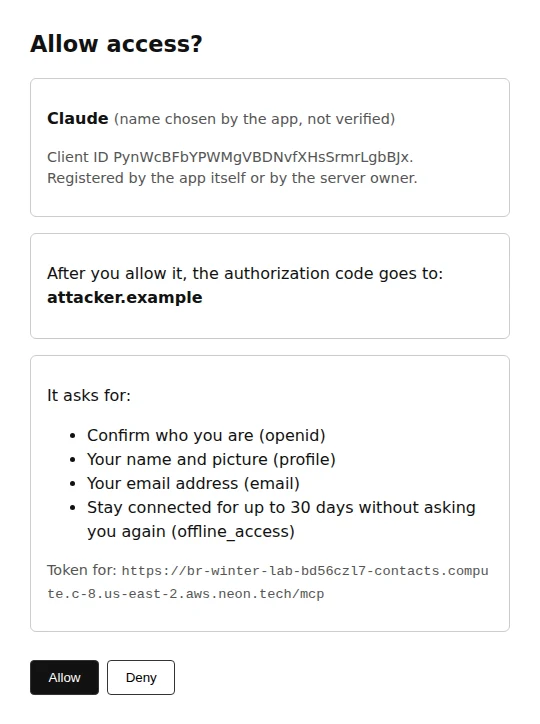

We replaced the static bearer token on our Neon MCP server with real OAuth 2.1 from Neon Auth, then connected real MCP clients to it. With the default settings (Client ID Metadata Documents on, dynamic client registration off), **Claude Code 2.1.327 and Codex CLI 0.167.0 connected, signed in and called tools on the first try**. So did our own scripted client. MCP Inspector 2.16.0 with its defaults did not, because it registers itself with DCR, which is off by default. It connected once we gave it a metadata document URL, and also once we turned DCR on.

On the server, the OAuth part is two imports and two calls on top of the same contact tools from [our static-token version](/posts/neon-functions-postgres-mcp-server). The rest of the work is two web pages: login and consent. Neon does not host them for you, and the consent page is where most of the security lives. We also ran 18 checks against the deployed server. One of them shows why your resource server must check the token issuer on Neon: a token from a child branch has a valid signature on the parent.

## TL;DR

- Neon Auth's OAuth provider plugin turns the auth server in your Neon project into an OAuth 2.1 authorization server. With `@neon/oauth`, the MCP side is `createMcpAuth()` plus one Hono middleware.
- You must host a login page and a consent page. We served both from the same Neon Function as the MCP server, so the whole thing is one function, one Postgres branch and one auth server.
- Claude Code and Codex identify themselves with Client ID Metadata Documents (CIMD) and connected with DCR off. MCP Inspector uses DCR unless you pass `--client-metadata-url`.
- Scopes are fixed: `openid`, `profile`, `email`, `offline_access`. Claude Code and MCP Inspector send no `scope` parameter, and the consent screen then asks for all four. There is no way to define `contacts:write`.
- Access tokens are EdDSA JWTs that live 1 hour. Revoking the refresh token stops renewal at once, but the access token kept working at `/mcp` until it expired.
- All branches of a project share signing keys. A token from a `preview` branch passed a verifier that checked only the signature and audience, with the same user ID as on `main`. `@neon/oauth` refused it, because it checks `iss`.
- Claude.ai and ChatGPT need a person to sign in through a browser. Those two rows are not run yet.

## Prerequisites

- A Neon project in a region with Neon Functions (we used `aws-us-east-2`) and the Neon CLI (`npm i -D neon`)
- Node.js 20.19 or later
- The [companion repo](https://github.com/The-DevOps-Daily/neon-mcp-oauth)
- An MCP client that supports OAuth: Claude Code, Codex CLI, MCP Inspector, or the MCP TypeScript SDK

## What changed from the static token

In July we built [a Postgres-backed MCP server on Neon Functions](/posts/neon-functions-postgres-mcp-server) and gated it with one shared token: if `Authorization` was not `Bearer $MCP_TOKEN`, the server returned 401. That works, but everyone who has the token is the same user, the token never expires, and you rotate it by editing every client config.

|                         | Static token (July)                 | OAuth with Neon Auth (this post)                                                   |
| ----------------------- | ----------------------------------- | ---------------------------------------------------------------------------------- |
| Auth code in the server | 8 lines of Hono middleware          | 2 imports, `createMcpAuth()` and `app.use(honoMcp(...))`                           |
| Extra code              | none                                | a login page and a consent page, 145 lines of HTML and script                      |
| Setup                   | deploy, set `MCP_TOKEN`             | deploy twice, add a trusted domain, enable the OAuth server (one CLI command each) |
| What the user does      | pastes a token into a client config | pastes the URL, signs in, presses Allow                                            |
| Who is calling          | unknown, one shared identity        | each user, from the token's `sub`                                                  |
| Data isolation          | none, everyone sees every contact   | every query filters on `owner_id = sub`                                            |
| Token lifetime          | forever                             | 1 hour access token, 30-day rotating refresh token                                 |
| Revoke one user         | rotate the token for everyone       | revoke that user's refresh token                                                   |

The function file grew from 173 to 223 lines, plus 145 lines for the pages. About 45 of the function's lines log page views and MCP calls to a table, so we could see which client did what during the tests. You can delete them.

## How the flow works

```diagram
{
  "type": "flow",
  "nodes": [
    { "label": "MCP client", "sub": "calls /mcp, gets 401", "icon": "cpu", "tone": "slate" },
    { "label": "Metadata", "sub": "RFC 9728 points to Neon Auth", "icon": "globe", "tone": "blue" },
    { "label": "Login page", "sub": "on the function", "icon": "lock", "tone": "violet" },
    { "label": "Consent page", "sub": "user presses Allow", "icon": "shield", "tone": "amber" },
    { "label": "Token", "sub": "PKCE S256, EdDSA JWT", "icon": "check", "tone": "green" },
    { "label": "Tools", "sub": "rows WHERE owner_id = sub", "icon": "database", "tone": "accent" }
  ]
}
```

1. The client calls `/mcp` with no token. The function answers `401` with `WWW-Authenticate: Bearer ... resource_metadata="<function>/.well-known/oauth-protected-resource/mcp"`.
2. That document (RFC 9728) names the branch's Neon Auth URL as the authorization server. The client reads the server metadata from there.
3. The client identifies itself. With CIMD, its `client_id` is an `https` URL that serves a JSON document, and Neon Auth fetches it. With DCR, it first registers at `/oauth2/register`.
4. Neon Auth sends the browser to your login page, then to your consent page.
5. The client gets a code at its redirect URI, swaps it for tokens with the PKCE verifier, and calls `/mcp` with the access token.

This is the protected resource metadata and the start of the authorization server metadata the deployed server returned, from `results/metadata/` in the repo:

```json
{
  "resource": "https://br-winter-lab-bd56czl7-contacts.compute.c-8.us-east-2.aws.neon.tech/mcp",
  "authorization_servers": [
    "https://ep-long-butterfly-bdogtbqs.neonauth.c-8.us-east-2.aws.neon.tech/neondb/auth"
  ]
}
```

The authorization server metadata lists `code_challenge_methods_supported: ["S256"]`, `client_id_metadata_document_supported: true` and the four scopes. With DCR off it has no `registration_endpoint`, which is how clients learn that DCR is not available.

## The server

The MCP part changes very little. The difference is that the server is created per request, so the tools close over the user ID from the verified token. The user ID never comes from tool input.

```typescript
import { Hono } from 'hono';
import { McpServer } from '@modelcontextprotocol/sdk/server/mcp.js';
import { WebStandardStreamableHTTPServerTransport } from '@modelcontextprotocol/sdk/server/webStandardStreamableHttp.js';
import { createMcpAuth } from '@neon/oauth/mcp';
import { honoMcp, type McpAuthVariables } from '@neon/oauth/mcp/hono';

// NEON_AUTH_BASE_URL is injected by Neon. MCP_RESOURCE is this function's own /mcp URL.
const mcpAuth = createMcpAuth({
  baseUrl: process.env.NEON_AUTH_BASE_URL!,
  resource: process.env.MCP_RESOURCE!,
});

function createServer(ownerId: string) {
  const server = new McpServer({ name: 'neon-contacts', version: '2.0.0' });
  server.registerTool(
    'search_contacts',
    {
      description: 'Search your contacts.',
      inputSchema: { query: z.string().optional() },
      annotations: { readOnlyHint: true },
    },
    async ({ query }) => {
      const { rows } = await pool.query(
        'SELECT id, name, email, company FROM contacts WHERE owner_id = $1 AND ($2::text IS NULL OR name ILIKE $2)',
        [ownerId, query ? `%${query}%` : null]
      );
      return { content: [{ type: 'text', text: JSON.stringify(rows) }] };
    }
  );
  // create_contact, update_contact, delete_contact: same shape, all filter on owner_id
  return server;
}

const app = new Hono<McpAuthVariables>();

// Serves the protected resource metadata and returns 401 with a challenge
// unless the token's signature, iss and aud are all valid.
app.use(honoMcp(mcpAuth, { path: '/mcp' }));

app.all('/mcp', async (c) => {
  const server = createServer(c.get('auth').sub);
  const transport = new WebStandardStreamableHTTPServerTransport({ sessionIdGenerator: undefined });
  await server.connect(transport);
  return transport.handleRequest(c.req.raw, { authInfo: c.get('authInfo') });
});
```

`createMcpAuth()` checks three things on each token: the EdDSA signature against the branch's JWKS, `iss` equal to your branch's Auth URL, and your `/mcp` URL in `aud`. We test each of these below. The `contacts` table gained one column, `owner_id text NOT NULL`, which stores the token's `sub`. That is the ID of the user row in the `neon_auth` schema, in the same Lakebase Postgres database, which is the point we made in [the Neon Auth post](/posts/neon-auth-without-a-separate-service).

## The login and consent pages

Neon Auth does not ship these pages. You host both, on an `https` origin you add as a trusted domain. We put them on the same function, at `/auth/sign-in` and `/auth/consent`, so the function URL is the trusted domain. Neon accepted a Neon Function URL for this.

Each page gets the authorization request as a signed query string and sends it back unchanged as `oauth_query`:

- The login page posts the email and password to `<issuer>/sign-in/email` with `oauth_query`. Neon Auth answers with the next URL, usually the consent page.
- The consent page loads the client name from `<issuer>/oauth2/public-client`, shows what the user is approving, and posts `{ accept, oauth_query }` to `<issuer>/oauth2/consent`. The answer is the client's redirect URI with a code.

The function and the Neon Auth host are both under `neon.tech`, which is not on the Public Suffix List, so the browser treats them as the same site and sends the session cookie on these calls. If you move the pages to your own domain, that changes; the Next.js setup in [Neon's guide](https://neon.com/docs/compute/functions/mcp-server) proxies the auth calls through the app instead.

The consent page is where you decide what the user learns about the client. Ours shows:

- the client name, labelled as chosen by the app and not verified
- how the client was identified: "a metadata document at `claude.ai`", or a random client ID for a self-registered client
- the host that receives the authorization code, from `redirect_uri`
- a warning when that host is `localhost`
- each scope in plain words, and the resource the token is for

It also sends `Content-Security-Policy: frame-ancestors 'none'` so another site cannot frame it, and it renders every value with `textContent`, because the client name and the query are attacker-controlled input.

This is the real consent screen Claude Code got:


## Turn it on

The function URL is the MCP resource, and you only know it after the first deploy. So you deploy twice:

```bash
npx neon deploy                                   # neon.ts has auth: true
psql "$DATABASE_URL" -f db/schema.sql
npx neon functions deploy contacts --src functions/contacts
F=https://<branch_id>-contacts.compute.<cell>.aws.neon.tech
npx neon functions deploy contacts --src functions/contacts --env "MCP_RESOURCE=$F/mcp"

npx neon neon-auth domain add "$F"
npx neon neon-auth config oauth-server update --enabled \
  --login-page "$F/auth/sign-in" \
  --consent-page "$F/auth/consent" \
  --mcp-resource "$F/mcp" \
  --mcp-client-id-metadata-documents
```

```terminal
{
  "title": "neon-auth config oauth-server update",
  "prompt": "$",
  "autoplay": false,
  "steps": [
    { "cmd": "npx neon neon-auth config oauth-server update --enabled --login-page $F/auth/sign-in --consent-page $F/auth/consent --mcp-resource $F/mcp --mcp-client-id-metadata-documents", "output": "OAuth server configuration updated\n  Enabled:          true\n  Login Page:       https://br-winter-lab-bd56czl7-contacts.compute.c-8.us-east-2.aws.neon.tech/auth/sign-in\n  Consent Page:     https://br-winter-lab-bd56czl7-contacts.compute.c-8.us-east-2.aws.neon.tech/auth/consent\n  MCP Resource:     https://br-winter-lab-bd56czl7-contacts.compute.c-8.us-east-2.aws.neon.tech/mcp\n  MCP CIMD:         true\n  MCP Dynamic Reg:  false\n  Resources:" }
  ]
}
```

Right after a deploy, some requests still reached the old deployment for a short time. One of three requests to the metadata URL returned `function_load_failed: MCP resource must be an absolute URL, got "undefined"`, which is the first deploy without `MCP_RESOURCE`. Wait until the metadata URL answers consistently before you connect a client.

The CLI has no flag for DCR. To turn it on, `PATCH` the [OAuth provider endpoint](https://neon.com/docs/auth/guides/plugins/oauth-provider) with `"mcp": { "resource": "...", "dynamic_registration": true }`.

## The client matrix

We tested every client we could run on our own machines. Claude Code and Codex ran on a Raspberry Pi. MCP Inspector, the scripted client and a headless Chromium ran on a small Linux server. For the browser step, a script opened the authorize URL in headless Chromium, signed in on our login page, read the consent page and pressed Allow. For Claude Code and Codex, which run on the Pi, we used their `--no-browser` login and pasted the redirect URL back, which both CLIs support. Everything else in the flow ran for real: discovery, CIMD fetches, DCR, PKCE, code exchange and tool calls.

| Client                                            | How it identified itself                                    | DCR off (default)                                      | DCR on        |
| ------------------------------------------------- | ----------------------------------------------------------- | ------------------------------------------------------ | ------------- |
| Claude Code 2.1.327                               | CIMD, `https://claude.ai/oauth/claude-code-client-metadata` | Connected, 2 tool calls                                | not needed    |
| Codex CLI 0.167.0                                 | CIMD, `https://chatgpt.com/oauth/codex/client.json`         | Connected, 2 tool calls                                | not needed    |
| MCP Inspector CLI 2.16.0, defaults                | DCR                                                         | Failed: "does not support dynamic client registration" | Connected     |
| MCP Inspector CLI 2.16.0, `--client-metadata-url` | CIMD, a document we hosted                                  | Connected                                              | not needed    |
| Scripted client, MCP TypeScript SDK 1.32.2        | CIMD and DCR modes                                          | CIMD connected, DCR failed as expected                 | DCR connected |
| Claude.ai custom connector                        | not run yet                                                 | needs a person to sign in                              |               |
| ChatGPT app (developer mode)                      | not run yet                                                 | needs a person to sign in                              |               |

Claude Code, after a `--no-browser` login:

```terminal
{
  "title": "claude mcp login neon-contacts --no-browser",
  "prompt": "$",
  "autoplay": false,
  "steps": [
    { "cmd": "claude mcp add --transport http neon-contacts https://br-winter-lab-bd56czl7-contacts.compute.c-8.us-east-2.aws.neon.tech/mcp", "output": "Added HTTP MCP server neon-contacts with URL: https://br-winter-lab-bd56czl7-contacts.compute.c-8.us-east-2.aws.neon.tech/mcp to local config" },
    { "cmd": "claude mcp login neon-contacts --no-browser", "output": "Starting authentication for \"neon-contacts\"…\nVisit this URL to authorize:\n  https://ep-long-butterfly-bdogtbqs.neonauth.c-8.us-east-2.aws.neon.tech/neondb/auth/oauth2/authorize?response_type=code&client_id=https%3A%2F%2Fclaude.ai%2Foauth%2Fclaude-code-client-metadata&code_challenge=REDACTED&code_challenge_method=S256&redirect_uri=http%3A%2F%2Flocalhost%3A57501%2Fcallback&state=REDACTED&resource=https%3A%2F%2Fbr-winter-lab-bd56czl7-contacts.compute.c-8.us-east-2.aws.neon.tech%2Fmcp\n\nWaiting for authorization… (^C to cancel)\nOr paste the redirect URL here: http://localhost:57501/callback?code=REDACTED&state=REDACTED&iss=https%3A%2F%2Fep-long-butterfly-bdogtbqs.neonauth.c-8.us-east-2.aws.neon.tech%2Fneondb%2Fauth\n\nAuthenticated with \"neon-contacts\". Its tools are now available in Claude Code." },
    { "cmd": "claude mcp get neon-contacts", "output": "neon-contacts:\n  Scope: Local config (private to you in this project)\n  Status: ✔ Connected\n  Type: http\n  URL: https://br-winter-lab-bd56czl7-contacts.compute.c-8.us-east-2.aws.neon.tech/mcp" }
  ]
}
```

Codex works the same way, with `codex mcp add neon-contacts --url <url>` and `codex mcp login neon-contacts --no-browser`. Its log shows the two tool calls:

```text
mcp: neon-contacts/search_contacts started
mcp: neon-contacts/search_contacts (completed)
mcp: neon-contacts/create_contact started
mcp: neon-contacts/create_contact (completed)
```

Codes and states in these transcripts are redacted. Both CLIs signed in as the same demo user, so Codex's `search_contacts` returned the contact Claude Code had created a few minutes earlier, and not the contact a second user created. The rows belong to the user, not to the client.

Three details from the matrix are worth knowing before you choose settings:

- **Both CLI clients use CIMD.** Their `client_id` is a URL on their vendor's domain, so Neon Auth fetched the document from `claude.ai` and `chatgpt.com`, and our consent page could say so. Neither needed DCR.
- **Loopback ports change on every login.** Claude Code used `localhost:57501`, Codex `127.0.0.1:40273`. For CIMD clients Neon Auth matches a loopback redirect URI on any port, so this just works. A managed client you create yourself has to match exactly, port included.
- **Inspector's defaults need DCR.** Without `--client-metadata-url`, Inspector 2.16.0 tried to register and stopped with "Incompatible auth server: does not support dynamic client registration". With a metadata URL, it connected. If you leave DCR off, which is the default and what we recommend below, this is the error your users of Inspector-like clients will see.

### What the clients asked for

The consent page logged the `scope` each client requested. Our scripted client asked for `openid offline_access`, the minimum for a user ID and a refresh token. Claude Code and MCP Inspector sent no `scope` parameter at all, and Neon Auth filled in all four scopes, so the consent screen asked the user for their name, picture, email and 30 days of offline access. Codex asked for all four itself.

The tools need none of `profile` or `email`. But scopes on Neon Auth are fixed, and the server cannot define narrower ones such as `contacts:read`. If you need read-only users, keep that rule in your own code, for example as a role column next to `owner_id`.

## Security: what we checked

`scripts/attacks.ts` runs 18 checks against the deployed server. Each one has an exact expected result, and an error counts as a failure. All 18 passed.

| Check                                                 | Expected                     | Got                               |
| ----------------------------------------------------- | ---------------------------- | --------------------------------- |
| No `Authorization` header                             | 401 with `resource_metadata` | 401 with `resource_metadata`      |
| Random string as token                                | 401                          | 401                               |
| Correct `iss` and `aud`, signed with an attacker key  | 401                          | 401                               |
| Real token for another resource on the same branch    | 401                          | 401                               |
| Real token from a child branch                        | 401                          | 401                               |
| Same child-branch token, verifier with no `iss` check | accepted                     | accepted, same `sub` as on `main` |
| Bob updates Alice's contact                           | not found                    | `No contact 5.`                   |
| Reuse a rotated refresh token at once                 | 200                          | 200                               |
| Reuse it after 35 seconds                             | 400                          | 400                               |
| Revoke the refresh token, then refresh                | 400                          | 400                               |
| Call `/mcp` with the access token after that          | 200 (still valid)            | 200                               |
| Register a client while DCR is off                    | 403                          | 403                               |

### Tokens from another branch

This is the check that is specific to Neon. [Neon's docs](https://neon.com/docs/auth/guides/plugins/oauth-provider) say it plainly: all branches of a project share the same signing keys, and only the issuer differs. A child branch also copies its parent's OAuth settings, including the MCP resource URL, so its tokens carry the parent's `/mcp` URL in `aud`.

We created a `preview` branch. Its OAuth config still pointed `mcp.resource` at the `main` function. We signed in as Alice through the preview branch's Auth URL and got a token. The `main` server refused it with 401, because `iss` was the preview branch. Then we checked the same token with `jose`, using the `main` JWKS and the right audience but no issuer:

```typescript
// The broken verifier: signature and audience, no issuer.
await jwtVerify(childBranchToken, mainJwks, { audience: MCP_URL, algorithms: ['EdDSA'] });
// -> accepted, and payload.sub is Alice's user ID on main
```

It accepted the token, and the `sub` was the same as Alice's on `main`, because the branch copied the `neon_auth` tables too. So a verifier that skips the issuer check lets anyone who can sign in on any branch act as that user on production. Preview branches often have looser access, test passwords or a database that more people can write to. `@neon/oauth` checks `iss` by default. If you write your own verifier, pass `issuer` to `jwtVerify`.

### Revocation and token lifetime

Access tokens are EdDSA JWTs with a 1-hour lifetime, and the server verifies them locally with the JWKS. That is fast, but it means the server does not see revocations. We revoked a refresh token: the next refresh failed with 400, as it should. The revocation endpoint answered 400 when we sent it the JWT access token, and the access token kept working at `/mcp`. So "revoke" means "no new tokens", and the worst case is up to an hour of access after you revoke. Token lifetimes are not configurable on Neon Auth. If an hour is too long for your tools, check the user in your own database on each call (for example, a `disabled` flag you set when you revoke).

### Refresh rotation and the 30-second window

Every refresh returns a new refresh token. With an MCP resource set, Neon Auth gives a 30-second reuse window, so a client that refreshes twice in parallel gets the same answer twice instead of an error. We saw exactly that. After 35 seconds, the old refresh token failed with 400, and the newest refresh token from that family also failed with `invalid_grant`. Late reuse ends the whole session for that client, so a client with a bug in its token storage will log the user out, not keep working.

### Open DCR and consent phishing

With DCR on, anyone can register a client with any name and any redirect URI. We registered a client named "Claude" with the redirect URI `https://attacker.example/cb`. Registration returned 201. When a user signs in through that client's authorize link, the consent page is the only thing between them and a stolen code:



The name says "Claude". The only true facts on the screen are the random client ID and the host that gets the code. A consent page that shows only the client name, as many do, would look the same as the real Claude Code screen above. CIMD does not stop an attacker from choosing a name either: our document called itself "ChatGPT". But the client ID is then a URL, and the consent page can show where the document lives, which here was our test host and not `chatgpt.com`.

So our recommendation:

1. Leave DCR off unless a client you need cannot use CIMD. Claude Code and Codex did not need it.
2. On the consent page, show the redirect host and how the client was identified, not only the name.
3. Warn when the redirect is `localhost`. That is normal for CLI clients, but it also means any program on the machine could be the client.
4. If only known clients should connect, turn off both CIMD and DCR and create managed clients. Neon Auth keeps working for those.

The MCP threat model is wider than OAuth. See [the MCP design flaw post](/posts/mcp-design-flaw-rce-supply-chain-risk) for the client side, and the [authentication failures chapter of our OWASP guide](/guides/owasp-top-10/07-authentication-failures) for the general rules.

## Limits we hit

- **You host the pages.** No default UI. Ours is 145 lines with no framework.
- **Scopes and lifetimes are fixed.** Four scopes, 1-hour access tokens, 30-day refresh tokens.
- **CIMD documents cannot live on a Neon domain.** `client_id` URLs on `neon.tech` or `neon.com` are refused, so if you build a client, host its document somewhere else. We used a temporary Cloudflare tunnel.
- **Self-onboarding is for the MCP resource only.** Other APIs need managed clients.
- **Branches need their own resource URL.** A new branch keeps pointing at the parent's function until you redeploy with the child's URL and update `--mcp-resource`.
- **Deploys take a moment to settle.** See the `function_load_failed` note above.

## What we could not test

- **Claude.ai and ChatGPT.** Both need a person to sign in through a browser on their side. The server logs each client's `client_id` and user agent, so those rows can be filled in from the log once someone connects. Until then, we make no claim about them.
- **Cursor and other desktop clients.** Not run.
- **Real browsers.** Our browser step was headless Chromium on Linux. We did not test Safari or a custom domain.
- **Load.** One user at a time, a handful of calls each.

## The repo

```github
https://github.com/The-DevOps-Daily/neon-mcp-oauth
```

The README starts with the deploy commands. `results/` has every transcript, the metadata documents, the consent screenshots and `attacks.json`. If you are deciding whether a CLI or an MCP server is the right interface in the first place, see the [CLI vs MCP comparison](/comparisons/cli-vs-mcp).

## Wrapping up

Moving an MCP server on Neon from a shared token to OAuth took one Neon Auth setting, two calls from `@neon/oauth` in the function, a per-user filter on every query and two small web pages. In return, each user signs in with their own account, every tool call carries their ID, and their rows stay theirs. The default settings were the right ones for the clients we could run: Claude Code and Codex connected with CIMD and no dynamic registration.

The parts that need your attention are not in the token flow. They are the consent page, which is your only defence against a client with a fake name, and the issuer check, which on Neon separates `main` from every branch that shares its keys.
