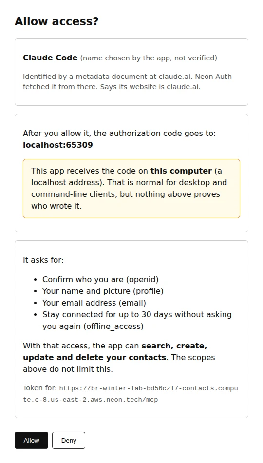

We replaced the static bearer token on our Neon MCP server with OAuth 2.1 from Neon Auth, then connected real MCP clients to it. With Client ID Metadata Documents on and dynamic client registration (DCR) off, **Claude Code 2.1.327 and Codex CLI 0.167.0 both signed in and called tools**. MCP Inspector 2.16.0 with its defaults did not connect, because it registers itself with DCR. It connected when we gave it a metadata document URL, and also when we turned DCR on.

On the server, the OAuth part is two imports and two calls on top of the same contact tools from [our static-token version](/posts/neon-functions-postgres-mcp-server). The rest of the work is two web pages: login and consent. Neon does not host them for you, and the consent page is where the user decides whether to trust a client. We also ran 20 checks against the deployed server. One of them shows why your resource server must check the token issuer on Neon: a token from a child branch has a valid signature on the parent.

## TL;DR

- Neon Auth's OAuth provider plugin turns the auth server in your Neon project into an OAuth 2.1 authorization server. With `@neon/oauth`, the MCP side is `createMcpAuth()` plus one Hono middleware.
- You must host a login page and a consent page. We served both from the same Neon Function as the MCP server, so the whole thing is one function, one Postgres branch and one auth server.
- Claude Code and Codex identify themselves with Client ID Metadata Documents (CIMD), and both connected with DCR off. MCP Inspector uses DCR unless you pass `--client-metadata-url`.
- Scopes are fixed: `openid`, `profile`, `email`, `offline_access`. Claude Code and MCP Inspector sent no `scope` parameter, and the consent screen then asked for all four. You cannot define a scope such as `contacts:write`.
- Access tokens are EdDSA JWTs with a 1-hour lifetime. Neon Auth refused to revoke one ("JWT access tokens are self-contained and cannot be revoked server-side"), and the token still worked at `/mcp` right after we revoked its refresh token.
- All branches of a project share signing keys. A token from a `preview` branch passed a verifier that checked only the signature and audience, with the same user ID as on `main`. `@neon/oauth` refused it, because it checks `iss`.
- Claude.ai and ChatGPT were not tested. Their compatibility is unknown.

## Prerequisites

- A Neon project in a region with Neon Functions (we used `aws-us-east-2`) and the Neon CLI (`npm i -D neon`)
- Node.js 20.19 or later
- The [companion repo](https://github.com/The-DevOps-Daily/neon-mcp-oauth)
- An MCP client that supports OAuth: Claude Code, Codex CLI, MCP Inspector, or the MCP TypeScript SDK

## What changed from the static token

In July we built [a Postgres-backed MCP server on Neon Functions](/posts/neon-functions-postgres-mcp-server) with an optional shared token: with `MCP_TOKEN` set, a request without the matching bearer token got a 401, and with it unset the demo was open. A shared token works, but everyone who has it is the same user, it never expires, and you rotate it by editing every client config.

|                         | Static token (July)                 | OAuth with Neon Auth (this post)                                                 |
| ----------------------- | ----------------------------------- | -------------------------------------------------------------------------------- |
| Auth code in the server | 8 lines of Hono middleware          | 2 imports, `createMcpAuth()` and `app.use(honoMcp(...))`                         |
| Extra code              | none                                | a login page and a consent page, 146 lines of HTML and script                    |
| Setup                   | deploy, set `MCP_TOKEN`             | deploy twice, add a trusted domain, enable the OAuth server, create users        |
| What the user does      | pastes a token into a client config | pastes the URL, signs in, presses Allow                                          |
| Who is calling          | unknown, one shared identity        | each user, from the token's `sub`                                                |
| Data isolation          | none, everyone sees every contact   | reads, updates and deletes filter on `owner_id = sub`; inserts set it from `sub` |
| Token lifetime          | forever                             | 1-hour access token, 30-day rotating refresh token                               |
| Stop renewal            | rotate the token for everyone       | revoke that refresh token; issued access tokens stay valid until they expire     |

The function file grew from 173 to 223 lines, plus 146 lines for the pages. About 45 of the function's lines log page views and MCP calls to a table, so we could see which client did what during the tests. You can delete them.

## How the flow works

```diagram
{
  "type": "flow",
  "nodes": [
    { "label": "MCP client", "sub": "calls /mcp, gets 401", "icon": "cpu", "tone": "slate" },
    { "label": "Metadata", "sub": "RFC 9728 points to Neon Auth", "icon": "globe", "tone": "blue" },
    { "label": "Login page", "sub": "on the function", "icon": "lock", "tone": "violet" },
    { "label": "Consent page", "sub": "user presses Allow", "icon": "shield", "tone": "amber" },
    { "label": "Token", "sub": "PKCE S256, EdDSA JWT", "icon": "check", "tone": "green" },
    { "label": "Tools", "sub": "rows WHERE owner_id = sub", "icon": "database", "tone": "accent" }
  ]
}
```

1. The client calls `/mcp` with no token. The function answers `401` with `WWW-Authenticate: Bearer ... resource_metadata="<function>/.well-known/oauth-protected-resource/mcp"`.
2. That document (RFC 9728) names the branch's Neon Auth URL as the authorization server. The client reads the server metadata from there.
3. The client identifies itself. With CIMD, its `client_id` is an `https` URL that serves a JSON document, and Neon Auth fetches it. With DCR, it first registers at `/oauth2/register`.
4. Neon Auth sends the browser to your login page, then to your consent page.
5. The client gets a code at its redirect URI, swaps it for tokens with the PKCE verifier, and calls `/mcp` with the access token.

This is the protected resource metadata the deployed server returned, from `results/metadata/` in the repo:

```json
{
  "resource": "https://br-winter-lab-bd56czl7-contacts.compute.c-8.us-east-2.aws.neon.tech/mcp",
  "authorization_servers": [
    "https://ep-long-butterfly-bdogtbqs.neonauth.c-8.us-east-2.aws.neon.tech/neondb/auth"
  ]
}
```

The authorization server metadata lists `code_challenge_methods_supported: ["S256"]`, `client_id_metadata_document_supported: true` and the four scopes. With DCR off it has no `registration_endpoint`, which is how clients learn that DCR is not available.

## The server

The MCP part changes very little. The difference is that the server is created per request, so the tools close over the user ID from the verified token. The user ID never comes from tool input. This is an abbreviated version of `functions/contacts/index.ts`; the pool setup, the other three tools and the logging are in the repo:

```typescript
import { Hono } from 'hono';
import { McpServer } from '@modelcontextprotocol/sdk/server/mcp.js';
import { WebStandardStreamableHTTPServerTransport } from '@modelcontextprotocol/sdk/server/webStandardStreamableHttp.js';
import { createMcpAuth } from '@neon/oauth/mcp';
import { honoMcp, type McpAuthVariables } from '@neon/oauth/mcp/hono';

// NEON_AUTH_BASE_URL is injected by Neon. MCP_RESOURCE is this function's own /mcp URL.
const mcpAuth = createMcpAuth({
  baseUrl: process.env.NEON_AUTH_BASE_URL!,
  resource: process.env.MCP_RESOURCE!,
});

function createServer(ownerId: string) {
  const server = new McpServer({ name: 'neon-contacts', version: '2.0.0' });
  server.registerTool(
    'search_contacts',
    {
      title: 'Search contacts',
      description: 'Search your contacts by name, email, company or notes.',
      inputSchema: {
        query: z.string().trim().min(1).optional(),
        limit: z.number().int().positive().max(100).default(20),
      },
      annotations: { readOnlyHint: true },
    },
    async ({ query, limit }) => {
      const { rows } = await pool.query(
        `SELECT id, name, email, company, notes, created_at FROM contacts
          WHERE owner_id = $1
            AND ($2::text IS NULL OR name ILIKE $2 OR email ILIKE $2 OR company ILIKE $2 OR notes ILIKE $2)
          ORDER BY name LIMIT $3`,
        [ownerId, query ? `%${query}%` : null, limit]
      );
      return asText({ count: rows.length, contacts: rows });
    }
  );
  // create_contact sets owner_id from ownerId; update_contact and delete_contact filter on it
  return server;
}

const app = new Hono<McpAuthVariables>();

// Serves the protected resource metadata and returns 401 with a challenge
// unless the token's signature, iss and aud are all valid.
app.use(honoMcp(mcpAuth, { path: '/mcp' }));

app.all('/mcp', async (c) => {
  const server = createServer(c.get('auth').sub);
  const transport = new WebStandardStreamableHTTPServerTransport({ sessionIdGenerator: undefined });
  await server.connect(transport);
  return transport.handleRequest(c.req.raw, { authInfo: c.get('authInfo') });
});

export default app;
```

`createMcpAuth()` checks three things on each token: the EdDSA signature against the branch's JWKS, `iss` equal to your branch's Auth URL, and your `/mcp` URL in `aud`. We test each of these below. The `contacts` table has an `owner_id text NOT NULL` column that stores the token's `sub`. That is the ID of the user row in the `neon_auth` schema, in the same Lakebase Postgres database, which is the point we made in [the Neon Auth post](/posts/neon-auth-without-a-separate-service).

`db/schema.sql` creates the demo tables in a new, empty database. If you upgrade the July database instead, you need a migration that adds `owner_id`, assigns the existing shared contacts to users you choose, and only then sets `NOT NULL` and adds the index.

## The login and consent pages

Neon Auth does not ship these pages. You host both, on an `https` origin you add as a trusted domain. We put them on the same function, at `/auth/sign-in` and `/auth/consent`, so the function URL is the trusted domain. Neon accepted a Neon Function URL for this.

Each page gets the authorization request as a signed query string and sends it back unchanged as `oauth_query`:

- The login page posts the email and password to `<issuer>/sign-in/email` with `oauth_query`. Neon Auth answers with the next URL, usually the consent page.
- The consent page loads the client name from `<issuer>/oauth2/public-client`, shows what the user is approving, and posts `{ accept, oauth_query }` to `<issuer>/oauth2/consent`. The answer is the client's redirect URI with a code.

The function and the Neon Auth host are different origins under `neon.tech`. `neon.tech` is not on the Public Suffix List, so the two hosts are the same site. Our page script calls Neon Auth with `credentials: 'include'`, and Neon Auth allows the trusted page origin, so the session cookie goes with those calls. If you move the pages to your own domain, the hosts are no longer the same site; the Next.js setup in [Neon's guide](https://neon.com/docs/compute/functions/mcp-server) proxies the auth calls through the app instead.

The consent page is where you decide what the user learns about the client. Ours shows:

- the client name, labelled as chosen by the app and not verified
- how the client was identified: "a metadata document at `claude.ai`", or a random client ID for a self-registered client
- the host that receives the authorization code, from `redirect_uri`
- a warning when that host is `localhost`
- each scope in plain words, and the resource the token is for
- what the token can do in this app: search, create, update and delete your contacts, which the scopes do not limit

It also sends `Content-Security-Policy: frame-ancestors 'none'` so another site cannot frame it, and it renders every value with `textContent`, because the client name and the query are attacker-controlled input.

This is the consent screen Claude Code got:



## Turn it on

The function URL is the MCP resource, and you only know it after the first deploy. So you deploy twice:

```bash
npm install
npx neon link --project-id <your-project-id>
npx neon deploy                                   # neon.ts has auth: true
psql "$DATABASE_URL" -f db/schema.sql
npx neon functions deploy contacts --src functions/contacts
F=https://<branch_id>-contacts.compute.<cell>.aws.neon.tech
npx neon functions deploy contacts --src functions/contacts --env "MCP_RESOURCE=$F/mcp"

npx neon neon-auth domain add "$F"
npx neon neon-auth config oauth-server update --enabled \
  --login-page "$F/auth/sign-in" \
  --consent-page "$F/auth/consent" \
  --mcp-resource "$F/mcp" \
  --mcp-client-id-metadata-documents
```

The demo has no sign-up page, so create a user before you connect a client: `POST <NEON_AUTH_BASE_URL>/sign-up/email` with `Origin: $F` and a JSON body with `email`, `password` and `name`. The README has the command.

`neon neon-auth config oauth-server get` shows the result. This is our branch after the tests, with the second resource we added for the audience check:

```text
OAuth server configuration
  Enabled:          true
  Login Page:       https://br-winter-lab-bd56czl7-contacts.compute.c-8.us-east-2.aws.neon.tech/auth/sign-in
  Consent Page:     https://br-winter-lab-bd56czl7-contacts.compute.c-8.us-east-2.aws.neon.tech/auth/consent
  MCP Resource:     https://br-winter-lab-bd56czl7-contacts.compute.c-8.us-east-2.aws.neon.tech/mcp
  MCP CIMD:         true
  MCP Dynamic Reg:  false
  Resources:        https://reports.example.com/api
```

DCR is off by default on a newly configured provider, and these commands do not change it. Neon's docs say branches configured before October 2026 may have relied on DCR being on, so check `MCP Dynamic Reg` on an older project. The CLI has no flag for DCR. To set it, `PATCH` the [OAuth provider endpoint](https://neon.com/docs/auth/guides/plugins/oauth-provider) with `"mcp": { "resource": "...", "dynamic_registration": false }` (or `true`).

Neon's guide notes that a new deployment can take a few minutes to serve traffic. Wait until `resource` in the protected resource metadata matches your `MCP_RESOURCE` before you connect a client.

## The client matrix

We tested every client we could run on our own machines. Claude Code and Codex ran on a Raspberry Pi. MCP Inspector, the scripted client and a headless Chromium ran on a small Linux server. For the browser step, a script opened the authorize URL in headless Chromium, signed in on our login page, read the consent page and pressed Allow. Claude Code and Codex ran on a different machine than the browser, so we used their `--no-browser` login and pasted the redirect URL back, which both CLIs support. We did not test their usual flow, where the browser sends the code to the CLI's local listener. Inspector ran next to the browser, which called its local listener directly. The scripted client caught the redirect in the browser and passed the code to the MCP SDK.

| Client                                            | How it identified itself                                    | DCR off (default)                                      | DCR on                 |
| ------------------------------------------------- | ----------------------------------------------------------- | ------------------------------------------------------ | ---------------------- |
| Claude Code 2.1.327                               | CIMD, `https://claude.ai/oauth/claude-code-client-metadata` | Connected, 2 tool calls                                | not tested             |
| Codex CLI 0.167.0                                 | CIMD, `https://chatgpt.com/oauth/codex/client.json`         | Connected, 2 tool calls                                | not tested             |
| MCP Inspector CLI 2.16.0, defaults                | DCR                                                         | Failed: "does not support dynamic client registration" | Connected, 1 tool call |
| MCP Inspector CLI 2.16.0, `--client-metadata-url` | CIMD, a document we hosted                                  | Connected, listed tools                                | not tested             |
| Our scripted client, MCP TypeScript SDK 1.32.2    | CIMD or DCR, by flag                                        | CIMD connected; DCR failed as expected                 | DCR connected          |
| Claude.ai custom connector                        | not tested                                                  | unknown                                                | unknown                |
| ChatGPT app (developer mode)                      | not tested                                                  | unknown                                                | unknown                |

Claude Code, with a `--no-browser` login:

```terminal
{
  "title": "claude mcp login neon-contacts --no-browser",
  "prompt": "$",
  "autoplay": false,
  "steps": [
    { "cmd": "claude mcp add --transport http neon-contacts https://br-winter-lab-bd56czl7-contacts.compute.c-8.us-east-2.aws.neon.tech/mcp", "output": "Added HTTP MCP server neon-contacts with URL: https://br-winter-lab-bd56czl7-contacts.compute.c-8.us-east-2.aws.neon.tech/mcp to local config" },
    { "cmd": "claude mcp login neon-contacts --no-browser", "output": "Starting authentication for \"neon-contacts\"…\nVisit this URL to authorize:\n  https://ep-long-butterfly-bdogtbqs.neonauth.c-8.us-east-2.aws.neon.tech/neondb/auth/oauth2/authorize?response_type=code&client_id=https%3A%2F%2Fclaude.ai%2Foauth%2Fclaude-code-client-metadata&code_challenge=REDACTED&code_challenge_method=S256&redirect_uri=http%3A%2F%2Flocalhost%3A57501%2Fcallback&state=REDACTED&resource=https%3A%2F%2Fbr-winter-lab-bd56czl7-contacts.compute.c-8.us-east-2.aws.neon.tech%2Fmcp\n\nWaiting for authorization… (^C to cancel)\nOr paste the redirect URL here: http://localhost:57501/callback?code=REDACTED&state=REDACTED&iss=https%3A%2F%2Fep-long-butterfly-bdogtbqs.neonauth.c-8.us-east-2.aws.neon.tech%2Fneondb%2Fauth\n\nAuthenticated with \"neon-contacts\". Its tools are now available in Claude Code." },
    { "cmd": "claude mcp get neon-contacts", "output": "neon-contacts:\n  Scope: Local config (private to you in this project)\n  Status: ✔ Connected\n  Type: http\n  URL: https://br-winter-lab-bd56czl7-contacts.compute.c-8.us-east-2.aws.neon.tech/mcp" }
  ]
}
```

Codex works the same way, with `codex mcp add neon-contacts --url <url>` and `codex mcp login neon-contacts --no-browser`. Its log shows the two tool calls:

```text
mcp: neon-contacts/search_contacts started
mcp: neon-contacts/search_contacts (completed)
mcp: neon-contacts/create_contact started
mcp: neon-contacts/create_contact (completed)
```

Codes and states in these transcripts are redacted. Both CLIs signed in as the same demo user, so Codex's `search_contacts` returned the contact Claude Code had created a few minutes earlier, and not the contact a second user had created. The rows belong to the user, not to the client.

Three details from the matrix are worth knowing before you choose settings:

- **Both CLI clients use CIMD.** Their `client_id` is a URL on their vendor's domain, so Neon Auth fetched the document from `claude.ai` and `chatgpt.com`, and our consent page could say so. Neither needed DCR.
- **Loopback ports can change between logins.** Our runs used `localhost:57501` and `localhost:65309` for Claude Code and `127.0.0.1:40273` for Codex. For CIMD clients, Neon Auth matches a loopback redirect URI on any port, so this works. A managed client you create yourself has to match exactly, port included.
- **Inspector's defaults need DCR.** Without `--client-metadata-url`, Inspector 2.16.0 tried to register and stopped with "Incompatible auth server: does not support dynamic client registration". With a metadata URL, it connected. If you leave DCR off, users of clients that only do DCR will see this error.

### What the clients asked for

We compared each client's authorize URL with the scopes Neon Auth passed on to our consent page. Our scripted client requested `openid offline_access`: `openid` for identity and `offline_access` for a refresh token. Claude Code and MCP Inspector sent no `scope` parameter, and the consent page received all four scopes, so the user was asked for their name, picture, email and 30 days of offline access. Codex requested all four itself.

The tools need neither `profile` nor `email`. But scopes on Neon Auth are fixed, and the server cannot define narrower ones such as `contacts:read`. Every client that gets a token in this demo can search, create, update and delete the user's contacts. If you need read-only users or read-only clients, keep that rule in your own code, for example as a role column next to `owner_id`.

## Security: what we checked

`scripts/attacks.ts` makes 20 assertions against the deployed server: expected HTTP statuses, response values, and the OAuth error code on refresh failures. A section that throws counts as a failed check. All 20 passed. The script also records one observation that is not counted: what Neon Auth says when you try to revoke an access token.

| Check                                                 | Expected                     | Got                               |
| ----------------------------------------------------- | ---------------------------- | --------------------------------- |
| No `Authorization` header                             | 401 with `resource_metadata` | 401 with `resource_metadata`      |
| Random string as token                                | 401                          | 401                               |
| Correct `iss` and `aud`, signed with an attacker key  | 401                          | 401                               |
| Real token for another resource on the same branch    | 401                          | 401                               |
| Real token from a child branch                        | 401                          | 401                               |
| Same child-branch token, verifier with no `iss` check | accepted                     | accepted, same `sub` as on `main` |
| Bob updates, deletes or searches Alice's contact      | not found / 0 rows           | not found / 0 rows                |
| Reuse a rotated refresh token at once                 | 200, same new token          | 200, same new token               |
| Reuse it after 35 seconds                             | 400 `invalid_grant`          | 400 `invalid_grant`               |
| Then use the token the first refresh returned         | 400 `invalid_grant`          | 400 `invalid_grant`               |
| Revoke the refresh token, then refresh                | 400 `invalid_grant`          | 400 `invalid_grant`               |
| Call `/mcp` with the access token right after that    | 200                          | 200                               |
| Register a client while DCR is off                    | 403                          | 403                               |

### Tokens from another branch

This is the check that is specific to Neon. [Neon's docs](https://neon.com/docs/auth/guides/plugins/oauth-provider) say it plainly: all branches of a project share the same signing keys, and only the issuer differs. A child branch also copies its parent's OAuth settings, including the MCP resource URL, so its tokens carry the parent's `/mcp` URL in `aud`.

We created a `preview` branch. Its OAuth config still pointed `mcp.resource` at the `main` function. We signed in as Alice against the preview branch's Auth URL, calling the auth endpoints directly (our pages are wired to the `main` issuer), and got a token. The `main` server refused it with 401, because `iss` was the preview branch. Then we checked the same token with `jose`, using the `main` JWKS and the right audience but no issuer:

```typescript
// The broken verifier: signature and audience, no issuer.
await jwtVerify(childBranchToken, mainJwks, { audience: MCP_URL, algorithms: ['EdDSA'] });
// -> accepted, and payload.sub is Alice's user ID on main
```

It accepted the token, and the `sub` was the same as Alice's on `main`, because the branch copied the `neon_auth` tables too. So without an issuer check, a token from another branch of the same project, with an audience that matches production, can read and change that user's rows on production. If a preview branch has weaker account or database controls than `main`, that is a real path in. `@neon/oauth` checks `iss` by default. If you write your own verifier, pass `issuer` to `jwtVerify`.

If you do want a working MCP server on a child branch, more than the resource URL has to change. Deploy the function on the child with the child's `MCP_RESOURCE`, point `--mcp-resource`, the login page and the consent page at the child's function, and add that origin as a trusted domain on the child. Its pages then call the child's issuer.

### Revocation and token lifetime

Access tokens are EdDSA JWTs with a 3,600-second lifetime, and the server verifies them locally with the JWKS. That is fast, but the server does not see revocations. We revoked a refresh token, and the next refresh with it failed with `invalid_grant`. When we sent the access token to the revocation endpoint, Neon Auth answered `400 unsupported_token_type` with "JWT access tokens are self-contained and cannot be revoked server-side". The access token still worked at `/mcp` right after that, and local JWT verification will keep accepting it until it expires.

So revoking a refresh token stops renewal for that grant. It does not end a token that was already issued, and it does not stop the user from signing in again. Token lifetimes are not configurable on Neon Auth. If you need to cut a user off at once, keep a `disabled` flag in your own database and check it on each tool call.

### Refresh rotation and the 30-second window

Every refresh returns a new refresh token. With an MCP resource set, Neon's docs describe a 30-second reuse window, so a client that sends the same refresh request twice gets the same answer. Our sequential test matched that: reusing the old refresh token at once returned 200 and the same new refresh token as the first call. After 35 seconds, the old refresh token failed with `invalid_grant`, and the token the first refresh had returned also failed with `invalid_grant`. A client with a bug in its token storage loses its refresh token this way and needs a new authorization. The user's browser session and stored consent may make that quick.

### Open DCR and consent phishing

With DCR on, anyone can register a client with a name they choose and any redirect URIs that pass Neon's checks, including an `https` callback on their own server. We registered a client named "Claude" with the redirect URI `https://attacker.example/cb`. It reached our consent screen:


This is consent phishing. The attacker starts the flow with their own client, so PKCE does not help: they hold the verifier. If the user presses Allow, the attacker's server gets a code and then tokens for that user. The name says "Claude". That name is self-chosen. The useful facts are the random client ID, the host that gets the code, the scopes, the resource and what the app can do. A consent page that shows only the client name would look like the real Claude Code screen above.

CIMD does not stop an attacker from choosing a name either. We hosted a document that called itself "ChatGPT", and Neon Auth accepted it. But the client ID is then a URL, so the consent page can show where the document lives, which was our test host and not `chatgpt.com`. That tells the user where the metadata came from. It does not prove which program is using a public client ID.

Turning DCR off later does not remove clients that registered while it was on. Neon's docs say so, and we saw it: after we turned DCR off, the "Claude" client above still reached the consent screen.

So our recommendation:

1. Leave DCR off unless a client you need cannot use CIMD. Claude Code and Codex did not need it.
2. On the consent page, show the redirect host, how the client was identified and what the token can do in your app, not only the name.
3. Warn when the redirect is `localhost`. That is normal for CLI clients, but any program on the machine could be the client.
4. If only clients you approve should connect, turn off CIMD and DCR, disable or delete any self-registered clients that are still there, and create managed clients. Tokens that were already issued stay valid until they expire.

The consent screen is the last check for the user, not the only one. Keeping DCR off, limiting what each user can do in your own code, and the issuer check above all reduce what a bad client can get. The MCP threat model is also wider than OAuth: see [the MCP design flaw post](/posts/mcp-design-flaw-rce-supply-chain-risk) for the client side, and the [authentication failures chapter of our OWASP guide](/guides/owasp-top-10/07-authentication-failures) for the general rules.

## Limits we hit

- **You host the pages.** No default UI. Ours is 146 lines with no framework.
- **Scopes and lifetimes are fixed.** Four scopes, 1-hour access tokens, 30-day refresh tokens.
- **CIMD documents cannot live on a Neon domain.** `client_id` URLs on `neon.tech` or `neon.com` are refused, so if you build a client, host its document somewhere else. We used a temporary Cloudflare tunnel.
- **Self-onboarding is for the MCP resource only.** Other APIs need managed clients.
- **Branches need their own setup.** A new branch keeps pointing at the parent's function and pages until you change them.
- **New deployments take a moment.** Check the protected resource metadata before you connect a client.

## What we could not test

- **Claude.ai and ChatGPT.** Neither was tested, so their compatibility is unknown. The server logs each client's `client_id` and user agent, so we can check those connections when someone runs them. Until then, we make no claim about them.
- **Cursor and other desktop clients.** Not tested.
- **Interactive browsers.** Our browser step was headless Chromium on Linux, and the CLI runs used the paste-back flow. We did not test Safari, a person clicking through, or a custom domain.
- **Load.** One user at a time, a handful of calls each.

## The repo

```github
https://github.com/The-DevOps-Daily/neon-mcp-oauth
```

The README starts with the deploy commands. `results/` has the client transcripts, the metadata documents, the consent screenshots and `attacks.json`. If you are deciding whether a CLI or an MCP server is the right interface in the first place, see the [CLI vs MCP comparison](/comparisons/cli-vs-mcp).

## Wrapping up

Moving an MCP server on Neon from a shared token to OAuth took one Neon Auth setting, two calls from `@neon/oauth` in the function, an owner check on every contact query and two small web pages. In return, each user signs in with their own account, every tool call carries their ID, and their rows stay theirs. The default settings were the right ones for the clients we could run: Claude Code and Codex connected with CIMD and no dynamic registration.

The parts that need your attention are not in the token flow. They are the consent page, where a user decides whether a client with a self-chosen name gets in, and the issuer check, which on Neon separates `main` from every branch that shares its keys.
