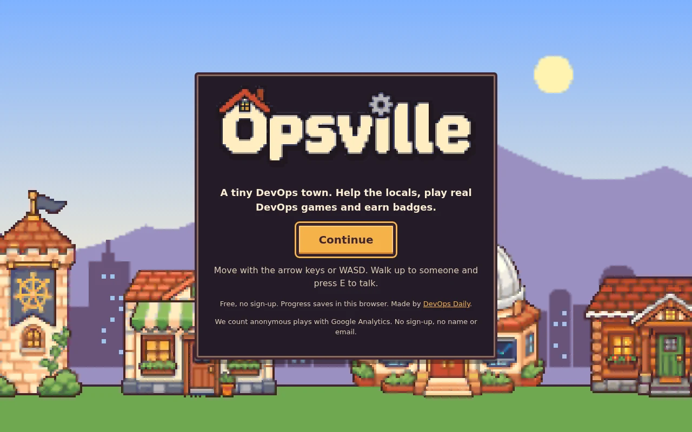
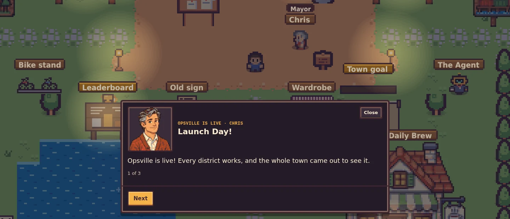
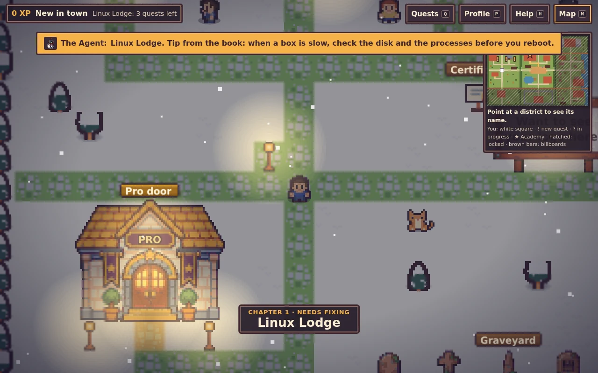
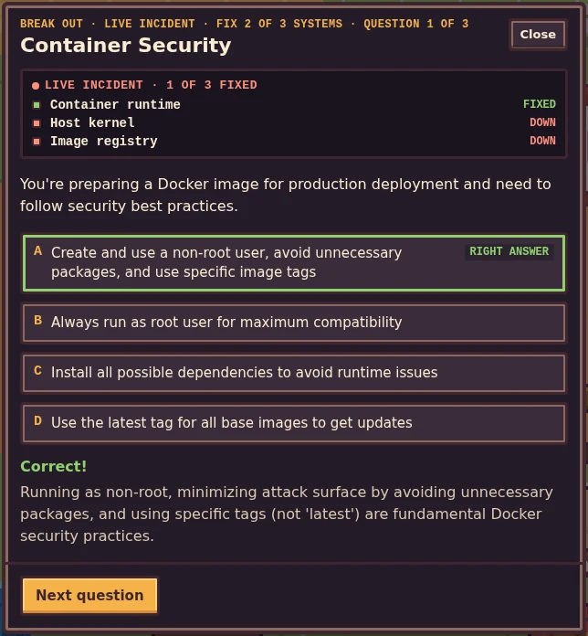
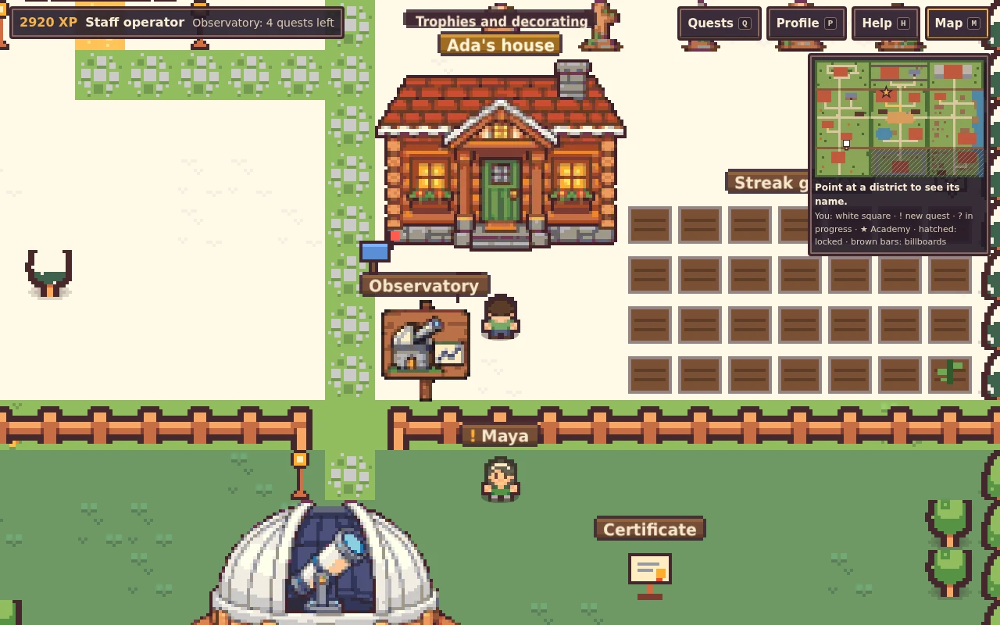
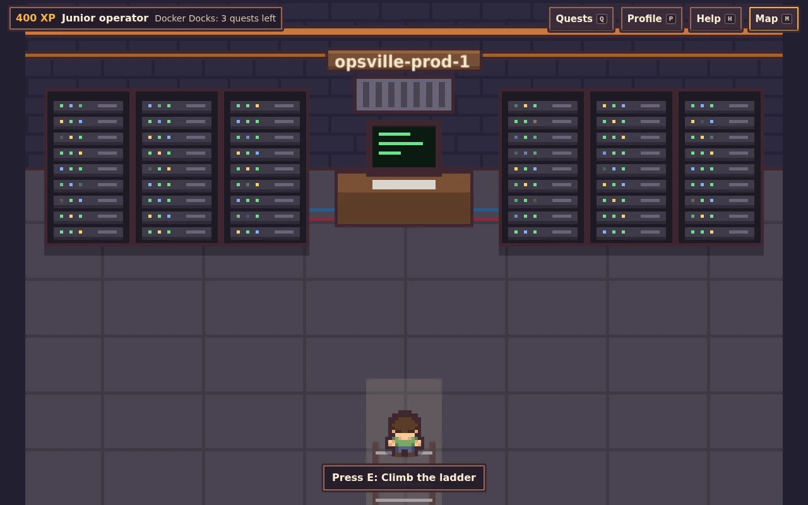

Opsville is a small pixel-art town where every district is broken, and you are the one on call. It is free, it runs in your browser, and it is live today at [devops-daily.com/opsville](https://devops-daily.com/opsville/). Most quests open one of the simulators from our [simulators page](/simulators), then ask you three questions from our quiz bank. Fix all eight districts and the town gets its Launch Day.

This post covers the game first, then how we built it.



## Prerequisites

- A modern browser on a desktop or a phone.
- A keyboard, a gamepad or a touch screen.
- No account. Your progress saves in your browser.

## Walk into town

You start in the town square. Mayor Chris has a problem: the town goes live soon, and none of the districts work. That is the **Launch Day** story. Each district is a chapter, with a closing scene once you fix it. The Agent, the robot from our book [The DevOps Survival Guide](/books/devops-survival-guide), waits in the square and comments when you walk into a new district.



There are 8 districts and 34 quests. The districts open one after another:

1. Linux Lodge
2. Docker Docks
3. Git Garden
4. CI/CD Railway
5. Kubernetes Castle
6. Observatory
7. Security Fort
8. Neon Data Depot

A broken district looks broken. Smoke rises from its landmark, its lamps flicker at night, and its people grumble. When you fix it, lights go up over its sign and its music opens up.



## How a quest works

Walk up to someone and press E, or tap Talk on a phone. They give you a task, such as "The disk is full" in Linux Lodge. The quest opens a simulator from our site in a panel: the Linux terminal, the [Fork Bomb Simulator](/games/fork-bomb-simulator), the [Container Security Challenge](/games/docker-escape), the [Kubernetes Scheduler Challenge](/games/k8s-scheduler) and more. When you finish, you answer three questions from our quiz bank. Two right answers pass the quest.

From Docker Docks on, each district ends with a boss. A boss quiz plays as a **live incident**: a status board with three systems that go from "Down" to "Fixed" as you answer.



Each quest gives you XP and a badge. Each cleared district gives you something new: a bike after Linux Lodge, a pet for each of the first five districts (a penguin, a little whale, a cat, a dog and a mini Agent), and new hats.

## Things to do between quests

- **The pager.** After you fix Linux Lodge, an incident in an open district pages you now and then. You get two minutes to get there and 30 seconds to fix it. You can snooze it, or turn it off in Help.
- **The daily quest.** One question a day from the quiz bank. Seven days in a row earns the Streak beanie.
- **Your house.** You get a log cottage in Linux Lodge with your name on the sign. Inside, there is a cup for every cleared district and a medal for every badge. The garden next to it grows a plant for each day you played in the last four weeks.
- **The newsstand.** The latest DevOps Daily posts, in the town square.
- **Photo mode.** Press F, pick a frame and a filter, and save a PNG.
- **Your look.** A character creator on first start, and a wardrobe in the square for later changes.
- **The Advent board.** From 1 to 24 December, the town gets snow, lights and a board with one door a day.



Twelve lost packets are hidden around town. Find all of them, and an old hatch by the lake opens. Below it is a server room that has not been rebooted in a long time.



## Accounts are optional

You can play the whole game without an account. If you sign in with a free DevOps Daily account, your save follows you to other devices. You can also join the weekly leaderboard (opt-in, with a board name only), help fill a weekly town goal with everyone else's XP, and race district speedruns.

The Help panel has a larger text switch. You can play with a keyboard, a gamepad or touch controls. If your system asks for reduced motion, the game turns off the moving effects. Sound is off until you turn it on.

## How we built it

### Vite, TypeScript and Phaser 3

Phaser draws the world: the map, the people, the weather and the effects. The panels, quizzes and HUD are plain HTML on top of the canvas.

### The map is a text file

The whole world is one text file: 72 x 50 characters, where one character is one 16 x 16 tile. A build script turns it into Tiled JSON with ground, decor, collision and object layers. Moving a building is a diff you can review. Here are four rows from the top of the map:

```text
P..*.:::.......::::.*..P................ggggg...P..%%%%........%%%%....P
P.v........)..:....v...P................SSDSS...P..HHHH........HHHH.T..P
P..*..T.:::::::.*..T.*.P........[.........:.....P..HHHH....]...HHHH....P
P.*.......:......*.....P########################P..........:...........P
```

`P` is a pine, `:` a stone path, `#` a rail track, `g` a grey roof, `S` a stone wall and `D` a door. Characters such as `[` and `)` are objects, defined in a list below the grid.

### Static files inside the main site

The game builds with the base path `/opsville/`. A release script copies the build into the site's repo, adds the game's response headers, and opens one pull request. Cloudflare Pages deploys it with the rest of the static site. The game needs no server of its own.

### Simulators in a frame

A quest loads `/games/<slug>/embed?embed=opsville&run=<id>` in a frame. When you finish, the simulator sends a message on the same origin:

```typescript
// Sent by the simulator when the player finishes it
{ type: 'devops-daily:game-complete', game: '<slug>', run: '<id>' }
```

On phones the simulator opens in a new tab, and the same message goes over a `BroadcastChannel`. If no message arrives, a "Done, take the quiz" button covers it. Either way, the quiz is the real gate.

```diagram
{
  "type": "flow",
  "nodes": [
    { "label": "Quest-giver", "sub": "talk to a local", "icon": "globe", "tone": "slate" },
    { "label": "Simulator", "sub": "/games embed", "icon": "box", "tone": "blue" },
    { "label": "game-complete", "sub": "postMessage", "icon": "net", "tone": "violet" },
    { "label": "Quiz gate", "sub": "2 of 3 to pass", "icon": "check", "tone": "amber" },
    { "label": "XP and badge", "sub": "server-checked", "icon": "shield", "tone": "green" }
  ]
}
```

### XP that the server decides

When you are signed in, the game only says "I finished quest X". The learning platform's API looks the quest up in its own list and decides the XP. Each quest counts once per player, two quests must be at least 30 seconds apart, and a player can count at most 24 quests in 24 hours. The rows live in the learning platform's existing Neon database, so the game did not need a new one. A test in the game fails when its quest list drifts from the server's list.

### Art from two sources

The tiles and characters come from [Kenney's](https://www.kenney.nl) CC0 packs: Tiny Town, Tiny Dungeon and RPG Urban Pack. The landmarks, signs and portraits are generated pixel art. A Python script cuts out their background, scales them to the pixel grid, and maps every colour to one warm palette shared with the tiles. That way both sources look like one game. The music is ours too: chords and patterns played with WebAudio, with no sound files.

## Play it and tell us what breaks

**Play Opsville free at [devops-daily.com/opsville](https://devops-daily.com/opsville/).** Start in Linux Lodge, and see how far you get before the pager goes off.

Found a bug, or have an idea for a quest or a district? [Open an issue on our GitHub repo](https://github.com/The-DevOps-Daily/devops-daily/issues/new/choose) and tell us.
