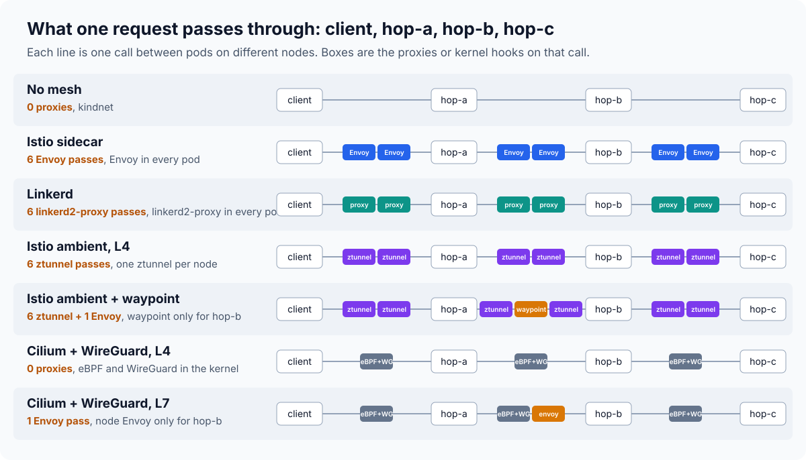

We ran the same small app five ways on Kubernetes: with no mesh, with Istio sidecars, with Istio ambient, with Linkerd and with Cilium. Then we measured what each one costs. At 1,000 requests per second through a three-hop chain, Istio sidecars added 9.4 ms to the median request and used 1.8 more CPU cores than no mesh. Istio ambient with only its per-node ztunnel added 2.0 ms and 0.4 cores, with mTLS and an identity-based rule. Linkerd's sidecars sat in between, at 5.9 ms and 0.7 cores.

Operations separated them less than we expected. We upgraded each mesh to its newest release three times and restarted its own components three times, under traffic. With the procedure we settled on, Istio in both modes and Linkerd did not fail a single request. Cilium lost 16 to 80 requests per upgrade, and for 10 to 35 seconds of each upgrade the load generator could not even send its full rate because requests were stuck. The worst upgrade was our own doing: when we restarted the Linkerd workloads the moment the new control plane reported ready, 3,600 to 3,984 requests failed within about 18 to 20 seconds, three times out of three.

This post shows how each setup puts proxies on the request path, what that costs in latency, CPU, memory and pod startup time, and where the numbers say "you cannot tell these apart". Everything ran on one throwaway DigitalOcean droplet, and the scripts and raw results are public.

```github
https://github.com/The-DevOps-Daily/mesh-overhead-bench
```

## TL;DR

- **Istio sidecars cost the most.** At 1,000 req/s they added 9.4 ms to the median and 1.76 CPU cores over no mesh, and with no rate limit the chain got 1,298 req/s through, against 8,712 with no mesh. They also had the slowest median pod startup and the most memory per pod. Linkerd's sidecars added 5.9 ms and 0.71 cores and got 2,074 req/s through.
- **Ambient's ztunnel is cheap.** Istio ambient with ztunnel only added 2.0 ms and 0.39 cores and handled 3,958 req/s, with mTLS and an identity rule on `hop-b`. ztunnel used 4 to 7 MiB per node with four meshed pods; an Envoy sidecar used 28 to 32 MiB per pod.
- **Pay for L7 only where you need it.** A waypoint for one service added 2.2 ms and 0.18 cores over ztunnel alone. An L7 rule on the same service in Cilium added 3.3 ms and 0.75 cores over Cilium's L4 setup. Sidecars pay for L7 on every call.
- **Cilium with WireGuard was the cheapest encrypted setup.** WireGuard plus the L4 rule added 1.1 ms and 0.22 cores over Cilium without them. Cilium itself is the CNI, so you only get that price if you already run it.
- **Sidecar pods start 3.4 to 3.7 s slower.** Median time to Ready was 5.2 s for Istio sidecars and 5.0 s for Linkerd, against 1.5 s with no mesh and 1.9 to 2.1 s for ambient and Cilium.
- **Upgrades:** Istio and Linkerd lost no requests in three upgrades each, as long as we waited before restarting the app pods. Restarting them straight after the control plane cost Linkerd 18 to 20 seconds of failures. Cilium lost 16 to 80 requests per upgrade.

## Prerequisites

- An Ubuntu 24.04 amd64 host you can throw away, and a root shell on it. The bootstrap script uses `apt-get` and downloads amd64 binaries. The full run keeps all 4 cores busy for about four hours, so do not use a shared box.
- Nothing else installed: the bootstrap script installs Docker, kind, kubectl, Helm and the Istio and Linkerd CLIs at the pinned versions.
- Basic Kubernetes networking: Services, DaemonSets, and what a sidecar is. If the sidecar model is new to you, the [service mesh simulator](/games/service-mesh-simulator) shows the request path step by step.

## How the test works

Everything runs on one throwaway DigitalOcean droplet: CPU-Optimized, 4 dedicated vCPUs, 8 GB of memory, Ubuntu 24.04. Each mesh gets a fresh [kind](https://kind.sigs.k8s.io/) cluster with one control plane node and two workers, running Kubernetes 1.36.4. The variants of one mesh share its cluster and run in a fixed order: Istio ambient with the waypoint first, then with ztunnel only; Cilium with WireGuard and the L7 rule first, then with the L4 rule, then with no encryption and no rule. kind nodes are containers on the same host, so "a node" here means a container with its own kubelet and network namespace, not a separate machine. That matters for absolute numbers and is covered in the limits section.

The app is a chain of three copies of one small Go service. `hop-a` calls `hop-b`, which calls `hop-c`. Each hop returns 502 if its downstream call fails, so a failure anywhere in the chain shows up at the client. The load generator, [fortio](https://github.com/fortio/fortio), runs as a pod in the same namespace, so in the sidecar setups it gets a sidecar too. Pods are pinned so that every call crosses from one worker to the other.

Every mesh puts a rule on `hop-b`. Where the mesh can see HTTP (Istio sidecars, the ambient waypoint, Linkerd, Cilium's L7 rule), the rule is: only `hop-a` may call it, and only with `GET` (Linkerd and Cilium also pin the path to `/`). Where it cannot (ambient with ztunnel only, Cilium at L4), the rule is only `hop-a`, because the method is invisible at L4. The no-mesh and Cilium-only baselines have no rule.

Before any test, a script calls `hop-b` directly from the load generator and records the refusal. That proves the rule is active. It does not prove the method check, because the load generator is refused for its identity before the method matters, and we never sent a `POST` from `hop-a`. What it does show is where the L7 proxy sits: Istio's sidecar, the waypoint and Linkerd answered with an HTTP 403, and for Cilium the agent on `hop-b`'s node reported one active L7 redirect.

## What each setup puts on the request path

The setups differ in one thing: what sits between two pods when they talk.



- **Sidecars (Istio and Linkerd).** Every pod gets its own proxy. A call goes through the caller's proxy and then the callee's, so the three calls in the chain pass through six proxies. Istio uses Envoy; Linkerd uses its own Rust proxy, linkerd2-proxy. Both terminate HTTP, so both can enforce the GET-only rule.
- **Istio ambient.** One ztunnel per node handles mTLS and L4 identity for every pod on that node. A call still passes through two ztunnels, one per node, but they are shared. ztunnel does not parse HTTP, so the GET-only rule needs a **waypoint**, an Envoy deployment that you add only for the services that need L7. Here that is only `hop-b`.
- **Cilium.** Policy runs as eBPF programs in the kernel and encryption is WireGuard between nodes, also in the kernel. There is no proxy at all until a policy needs L7. Then Cilium sends that traffic through `cilium-envoy`, one Envoy per node. Cilium's identity is based on pod labels, not on mTLS certificates, which is a different security model from the other three.

## The versions

Each mesh version was the newest release on the project's own release page on 2026-11-20. For the upgrade test each mesh was first installed at the release before it.

| Component                   | Version under test | Upgraded from |
| --------------------------- | ------------------ | ------------- |
| Istio (sidecar and ambient) | 1.32.0             | 1.31.4        |
| Linkerd                     | edge-26.11.2       | edge-26.11.1  |
| Cilium                      | 1.20.5             | 1.20.4        |
| Kubernetes (kind v0.33.0)   | 1.36.4             |               |
| fortio                      | 1.77.0             |               |

Linkerd's open source project ships edge releases. Its last numbered version, 2.20, matches edge-26.6.3, and stable builds of it come from vendors, so edge-26.11.2 is the newest Linkerd anyone can install from the project itself. Kubernetes 1.36 is the newest minor version Cilium 1.20 lists as tested, and Istio 1.32 supports it too; 1.36.4 is the kind node image that kind v0.33.0 ships for it.

Every mesh runs with its install defaults: `istioctl install` with the `default` or `ambient` profile, `linkerd install`, and the Cilium Helm chart with WireGuard turned on plus the two settings [Cilium's kind guide](https://docs.cilium.io/en/stable/installation/kind/) uses (`ipam.mode=kubernetes`, `image.pullPolicy=IfNotPresent`). Nothing was tuned for speed. Tuning one mesh but not the others would be a different test.

## What we measured

- **Latency at fixed rates.** fortio sends 100, 500 and 1,000 requests per second for 60 seconds over 16 connections. Five rounds per rate, and the order of the rates changes each round so that no rate always runs first. The charts show the median of the five runs, and the range is in the text.
- **Throughput with no rate limit.** Three 30-second runs with no rate limit and the same 16 connections, so each connection sends its next request as soon as the last one returns.
- **CPU and memory.** A script reads the cgroup counters of every container on every node before and after each run, and `/proc/stat` for the whole host. The host number matters for Cilium: WireGuard encryption runs in kernel threads that no pod is charged for, so only the host total sees it.
- **Pod startup.** Ten new pods in the mesh, timed from `kubectl apply` until each one is Ready. Six rounds, the first one thrown away to warm the image caches.
- **Upgrades and restarts under load.** 200 requests per second, every request logged with its time and result, while the mesh is upgraded to the new release or every mesh component is restarted. Restarts ran three times per mesh. An upgrade can only happen once per cluster, so we repeated it on fresh clusters.

## Latency: what each proxy pass costs

At 1,000 requests per second, here is the median and the p99 of each setup. Each bar is the median of five 60-second runs.

```chart
{
  "type": "bar",
  "title": "Latency through the three-hop chain at 1,000 req/s",
  "unit": "ms",
  "tickLabel": "p99",
  "caption": "Bar: median (p50) latency. Marker: p99. Each value is the median of five 60-second runs. 4 vCPU droplet, kind, Kubernetes 1.36. Raw data: mesh-overhead-bench/results.",
  "rows": [
    {
      "label": "No mesh (kindnet)",
      "value": 1.6,
      "tick": 3.38
    },
    {
      "label": "Cilium CNI, no mesh",
      "value": 1.93,
      "tick": 3.84
    },
    {
      "label": "Cilium + WireGuard",
      "value": 3.0,
      "tick": 5.16
    },
    {
      "label": "Istio ambient, ztunnel only",
      "value": 3.61,
      "tick": 6.46
    },
    {
      "label": "Istio ambient + waypoint",
      "value": 5.77,
      "tick": 9.89
    },
    {
      "label": "Cilium + WireGuard + L7",
      "value": 6.25,
      "tick": 11.24
    },
    {
      "label": "Linkerd",
      "value": 7.48,
      "tick": 12.87
    },
    {
      "label": "Istio sidecar",
      "value": 11.04,
      "tick": 19.56
    }
  ]
}
```

Read the chart as three groups.

- **No proxy on the path.** No mesh, Cilium as a plain CNI, and Cilium with WireGuard. Cilium on its own runs VXLAN between nodes here, which put it 0.3 ms behind kindnet at the median. WireGuard plus the L4 rule added another 1.1 ms. We changed both at once, so this does not separate encryption from policy.
- **One node proxy per side.** Istio ambient with only ztunnel added 2.0 ms over no mesh. Spread over its six ztunnel passes, that is about 0.3 ms each. These per-pass figures are the end-to-end difference divided by the number of passes, not a measurement of one proxy, so they also carry the extra scheduling and networking each pass causes.
- **Envoy or linkerd2-proxy on the path.** Adding the waypoint for `hop-b` cost another 2.2 ms over ztunnel alone, for one Envoy pass plus the extra network hop to the waypoint pod. Cilium's L7 rule, also one Envoy pass, cost 3.3 ms over Cilium's L4 setup. Linkerd's six sidecar passes added 5.9 ms over no mesh, about 1.0 ms per pass on the same rough split, and Istio's six Envoy sidecar passes added 9.4 ms, about 1.6 ms per pass.

The runs repeat well. Across five runs, the median moved by at most 0.63 ms in any setup and at any rate, so most of the gaps above are real for this host. Two are not:

- **Istio ambient with a waypoint against Cilium with an L7 rule.** In the final runs the waypoint was faster: 5.77 ms (runs from 5.75 to 5.81) against 6.25 ms (6.22 to 6.27) at 1,000 req/s. But an earlier Cilium cluster, which we threw away because it was still on 1.20.4 (see the limits section), measured 5.82 ms for the same setup. That change mixes a new Cilium and Envoy version with a new cluster, so it does not tell us how much a cluster alone moves the number, but it is a reason not to call a 0.5 ms gap from one cluster each.
- **Istio ambient with ztunnel only against Cilium with WireGuard.** At 1,000 req/s the medians were 3.61 ms and 3.00 ms, but the two run on different CNIs (kindnet against Cilium's VXLAN), so the gap mixes the mesh with the network under it. Measured against its own baseline at 1,000 req/s, ztunnel added 2.0 ms and WireGuard with the L4 rule added 1.1 ms.

The lower rates tell the same story. At 100 req/s every setup was a little slower than at 1,000, including no mesh (2.07 ms against 1.60 ms). A likely reason is that on a mostly idle VM each request has to wake sleeping CPUs, but we did not measure CPU sleep states to confirm it. The order of the setups did not change at any rate.

```chart
{
  "type": "dots",
  "title": "p99 of every 60-second run at 1,000 req/s",
  "unit": "ms",
  "caption": "Five runs per setup, one dot per run. Raw fortio JSON in results/<setup>/latency/.",
  "series": [
    {
      "name": "No mesh (kindnet)",
      "samples": [
        3.38,
        3.28,
        3.32,
        3.39,
        3.43
      ],
      "color": "#64748b"
    },
    {
      "name": "Cilium CNI, no mesh",
      "samples": [
        3.84,
        3.86,
        3.84,
        3.82,
        3.91
      ],
      "color": "#94a3b8"
    },
    {
      "name": "Cilium + WireGuard",
      "samples": [
        5.16,
        5.32,
        4.97,
        5.18,
        5.06
      ],
      "color": "#10b981"
    },
    {
      "name": "Istio ambient, ztunnel only",
      "samples": [
        6.11,
        6.46,
        6.48,
        6.36,
        6.46
      ],
      "color": "#7c3aed"
    },
    {
      "name": "Istio ambient + waypoint",
      "samples": [
        9.85,
        9.88,
        9.89,
        9.98,
        10.04
      ],
      "color": "#a855f7"
    },
    {
      "name": "Cilium + WireGuard + L7",
      "samples": [
        11.46,
        11.11,
        11.24,
        10.98,
        11.42
      ],
      "color": "#059669"
    },
    {
      "name": "Linkerd",
      "samples": [
        12.62,
        12.87,
        12.46,
        13.37,
        13.16
      ],
      "color": "#0d9488"
    },
    {
      "name": "Istio sidecar",
      "samples": [
        19.44,
        19.88,
        19.56,
        19.44,
        19.73
      ],
      "color": "#2563eb"
    }
  ]
}
```

The absolute numbers are high for three in-cluster calls, including with no mesh. This is a small virtual machine with 4 vCPUs shared by three kind nodes, and each proxy pass adds thread wakeups and context switches. On separate, larger nodes the numbers may well be lower, and the gaps may shrink or grow; [Istio's own performance page](https://istio.io/latest/docs/ops/deployment/performance-and-scalability/) lists hardware, concurrency and protocol among the things that move them. What this test shows is the order of the setups on one host, with everything else held the same.

## Throughput with no rate limit

With no rate limit and the same 16 connections, each sending its next request as soon as the last one returned, the chain handled this many requests per second (median of three runs):

```chart
{
  "type": "bar",
  "title": "Requests per second with no rate limit, 16 connections",
  "unit": " req/s",
  "caption": "Median of three 30-second runs. Each connection sends its next request as soon as the last one returns. Same 4 vCPU host for every setup.",
  "rows": [
    {
      "label": "No mesh (kindnet)",
      "value": 8712
    },
    {
      "label": "Cilium CNI, no mesh",
      "value": 6974
    },
    {
      "label": "Cilium + WireGuard",
      "value": 4362
    },
    {
      "label": "Istio ambient, ztunnel only",
      "value": 3958
    },
    {
      "label": "Istio ambient + waypoint",
      "value": 2542
    },
    {
      "label": "Cilium + WireGuard + L7",
      "value": 1946
    },
    {
      "label": "Linkerd",
      "value": 2074
    },
    {
      "label": "Istio sidecar",
      "value": 1298
    }
  ]
}
```

With a fixed number of connections, throughput is roughly 16 divided by the latency of one request, and per-request latency on a busy box is mostly CPU. The host was 76% to 91% busy in these runs, so treat this as "how much traffic 16 clients get through", not a measured CPU limit. The Istio sidecar setup got 1,298 req/s through, about a seventh of the 8,712 with no mesh, and the 1,000 req/s used in the latency runs was 77% of that figure. Ambient with ztunnel only got to 3,958, three times the sidecar figure. Adding one waypoint dropped it to 2,542, because every request now goes through one Envoy, and Cilium with an L7 rule dropped from 4,362 to 1,946 for the same reason.

Linkerd handled 2,074 req/s with six proxy passes per request, against 1,298 for Istio's six. Per pass, linkerd2-proxy used less CPU than Envoy on this test. It does not mean Linkerd beats ambient: ambient with ztunnel only handled almost twice as much.

## CPU: where the cores go

Total host CPU at 1,000 requests per second, median of five runs. The reference line is no mesh.

```chart
{
  "type": "bar",
  "title": "Host CPU at 1,000 req/s",
  "unit": " cores",
  "caption": "Whole-host CPU from /proc/stat, so kernel work such as WireGuard counts. Median of five runs. Includes the app and the load generator, which are the same in every setup.",
  "refs": [
    {
      "value": 0.58,
      "label": "no mesh"
    }
  ],
  "rows": [
    {
      "label": "No mesh (kindnet)",
      "value": 0.58
    },
    {
      "label": "Cilium CNI, no mesh",
      "value": 0.73
    },
    {
      "label": "Cilium + WireGuard",
      "value": 0.95
    },
    {
      "label": "Istio ambient, ztunnel only",
      "value": 0.98
    },
    {
      "label": "Istio ambient + waypoint",
      "value": 1.16
    },
    {
      "label": "Cilium + WireGuard + L7",
      "value": 1.7
    },
    {
      "label": "Linkerd",
      "value": 1.3
    },
    {
      "label": "Istio sidecar",
      "value": 2.34
    }
  ]
}
```

No mesh used 0.58 cores at this rate, most of it the app and the load generator. On top of that:

| Setup                       | Host cores at 1,000 req/s | Extra over its baseline | Where the extra went                                    |
| --------------------------- | ------------------------- | ----------------------- | ------------------------------------------------------- |
| Istio sidecar               | 2.34                      | +1.76                   | 4 Envoy sidecars: 1.60 cores                            |
| Linkerd                     | 1.30                      | +0.71                   | 4 linkerd2-proxy sidecars: 0.64 cores                   |
| Istio ambient + waypoint    | 1.16                      | +0.57                   | 3 ztunnels 0.36, waypoint 0.19                          |
| Istio ambient, ztunnel only | 0.98                      | +0.39                   | 3 ztunnels: 0.38 cores                                  |
| Cilium + WireGuard + L7     | 1.70                      | +0.97 over Cilium alone | cilium-envoy 0.31, Cilium agents 0.33 (0.06 without L7) |
| Cilium + WireGuard          | 0.95                      | +0.22 over Cilium alone | mostly kernel time, charged to no pod                   |
| Cilium CNI, no mesh         | 0.73                      | +0.15 over kindnet      |                                                         |

Two things stand out. First, Cilium's agents went from 0.06 to 0.33 cores when the L7 rule was added, on top of Envoy's own 0.31. [Cilium's Envoy documentation](https://docs.cilium.io/en/stable/security/network/proxy/envoy/) says Envoy streams its access logs to the agent over a UNIX socket, and with an L7 rule every HTTP request produces one. That is the likely reason the agent's CPU grows with the request rate; we did not profile the agent to confirm it. Second, WireGuard is cheap: WireGuard plus the L4 rule cost 0.22 cores for 1,000 three-hop requests per second. The CPU charged to the kind nodes' own cgroups did not go up at all (0.76 cores without WireGuard, 0.72 with it), so the extra is kernel time that only the host total shows. A per-pod dashboard would show WireGuard as free.

## Memory: per pod or per node

This is the part where the architectures differ most, because it decides how the cost grows. Working-set memory with the cluster idle, from the cgroup files:

| Setup         | Per meshed pod                 | Per node                                                                             | Once per cluster                                       |
| ------------- | ------------------------------ | ------------------------------------------------------------------------------------ | ------------------------------------------------------ |
| Istio sidecar | Envoy: 28 to 32 MiB            |                                                                                      | istiod 44 MiB, ingress gateway 26 MiB                  |
| Linkerd       | linkerd2-proxy: 3.0 to 4.4 MiB |                                                                                      | control plane 69 MiB (3 pods, each with its own proxy) |
| Istio ambient | none                           | ztunnel 4 to 7 MiB, istio-cni 15 to 27 MiB                                           | istiod 39 to 47 MiB, plus 26 MiB per waypoint          |
| Cilium        | none                           | agent 92 to 255 MiB (about 100 MiB with no mesh features), cilium-envoy 13 to 16 MiB | operator (2 replicas) 66 to 74 MiB                     |

The first column is the one that grows with your cluster. Here there are four meshed pods, so Istio's sidecars added up to 121 MiB, and Linkerd's to 15 MiB. Multiplied out to 200 pods, the same per-pod numbers would be about 6 GB of Envoy against about 0.8 GB of linkerd2-proxy. ztunnel runs once per node instead, but we only measured it with four meshed pods, so we cannot say how much it grows with 200. All of that is an extrapolation from idle sidecars with three upstreams each. By default Istio sends every sidecar the configuration for every service in the mesh, and Envoy's memory grows with it, so a real cluster without a [`Sidecar` resource](https://istio.io/latest/docs/reference/config/networking/sidecar/) to scope it will be worse, not better.

Cilium looks heavy in this table, but most of it is the CNI. With no encryption and no policy at all, the three agents used 98 to 102 MiB each. In the L7 run, which came straight after the upgrade in the same cluster, two agents sat at 217 and 255 MiB; with WireGuard and the L4 rule they were 92 to 141 MiB. We cannot tell whether that growth is the L7 rule or memory left over from the upgrade, so we do not count it as mesh cost. cilium-envoy, the part that only does L7, used 13 to 16 MiB per node. If you already run Cilium, we could not pin any clear memory cost on its mesh features. If you do not, adopting it for those features means replacing your CNI, which is a much bigger decision than installing a mesh.

The default Istio profile also installs an ingress gateway (26 MiB here). We left it in because it is the default, and counted it separately.

## Pod startup

Time from `kubectl apply` of 10 pods until each pod is Ready, 50 pods per setup (five rounds of ten, after one warm-up round):

| Setup                   | Median | p90    | Slowest | Containers per pod               |
| ----------------------- | ------ | ------ | ------- | -------------------------------- |
| No mesh                 | 1.51 s | 1.90 s | 2.55 s  | app                              |
| Istio ambient           | 1.88 s | 2.09 s | 2.89 s  | app                              |
| Cilium + WireGuard + L7 | 2.05 s | 2.83 s | 3.02 s  | app                              |
| Linkerd                 | 4.95 s | 6.02 s | 6.46 s  | app, linkerd-init, linkerd-proxy |
| Istio sidecar           | 5.21 s | 5.67 s | 5.94 s  | app, istio-init, istio-proxy     |

Sidecars add an init container that sets up iptables and a proxy that must be ready before the pod is, and on this box that moved the median time to Ready up by 3.4 to 3.7 seconds. Ambient and Cilium add nothing to the pod spec, and their median pod was Ready 0.4 to 0.5 seconds after no mesh's. Part of Cilium's gap is the CNI, not the mesh: we did not time startup in the Cilium-only setup. For a Deployment of 10 replicas this hardly matters. For jobs or autoscaling that start many short-lived pods it may, but we only started ten at a time, so we cannot say how the gap behaves with hundreds.

Ambient and Cilium are close (medians 1.88 s and 2.05 s; round medians 1.85 to 2.04 s and 2.01 to 2.21 s), and Cilium's p90 was higher. Linkerd and Istio sidecars cannot be told apart at the median (round medians overlap), and Linkerd's p90 and slowest pod were worse than Istio's.

## Upgrades and restarts under traffic

For each mesh we sent 200 requests per second through the chain from 8 connections and then either upgraded the mesh to its newest release or restarted the mesh's own components. What a restart covers differs by design. For Istio sidecars and Linkerd it is the control plane only; the sidecars keep running. For ambient it is istiod, ztunnel and istio-cni on every node, and the waypoint. For Cilium it is the agent and `cilium-envoy` on every node, and the operator. For no mesh we restarted kindnet and kube-proxy instead.

An upgrade of a sidecar mesh has a second step, because the proxies only change when the pods restart, so after the control plane we restarted `hop-a`, `hop-b` and `hop-c`. The no-mesh upgrade run does only that rolling restart, so the app's own rollout is accounted for. Every request was logged with its time and result.

| Setup                                                 | Upgrades (failed requests per run) | Restarts (failed requests per run) | Slowest successful request during an upgrade or restart |
| ----------------------------------------------------- | ---------------------------------- | ---------------------------------- | ------------------------------------------------------- |
| No mesh (app rollout; kindnet and kube-proxy restart) | 0, 0, 0                            | 0, 0, 0                            | 14 ms                                                   |
| Istio sidecar                                         | 0, 0, 0                            | 0, 0, 0                            | 148 ms                                                  |
| Istio ambient + waypoint                              | 0, 0, 0                            | 0, 0, 0                            | 69 ms                                                   |
| Linkerd                                               | 0, 0, 0                            | 0, 0, 0                            | 42 ms                                                   |
| Cilium + WireGuard + L7                               | 80, 24, 16                         | 8, 7, 0                            | 6.0 s                                                   |

Istio in both modes and Linkerd did not fail a single request in three upgrades and three restarts each (with the 30-second wait described below). That includes the ztunnel DaemonSet being replaced on every node while traffic flowed through it, which [Istio's upgrade guide](https://istio.io/latest/docs/ambient/upgrade/helm/) warns can briefly disrupt traffic on the node. Our traffic was short requests on keep-alive connections, which is the easy case; long-lived streams were not tested. On this measure, those three cannot be told apart.

Cilium was the only one that lost requests without any help from us, and the count understates it. Every failure was a request that hung for 3 to 6 seconds and then ended in a read timeout, and while 8 connections were stuck waiting, the load generator could not send its 200 requests per second. In the three upgrades the sent rate fell below 150 per second for 35, 14 and 10 seconds, and in the restarts for 7, 6 and 1 seconds. In every run of the other meshes with no failures, it never dropped below 150. In five of the six runs about 8 more requests succeeded only after a second or more, and in one run a request took 6 seconds to succeed. That pattern looks like packets dropped while the agent or `cilium-envoy` on a node was being replaced, followed by TCP retransmits, but we did not capture packets to prove it. An earlier upgrade on a separate cluster lost 48 requests the same way. With an L7 rule in place, `cilium-envoy` is on the path, so it is part of the blast radius of an agent or Envoy restart.

### The upgrade we broke ourselves

The table above has one condition: after the control plane rollout finished, we waited 30 seconds before restarting the app pods. That wait was not in the first version of the script. In a trial run, Linkerd restarted the app pods the moment `kubectl rollout status` said the new control plane was ready, and 3,600 requests failed. We then ran that variant on purpose, twice for each sidecar mesh, on fresh clusters:

```chart
{
  "type": "line",
  "title": "Failed requests per second during a sidecar mesh upgrade",
  "unit": " failed/s",
  "caption": "200 req/s through the chain. Second 0 is the start of the control plane upgrade. 'No wait': hop-a, hop-b and hop-c restarted the moment the control plane rollout finished (at 12.7 s for Linkerd, 16.6 s for Istio). '30 s wait': the same, 30 seconds later. Raw data: results/linkerd and results/istio-sidecar, disruption-upgrade*.",
  "x": [
    "0",
    "1",
    "2",
    "3",
    "4",
    "5",
    "6",
    "7",
    "8",
    "9",
    "10",
    "11",
    "12",
    "13",
    "14",
    "15",
    "16",
    "17",
    "18",
    "19",
    "20",
    "21",
    "22",
    "23",
    "24",
    "25",
    "26",
    "27",
    "28",
    "29",
    "30",
    "31",
    "32",
    "33",
    "34",
    "35",
    "36",
    "37",
    "38",
    "39",
    "40",
    "41",
    "42",
    "43",
    "44",
    "45",
    "46",
    "47",
    "48",
    "49",
    "50",
    "51",
    "52",
    "53",
    "54",
    "55",
    "56",
    "57",
    "58",
    "59",
    "60"
  ],
  "series": [
    {
      "name": "Linkerd, no wait",
      "data": [
        0,
        0,
        0,
        0,
        0,
        0,
        0,
        0,
        0,
        0,
        0,
        0,
        0,
        0,
        0,
        0,
        0,
        0,
        0,
        0,
        0,
        16,
        0,
        0,
        664,
        200,
        200,
        200,
        200,
        200,
        200,
        200,
        200,
        200,
        200,
        200,
        200,
        200,
        200,
        200,
        80,
        0,
        0,
        0,
        0,
        0,
        0,
        0,
        0,
        0,
        0,
        0,
        0,
        0,
        0,
        0,
        0,
        0,
        0,
        0,
        0
      ],
      "color": "#ef4444"
    },
    {
      "name": "Istio sidecar, no wait",
      "data": [
        0,
        0,
        0,
        0,
        0,
        0,
        0,
        0,
        0,
        0,
        0,
        0,
        0,
        0,
        0,
        0,
        0,
        0,
        0,
        0,
        0,
        0,
        0,
        0,
        25,
        14,
        0,
        0,
        8,
        0,
        0,
        0,
        0,
        0,
        0,
        0,
        0,
        0,
        0,
        0,
        0,
        0,
        0,
        0,
        0,
        0,
        0,
        0,
        0,
        0,
        0,
        0,
        0,
        0,
        0,
        0,
        0,
        0,
        0,
        0,
        0
      ],
      "color": "#2563eb"
    },
    {
      "name": "Linkerd, 30 s wait",
      "data": [
        0,
        0,
        0,
        0,
        0,
        0,
        0,
        0,
        0,
        0,
        0,
        0,
        0,
        0,
        0,
        0,
        0,
        0,
        0,
        0,
        0,
        0,
        0,
        0,
        0,
        0,
        0,
        0,
        0,
        0,
        0,
        0,
        0,
        0,
        0,
        0,
        0,
        0,
        0,
        0,
        0,
        0,
        0,
        0,
        0,
        0,
        0,
        0,
        0,
        0,
        0,
        0,
        0,
        0,
        0,
        0,
        0,
        0,
        0,
        0,
        0
      ],
      "color": "#0d9488",
      "dash": "6 5"
    }
  ]
}
```

| Upgrade procedure                              | Linkerd                    | Istio sidecar |
| ---------------------------------------------- | -------------------------- | ------------- |
| Restart app pods right after the control plane | 3,600, 3,760, 3,984 failed | 47, 44 failed |
| Wait 30 s, then restart app pods               | 0, 0, 0                    | 0, 0, 0       |

With Linkerd, the first failed request and the last one were 18 to 20 seconds apart, with no successful request in between, starting 8 to 11 seconds after the app rollout began. The load generator's own proxy log shows why. It had been connected to the old destination controller, the Linkerd component that tells proxies where each service's pods are. When that controller shut down, the proxy kept trying to reconnect to its old address. About 12 seconds later the old `hop-a` pod it still knew about went away; a few requests failed on that broken connection (some as 502s or timeouts), and then the proxy had no endpoint left and failed every request fast with a 503 (`Unavailable; entering failfast`). About 28 seconds after it lost the controller, it found the new one, learned the new `hop-a` address in the same second, and recovered. Istio's sidecars had a much shorter window, 44 to 47 failed requests within about five seconds. We did not dig into the Istio case.

The fix is boring: let the new control plane settle before you restart workloads. Thirty seconds was enough in all six of our runs, but the Linkerd proxy took about 28 seconds to find the new controller, so that margin is thin. Check instead of sleeping (`linkerd check --proxy`, `istioctl proxy-status`), and do not take a finished `rollout status` as the signal. The load generator here kept its old proxy for the whole upgrade, which is the normal state for most pods in a real cluster during an upgrade, so this is not a lab-only effect. Ambient and Cilium have no second step: their node agents, node proxies and (for ambient) the waypoint Deployment roll to the new version without restarting any app pod.

## What we could not conclude

Be careful with what this test cannot show.

- **One host, one cluster per setup.** The five runs per rate show that the numbers repeat inside one cluster. They do not show how much a fresh cluster moves them. Our first Cilium cluster measured 5.82 ms at the median for the L7 setup and the final one 6.25 ms, but the version changed too, so even that is not a clean measure of cluster-to-cluster spread.
- **A run we threw away.** The first Cilium runs upgraded with `helm upgrade --reuse-values`, which kept the old 1.20.4 images, so every Cilium number was on the old version and the "upgrade" only restarted pods. We caught it from the image list the scripts save, reran every Cilium test with the values passed explicitly, and kept the discarded data in the repository under `results/discarded-cilium-reuse-values/`. The fix made Cilium look slower on L7 latency and worse on upgrades (the fake upgrades lost 16 to 18 requests, the real ones 16 to 80).
- **kind is not a real cluster.** Nodes are containers sharing 4 vCPUs, so a "node" proxy competes with every other node for the same cores. On separate machines, per-node components like ztunnel and the Cilium agent would each get their own CPU, which probably helps them more than it helps sidecars. We did not test that.
- **Defaults only.** Envoy concurrency, Linkerd's proxy CPU settings, Istio's `Sidecar` scoping, Cilium's kube-proxy replacement and native routing were all left at their defaults. Any of them can move the numbers. Cilium in particular ran with VXLAN and kube-proxy, which is not how most people tune it for speed.
- **Short HTTP requests only.** Our traffic was small GET requests over keep-alive connections. Istio's [ambient upgrade guide](https://istio.io/latest/docs/ambient/upgrade/helm/) warns that an in-place ztunnel upgrade "will briefly disrupt all ambient mesh traffic on the node", mostly long-lived connections. We saw no failed requests, but we did not test long streams, gRPC or WebSockets.
- **One replica per hop.** That keeps the request path the same in every run, but real services run several replicas, and the upgrade behavior of a sidecar mesh depends on how the app's own rollout drains.

## Run it yourself

The whole matrix is one script. Plan for about four hours on a 4 vCPU host, and do not run it on a machine you need: it creates and deletes kind clusters and keeps the CPU busy.

```bash
git clone https://github.com/The-DevOps-Daily/mesh-overhead-bench && cd mesh-overhead-bench
# as root on a fresh Ubuntu 24.04 amd64 host
scripts/00-bootstrap-host.sh               # docker, kind, kubectl, helm, istioctl, linkerd at pinned versions
docker build -t hop:v1 app/                # the service used for every hop
scripts/60-run-all.sh 2>&1 | tee run.log   # every setup, one at a time
python3 analysis/summarize.py results      # tables in results/summary/
```

To try one mesh, run `scripts/50-run-mesh.sh istio-ambient` (or `none`, `istio-sidecar`, `linkerd`, `cilium`). `PILOT=1` makes it a 15-minute smoke run. Here is part of the real log from our run, including the policy check where the ambient L4 rule refuses the load generator:

```terminal
{
  "title": "mesh-overhead-bench",
  "prompt": "$",
  "steps": [
    {
      "comment": "switch hop-b to the L4-only rule and check it (Istio ambient, from our run.log)"
    },
    {
      "cmd": "scripts/31-policy.sh istio-ambient-l4 results/istio-ambient-l4",
      "output": "service/hop-b unlabeled\nauthorizationpolicy.security.istio.io \"hop-b-l7\" deleted from bench namespace\ngateway.gateway.networking.k8s.io \"waypoint\" deleted from bench namespace\nauthorizationpolicy.security.istio.io/hop-b created\nconfig=istio-ambient-l4\n--- client -> hop-a (chain, expect 200)\nhop-a ok\nHTTP/1.1 200 OK\n--- client -> hop-b directly (expect refused when a policy is set)\n{\"ts\":1795195434.194682,\"level\":\"err\",\"r\":1,\"file\":\"http_client.go\",\"line\":1134,\"msg\":\"Read error\",\"err\":\"read tcp 10.244.2.4:42548->10.96.27.50:8080: read: connection reset by peer\",\"size\":0,\"header_len\":0,\"dest\":{\"IP\":\"10.96.27.50\",\"Port\":8080,\"Zone\":\"\"},\"url\":\"http://hop-b:8080/\",\"thread\":0,\"run\":0}\n{\"ts\":1795195434.194720,\"level\":\"err\",\"r\":1,\"file\":\"commonflags.go\",\"line\":161,\"msg\":\"Error status -1\"}\ncommand terminated with exit code 1"
    },
    {
      "comment": "first round of the latency runs for the same setup"
    },
    {
      "cmd": "scripts/40-latency.sh istio-ambient-l4",
      "output": "istio-ambient-l4 rep1 qps100: p50=4.212ms p99=6.808ms actual=100 codes={\"200\":6000}\nistio-ambient-l4 rep1 qps500: p50=3.763ms p99=6.509ms actual=500 codes={\"200\":30000}\nistio-ambient-l4 rep1 qps1000: p50=3.556ms p99=6.108ms actual=1000 codes={\"200\":60000}"
    }
  ]
}
```

## Which one to pick

If you need mTLS between services and identity-based L4 rules, you do not need sidecars for that any more. Istio ambient with ztunnel only did it for about a fifth of the extra CPU and a fifth of the added latency of Istio sidecars, and its pods became Ready within 0.4 s of no mesh at the median. In the upgrade and restart tests, which ran with the waypoint in place and so also replaced ztunnel on every node, ambient lost no requests. If you already run Cilium, WireGuard plus L4 policy was the cheapest encrypted setup we measured, with the caveat that its identity comes from labels, not from certificates.

Pay for L7 only where you need it. A waypoint for one service, or an L7 rule on one service in Cilium, cost about one Envoy pass on the calls to that service. Sidecars charge that on every call, whether the call needs L7 or not.

Sidecars still make sense when you need L7 features on almost every service, or when you depend on things that need a per-pod proxy today. Between the two sidecar meshes, Linkerd's proxies used 60% less CPU than Istio's Envoy sidecars (0.64 against 1.60 cores at 1,000 req/s), about an eighth of the memory per pod, and added 3.6 ms less to the median.

For your own decision, see our [Istio vs Linkerd comparison](/comparisons/istio-vs-linkerd) for features, and [Cilium vs Calico](/comparisons/cilium-vs-calico) if the CNI question is the real one. If you are going to run Istio either way, the [Istio traffic management guide](/posts/istio-traffic-management-routing-retries-circuit-breaking) covers the routing and retry features that justify a waypoint, and the [zero trust chapter](/guides/security-principles/04-zero-trust) explains why mTLS between services is worth some CPU.

The scripts, the raw fortio output for every run and every cgroup snapshot are in the repository. Run them on your own nodes before you trust our numbers for your cluster.

```github
https://github.com/The-DevOps-Daily/mesh-overhead-bench
```
