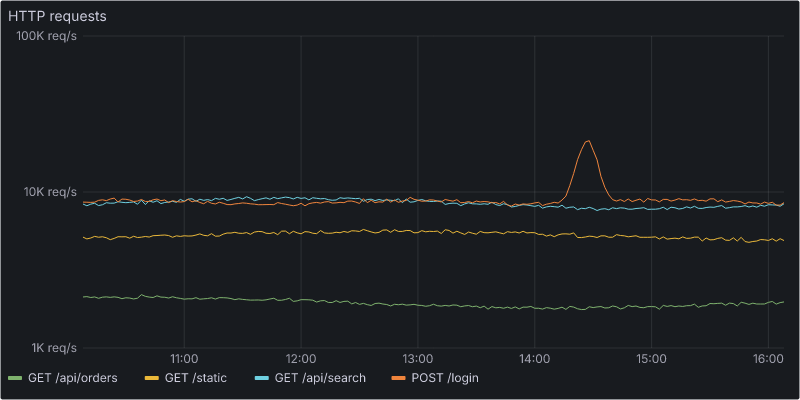
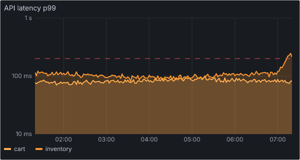
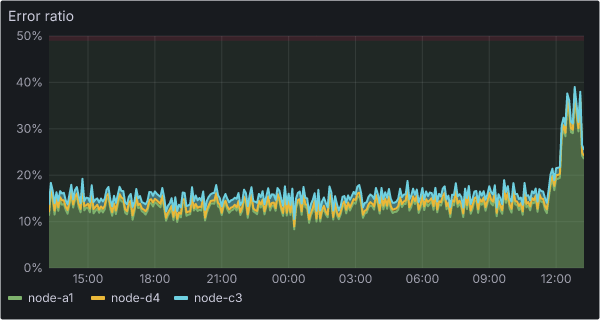

Grafana can attach a screenshot of the alerting panel to a notification. A bot can send that image to a vision model and post one line next to the page. NVIDIA Nemotron 3.5 Super VL came to DigitalOcean Serverless Inference on 15 October 2026 ([release notes](https://docs.digitalocean.com/release-notes/)), so we tested it on that job.

We drew 100 dashboard panels with known answers and asked four questions about each: the peak value, the time of the peak, whether the data crossed the threshold, and which series is highest. Our claim, written before we measured: Nemotron 3.5 Super VL gets all four right on at least 90 of 100 panels, for under $0.001 per screenshot. It got all four right on **48** panels with reasoning off and **54** with reasoning on. The claim failed. The cost limit held only with reasoning off: **$0.00026** per screenshot, against **$0.0024** with reasoning on.

None of the four models we tested came close to 90. Qwen3.8-Max got 65 and Gemma 4 got 64, at **$0.11 per 1,000 screenshots** for Gemma. Log-scale axes broke every model.

So the numbers in an alert message should come from the alert payload, not the model. The more useful result is a small bot that lets the model describe the screenshot and lets rules decide whether to trust it. On Nemotron's 300 reads, the rules caught 63 percent of the wrong reads and blocked no correct read. With the wrong screenshot attached on purpose, the bot refused it 99 times in 100.

## TL;DR

- All four facts right, of 100 Grafana-style panels: Qwen3.8-Max 65, Gemma 4 64, Nemotron 3.5 Super VL 54 with reasoning and 48 without, Llama 4 Maverick 21. Our bar was 90.
- Peak time and threshold were easy (86 to 99 percent for every model). Peak value and top series were hard. On log axes, the best model read all four right on 8 of 25 panels.
- Reasoning made Nemotron 13 times slower (19 seconds at the median, 82 at worst) and 9 times more expensive. The gain from 48 to 54 is inside the noise.
- At temperature 0, Nemotron gave the same four answers in all three runs on 13 of 100 panels. Qwen3.8-Max did on 76.
- A cross-check against the alert caught 63 percent of Nemotron's wrong reads (81 percent at a 5 percent tolerance). It cannot check the peak time, the series on a stacked panel, or the words in the summary.

## Prerequisites

- A [DigitalOcean account](https://m.do.co/c/2a9bba940f39) (referral link) with a Serverless Inference model access key
- Node.js 22 or later
- About $1 of inference if you rerun every model; the reasoning-mode run is most of it

<!-- TODO: add the github repo card fence for The-DevOps-Daily/grafana-panel-vision here when the repo is public -->

## The job and the claim

A bot that reads the attached panel could save the on-call engineer one click: "p99 went to 1.8 s at 13:55 UTC and stayed under the 2.5 s threshold". The question is whether you can trust that sentence during a night page.

Each model got the same prompt for every panel, with the panel as a PNG, and had to answer in JSON. This is a real answer from Nemotron 3.5 Super VL with reasoning off:

```json
{
  "peak": { "value": 1.8, "unit": "s" },
  "peakTime": "13:45",
  "thresholdCrossed": "no",
  "topSeries": "search",
  "summary": "Upstream response time stays under 1 second until midday, then spikes sharply to about 1.8 seconds in the early afternoon while remaining below the 2.5 s warning threshold."
}
```

The truth for that panel is 1.85 s at 13:55 UTC, not crossed, `search`, so this read passes. The tolerances, set before the first run:

- **Peak value**: within 5 percent of the true peak, after unit conversion. A unit from the wrong family, such as MiB on a latency panel, is wrong. "MB" counts as "MiB", because the axis says MiB.
- **Peak time**: within 5 percent of the panel's time range. That is 3 minutes on a 1-hour panel, 18 on 6 hours and 72 on 24 hours.
- **Threshold crossed**: exact. The answer is "yes", "no" or "no threshold".
- **Top series**: the answer is matched to the nearest legend name, with at most 2 typing errors (1 for short names). A tie, or an answer that names two legend entries, counts as wrong. On a stacked panel, the top series is the one with the thickest band at the peak, not the band drawn on top, and the prompt says so.

A panel counts as read only when all four facts are right.

## 100 panels with known answers

:::warning
These are **Grafana-style panels drawn by our own renderer, not screenshots from Grafana**. Real data has plateaus and near-equal peaks, which our generator rejects so that each question has one answer. Many real dashboards show a legend with Max or Last columns, which would turn the value question into text reading and help the models. A model trained on real Grafana screenshots could read real panels better or worse than ours. We do not know which.
:::

The renderer writes SVG and converts it to PNG with `@resvg/resvg-js`. It copies the Grafana dark theme: panel background, Inter font, classic palette, grid, axis labels with units, a list legend, and thresholds as a dashed line, a shaded region or both. There are no tooltips and no legend values. A seeded generator (mulberry32) draws the data, and the truth comes from the same numbers.

| What varies                           | Panels                                |
| ------------------------------------- | ------------------------------------- |
| Unit                                  | ms 29, percent 22, req/s 23, bytes 26 |
| Series per panel                      | 1: 17, 2: 25, 3: 22, 4: 19, 5: 17     |
| Log y-axis                            | 25                                    |
| Stacked areas                         | 19                                    |
| Similar colours (shades of one hue)   | 27                                    |
| Small panel (420x230 or 360x200)      | 19                                    |
| Threshold shown (line, region, both)  | 65 (28, 17, 20), crossed on 44        |
| Peak at the right edge                | 28                                    |
| Time range 1 h, 6 h, 24 h (UTC clock) | 33, 36, 31                            |
| Noise low, medium, high               | 32, 42, 26                            |

In an earlier project, a bug in our own test data made strong models look wrong, so we checked the truth first. A second script reads every panel back from the SVG alone, the way a reader would: the peak from the tick labels, the time from the clock labels, and the top series from the line colours and the legend (on the 19 stacked panels, from the band heights at the peak). It agreed with the truth on all 100 panels, with a largest peak error of 0.011 percent. To prove the check can fail, a third script breaks the renderer in a copy: wrong byte labels gave 38 problems, lines drawn 3 percent too high gave 204, and stacked bands drawn in the wrong colours failed the band check on all 19 stacked panels. We also viewed 14 panels next to their truth records.

## Which models we tested

A probe sent the same question to 15 models, with no image and then with the smallest and the largest panel. A model passed if it answered and its prompt token count rose with the image, which proves the image arrived. 11 passed. Mistral 3 14B returned "model does not support image input", and Kimi K2.6 rejected temperature 0. Our account gets HTTP 403, "not available for your subscription tier", for the GPT models, so this test has open-weight models only.

Several vision models reason before they answer, which is too slow for a page. On the two probe panels, Kimi K3 took 28 and 165 seconds, DeepSeek V4.1 Flash 45 and 13, and Qwen 3.5 397B 71 (with no answer) and 42. We kept **Nemotron 3.5 Super VL** (`nemotron-3.5-super-vl`), with reasoning off and on, and three models that answered in 1.5 to 3 seconds: **Qwen3.8-Max** (`qwen3.8-max`), **Gemma 4** (`gemma-4-31B-it`) and **Llama 4 Maverick** (`llama-4-maverick`). Nemotron Nano 12B v2 VL was also fast; we left it out to keep the test to four models.

Every call in the comparison used temperature 0 and at most 1,024 output tokens. Reasoning mode got 16,384, because the reasoning counts against that limit. Each model read every panel three times. Reasoning calls took about 20 seconds each, so that mode read all 100 panels once and a fixed 34-panel subset two more times.

Nemotron reasons by default. Two request settings turn it off. The `/no_think` system prompt does not:

```terminal
{
  "title": "stage 0b: turning reasoning off on one 1000x500 panel",
  "prompt": "$",
  "steps": [
    {
      "cmd": "node scripts/00b-reasoning-switch.mjs nemotron-3.5-super-vl",
      "output": "nemotron-3.5-super-vl | default                                      | HTTP 200 | 22795 ms | completion 4096 | reasoning chars 13191 | $0.00291\nnemotron-3.5-super-vl | reasoning_effort=low                         | HTTP 200 | 22271 ms | completion 4096 | reasoning chars 14191 | $0.00291\nnemotron-3.5-super-vl | reasoning_effort=none                        | HTTP 200 | 1207 ms | completion 99 | reasoning chars 0 | $0.00031\nnemotron-3.5-super-vl | chat_template_kwargs.enable_thinking=false   | HTTP 200 | 1268 ms | completion 92 | reasoning chars 0 | $0.00031\nnemotron-3.5-super-vl | system prompt /no_think                      | HTTP 200 | 21921 ms | completion 4096 | reasoning chars 14294 | $0.00291"
    }
  ]
}
```

That probe had a 4,096-token limit, and the reasoning runs used all of it without an answer. In the main run, none of the 168 reasoning calls hit the 16,384 limit. The longest used 11,979 tokens.

## Results

| Model                                | All four right (95% CI) | Peak value | Peak time | Threshold | Top series | $ per 1,000 | Latency p50 / p95 |
| ------------------------------------ | ----------------------- | ---------- | --------- | --------- | ---------- | ----------- | ----------------- |
| Qwen3.8-Max                          | 65 (55 to 74)           | 77         | 97        | 97        | 91         | 1.47        | 1.5 s / 2.2 s     |
| Gemma 4                              | 64 (54 to 73)           | 77         | 99        | 96        | 86         | 0.11        | 2.7 s / 3.4 s     |
| Nemotron 3.5 Super VL, reasoning on  | 54 (44 to 63)           | 71         | 94        | 96        | 80         | 2.37        | 19.0 s / 58.5 s   |
| Nemotron 3.5 Super VL, reasoning off | 48 (39 to 58)           | 69         | 96        | 91        | 75         | 0.26        | 1.4 s / 1.8 s     |
| Llama 4 Maverick                     | 21 (14 to 30)           | 34         | 89        | 86        | 81         | 0.28        | 2.7 s / 9.1 s     |

Accuracy and cost are from run 1. Latency covers every successful call in all runs, and it is the time of the attempt that succeeded. The parallel runs hit HTTP 429 often (retried attempts: 88 for Nemotron with reasoning off, 7 with reasoning on, 99 for Qwen3.8-Max, 75 for Gemma 4), and those waits are not in the latency figures.

```chart
{
  "type": "bar",
  "title": "Panels with all four facts right, by panel feature (run 1)",
  "unit": "%",
  "caption": "100 Grafana-style panels drawn by our renderer, 31 October 2026. Panels per row: 1 series 17, stacked 19, small 19, similar colours 27, 4-5 series 36, log y-axis 25. Rows this small give wide intervals; read them as directions, not rates.",
  "rows": [
    { "label": "1 series", "value": 88.2, "series": "Nemotron, reasoning off" },
    { "label": "1 series", "value": 88.2, "series": "Qwen3.8-Max" },
    { "label": "1 series", "value": 76.5, "series": "Gemma 4" },
    { "label": "stacked", "value": 31.6, "series": "Nemotron, reasoning off" },
    { "label": "stacked", "value": 63.2, "series": "Qwen3.8-Max" },
    { "label": "stacked", "value": 68.4, "series": "Gemma 4" },
    { "label": "small panel", "value": 42.1, "series": "Nemotron, reasoning off" },
    { "label": "small panel", "value": 63.2, "series": "Qwen3.8-Max" },
    { "label": "small panel", "value": 57.9, "series": "Gemma 4" },
    { "label": "similar colours", "value": 25.9, "series": "Nemotron, reasoning off" },
    { "label": "similar colours", "value": 55.6, "series": "Qwen3.8-Max" },
    { "label": "similar colours", "value": 48.1, "series": "Gemma 4" },
    { "label": "4-5 series", "value": 30.6, "series": "Nemotron, reasoning off" },
    { "label": "4-5 series", "value": 58.3, "series": "Qwen3.8-Max" },
    { "label": "4-5 series", "value": 55.6, "series": "Gemma 4" },
    { "label": "log y-axis", "value": 4.0, "series": "Nemotron, reasoning off" },
    { "label": "log y-axis", "value": 8.0, "series": "Qwen3.8-Max" },
    { "label": "log y-axis", "value": 32.0, "series": "Gemma 4" }
  ],
  "series": [
    { "name": "Nemotron, reasoning off", "color": "#76b900" },
    { "name": "Qwen3.8-Max", "color": "#0080ff" },
    { "name": "Gemma 4", "color": "#f59e0b" }
  ]
}
```

What stands out:

- **Time and threshold are easy.** Every model got the peak time right on 89 to 99 panels and the threshold on 86 to 97.
- **A simple panel is almost solved.** With one series, Nemotron and Qwen3.8-Max both got 15 of 17 right. Every added feature cost accuracy. Similar colours cost Nemotron the most: 16 of its 25 wrong series names were on the 27 similar-colour panels.
- **Qwen3.8-Max and Gemma 4 cannot be told apart.** Each got 14 or 13 panels right that the other got wrong. Both beat Nemotron with reasoning off: Qwen3.8-Max on 20 panels against 3, Gemma 4 on 24 against 8 (sign test p = 0.007).
- **The 5 percent bar hurt Gemma 4 most.** It rounds: 20,000 req/s for a peak of 21,330, 300 ms for 331. Within 10 percent, Gemma read the value right on 93 panels, Qwen3.8-Max on 87 and Nemotron on 82.

Repeat runs at temperature 0 showed another difference. Qwen3.8-Max and Gemma 4 gave the same verdict in all three runs on 97 and 98 panels. Nemotron with reasoning off did on 71, and gave the same four answers on only 13. Llama 4 Maverick gave the same four answers on 92 panels and was right in all three runs on only 21. Consistent is not the same as correct.

## Where the reads go wrong

**Log axes.** The models read a log axis as if it were linear, or round to a tick. Nemotron read the value within 5 percent on 1 of 25 log panels, Qwen3.8-Max on 4 and Gemma 4 on 10.



The spike peaks at 21.3K req/s at 14:28 UTC. Every model found the series and the time. Qwen3.8-Max and Gemma 4 said 20,000 every time, 6.2 percent low. Nemotron's three runs said 30 req/s, 45,000 req/s and 30K req/s.

**The threshold label as the answer.** When a spike crosses a dashed line, the label of that line is the easiest number on the panel to read.



The rise at the right edge goes to 246 ms, above the 200 ms line. Qwen3.8-Max, Gemma 4 and Llama 4 Maverick answered 200 ms in all three runs: the threshold, not the peak. Nemotron answered 500 ms, 0.3 s and 300 ms. Only Llama 4 Maverick named `inventory` in every run, and it said the threshold was not crossed.

**The band on top is not the biggest.** On a stacked panel, the series drawn last sits on top, even when its own values are small.



`node-c3` is the thin band on top. Qwen3.8-Max and Llama 4 Maverick named it in all three runs and Nemotron in two. Gemma 4 named `node-a1` every time. This panel also shows the hardest threshold style, a shaded region with no line. The models got a region-only threshold right on 12 to 15 of 17 panels, and a region with a line on 19 or 20 of 20.

## Reasoning on: slower and more expensive, and not clearly better

With reasoning on, Nemotron got 54 panels right against 48. Only reasoning got 14 panels right, and only no-reasoning got 8. A sign test gives p = 0.29, so 100 panels cannot say whether reasoning helps. The cost is clear: 3,349 output tokens per call on average in run 1 (8,163 at the 95th percentile), and 19.0 seconds at the median over all 168 calls, 81.8 at worst.

- **The usage block hides the reasoning.** Every reasoning call returned `reasoning_tokens: 0`, while `completion_tokens` included the reasoning and the reasoning text came back in the reply. If you cap or alert on `reasoning_tokens`, you see nothing.
- **Temperature 0 does not explain it.** Reasoning models are often tuned for a higher temperature, so we ran the 34-panel subset again at 0.6. It got 19 right, against 20 at temperature 0 and 20 with reasoning off.
- **It is not more repeatable.** On the subset, reasoning gave the same four answers in all three runs on 3 panels, against 7 with reasoning off.

## What a screenshot costs

DigitalOcean's [pricing page](https://docs.digitalocean.com/products/inference/details/pricing/) ("Last verified 30 Oct 2026", read on 31 October) lists no separate image rate for these models. We priced each call from the token counts the API reported, at list input and output prices. That assumes the image tokens inside `prompt_tokens` are billed at the input rate. We did not check it against an invoice.

| Model                                | Image tokens, 360x200 | Image tokens, 1000x500 | Prompt tokens (cached) | Output tokens | $ per screenshot |
| ------------------------------------ | --------------------- | ---------------------- | ---------------------- | ------------- | ---------------- |
| Nemotron 3.5 Super VL, reasoning off | 288                   | 514                    | 652 (0)                | 97            | 0.00026          |
| Nemotron 3.5 Super VL, reasoning on  | 288                   | 514                    | 652 (0)                | 3,349         | 0.0024           |
| Qwen3.8-Max                          | 68                    | 498                    | 594 (262)              | 126           | 0.0015           |
| Gemma 4                              | 266                   | 255                    | 604 (325)              | 102           | 0.00011          |
| Llama 4 Maverick                     | 437                   | 1,017                  | 1,096 (271)            | 72            | 0.00028          |

Image tokens are the prompt tokens with the panel minus those of the same question with no image. Gemma 4 uses about 260 at any size, Qwen3.8-Max scales with the pixels, and Llama 4 Maverick jumps from 437 to 1,017 above 600 pixels wide.

Our first cost numbers were wrong in our favour. Runs 2 and 3 send the same image again, and Qwen3.8-Max, Gemma 4 and Llama 4 Maverick served most of it from the prompt cache: Llama's cached tokens went from 271 in run 1 to 1,044. A bot sees each screenshot once, so we now price run 1 only. That raised Qwen3.8-Max from $1.11 to $1.47 per 1,000 and Gemma 4 from $0.097 to $0.113. Nemotron reported no cached tokens on any call, even for the prompt text that every call shares.

## Rules decide, the model explains

The alert already knows the numbers. In our test, each alert comes from a rule on the panel's query, reduced with `max` over the panel's range, so the payload has the peak value, the series label (unless the rule is on a sum), the threshold and the firing state. If your rule reduces with `last` or a shorter window, compare against that value instead. The model reads the image blind, with no numbers from the alert, and three rules compare its read with the payload:

```javascript
// lib/bot.mjs (shortened). tol is 10% by default.
export function crossCheck(alert, answer, { tol = 0.1 } = {}) {
  if (!answer) return { verdict: 'could not confirm', checks: [{ fact: 'read', ok: false }] };
  const checks = [];
  // 1. Peak value against the alert's reduced value.
  const p = readPeak(alert.unit, answer.peak);
  checks.push({
    fact: 'peak value',
    ok: p.ok && Math.abs(p.base - alert.values.B) / alert.values.B <= tol,
  });
  // 2. Series, when the alert is for one series. A rule on a sum has none.
  if (alert.labels.series) {
    checks.push({
      fact: 'series',
      ok: matchSeries(answer.topSeries, [alert.labels.series]) === alert.labels.series,
    });
  }
  // 3. Threshold state, when the model saw a threshold on the panel.
  const th = normThreshold(answer.thresholdCrossed);
  if (th === 'yes' || th === 'no') {
    checks.push({ fact: 'threshold', ok: th === (alert.status === 'firing' ? 'yes' : 'no') });
  }
  return { verdict: checks.every((c) => c.ok) ? 'confirmed' : 'could not confirm', checks };
}
```

The message always starts with the alert's own facts. The model's sentence is added only when its read agrees. Here is the bot on three panels, with Nemotron and reasoning off:

```terminal
{
  "title": "the bot on three alerts",
  "prompt": "$",
  "steps": [
    { "cmd": "node scripts/05b-bot-demo.mjs p034 p090 p003", "output": "--- p034 (data/panels/p034.png) -> confirmed, 2033 ms\nContainer RSS: firing, max 3.19 GiB over the last 6h, threshold 2.51 GiB.\nScreenshot (checked against the alert): Container RSS memory usage spikes sharply around 08:15 UTC to over 3 GiB, driven primarily by worker-5c6b-h3t7, then settles back to roughly 1-2 GiB.\n--- p090 (data/panels/p090.png) -> confirmed, 1380 ms\nCheckout latency p95: firing, max 106.72 ms over the last 24h, threshold 73 ms, series search.\nScreenshot (checked against the alert): Checkout latency p95 is stable around 30-40 ms until a spike to about 100 ms near 22:00 UTC, crossing the red 100 ms threshold.\n--- p003 (data/panels/p003.png) -> could not confirm, 1311 ms\nHTTP requests: firing, max 21.33K req/s over the last 6h, threshold 17K req/s, series POST /login.\nCould not confirm the screenshot (the screenshot reads 25K req/s, the alert says 21.33K req/s). Open the dashboard before you trust the image." }
  ]
}
```

The p090 message shows the limit. The value, series and threshold state agree, so the bot says "confirmed", but the summary says "the red 100 ms threshold" and the threshold is 73 ms. The rules check the structured answer, not every word. That is why the bot posts the alert's numbers itself.

Over all recorded reads:

| Model                                | Wrong reads | Caught at 10% | Caught at 5% | Correct reads blocked |
| ------------------------------------ | ----------- | ------------- | ------------ | --------------------- |
| Nemotron 3.5 Super VL, reasoning off | 155 of 300  | 97 (63%)      | 125 (81%)    | 0                     |
| Qwen3.8-Max                          | 109 of 300  | 58 (53%)      | 90 (83%)     | 0                     |
| Gemma 4                              | 111 of 300  | 54 (49%)      | 98 (88%)     | 0                     |
| Llama 4 Maverick                     | 236 of 300  | 143 (61%)     | 214 (91%)    | 0                     |

"Correct reads blocked: 0" is by construction. Our alert value is the true peak and the bot's checks are looser than the scorer's, so a correct read cannot fail them. A real alert that reduces differently from the panel would add false flags. What the 10 percent check let through for Nemotron:

- 24 reads with only a value error between 5 and 10 percent, such as 300 ms for 331 ms
- 21 wrong series names, all on stacked panels, where the alert is on the sum and has no series to compare
- 6 threshold errors where the model said "no threshold" on a panel that shows one; the bot cannot tell that apart from a rule threshold that is not drawn
- 7 wrong peak times, alone or with a small value error; the payload has no peak time

Then we broke it on purpose: each read was checked against the alert of a different panel with the same unit, like a wrong image on the notification. The bot said "could not confirm" for 99 of 100 reads from Nemotron and from Qwen3.8-Max, and for 100 of 100 from Gemma 4 and Llama 4 Maverick. The pair that passed had a wrong alert on a sum (no series check) whose value was 8.6 percent from the read.

We expected the model to copy the alert's numbers if the prompt contained them, which is why the bot reads blind. For Nemotron that was wrong. With the wrong alert in the prompt, its peak matched the image on 81 of 100 panels and the alert on 1, and the cross-check still refused 98. We keep the blind read because it costs nothing, but this test does not show that it is necessary.

## What 100 panels cannot tell you

- **The claim failed by a wide margin.** The 95 percent intervals for Nemotron end at 58 and 63 panels, far below 90.
- **We cannot rank Qwen3.8-Max against Gemma 4,** or Nemotron with reasoning against without. Both gaps are too small for 100 panels.
- **Feature rows are directions, not rates.** Each covers 17 to 36 panels. Gemma 4's 8 of 25 on log axes has a 95 percent interval of 17 to 52 percent.
- **The panels are ours.** Real Grafana screenshots are a different input, easier in some ways and harder in others.
- **One prompt.** We did not try a prompt that warns about log axes. We did not use a JSON response mode, and Qwen3.8-Max wrote invalid JSON twice in 300 calls (`"thresholdCrossed": no`).
- **One day of one service.** The models DigitalOcean served on 31 October 2026, at temperature 0. Prices are list prices times reported tokens, not an invoice.

## Run it yourself

Each stage writes a file that the next one reads. Every recorded call is stamped with a hash of the runner code and the inputs. The scorer refuses unstamped, mixed or stale files, and records filed under the wrong configuration. The runner stops before its own count of spend passes a cap ($3.50 by default).

```bash
git clone https://github.com/The-DevOps-Daily/grafana-panel-vision
cd grafana-panel-vision
npm ci
cp .env.example .env                 # add your model access key

node scripts/01-render-panels.mjs    # 100 PNGs + data/truth.jsonl + data/alerts.jsonl
node scripts/01b-check-panels.mjs    # read every panel back from the SVG
mv results/raw results/raw-ours      # keep our run; yours goes into results/raw
node scripts/02-run-models.mjs --configs nemotron-3.5-super-vl,gemma-4-31B-it --runs 3
node scripts/03-score.mjs            # results/summary.md
node scripts/05-crosscheck.mjs       # how often the bot catches a wrong read
```

To test your own dashboards, replace the renderer with exports of your real panels and write the truth for each by hand. It is slower, and it is the only way to know how these models read your panels.

## Summary

A vision model on DigitalOcean can describe a Grafana panel in about 1.5 seconds for a fraction of a cent. On our 100 panels, no model read the four key facts reliably enough to be the source of truth in a page. Log axes, stacked areas and similar colours caused most errors, and reasoning did not fix them.

What we would ship:

- **Take the numbers from the alert, not from the image.** The payload already has the value, the threshold and the series.
- **Let the model narrate, and check it first.** Compare its value, series and threshold state with the payload, and say "could not confirm" when they disagree.
- **Use a fast model with reasoning off.** Gemma 4 and Qwen3.8-Max were the most accurate, and Gemma 4 cost $0.11 per 1,000 screenshots.
- **Make attached panels easy to read.** Use a linear axis, distinct colours, few series, and a threshold drawn as a line and a region.
